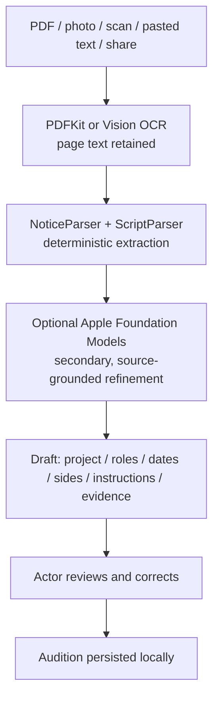
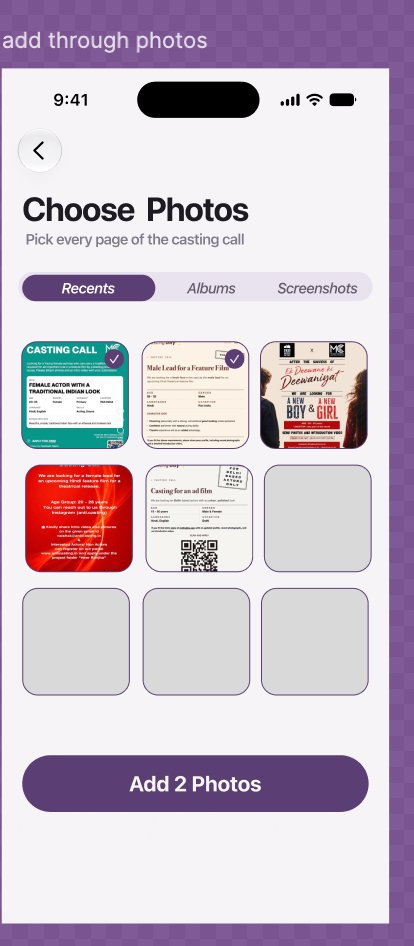

# OneTake iOS documentation

The current guide covers the refactor, audition workflow, and simulator setup. Dated sections below record earlier implementation and verification, including the project layout at the time.

## Contents

- [Current workflow and project layout](#current-workflow-and-project-layout)

- [November 11 audit and verification](#november-11-audit-and-verification)
- [Project overview and setup](#doc-readme)
- [November 7 implementation notes](#doc-docs-implementation-notes-2026-11-07)
- [Session changelog](#doc-docs-session-changelog)
- [App structure and workflows](#doc-docs-structure-and-working)
- [Codebase overview](#doc-docs-codebase-overview)
- [Project audit](#doc-docs-project-structure-and-systematic-audit)
- [Navigation and UX change history](#doc-docs-navigation-changes)
- [Machine learning and parsing pipeline](#doc-docs-ml-pipeline)
- [Future enhancements](#doc-docs-future-enhancements)
- [Illustration explorations](#doc-docs-illustrations-readme)
- [Dataset catalog](#doc-docs-research-dataset-catalog)
- [Dataset collection](#doc-docs-research-dataset-collection)
- [Pilgrimage research report](#doc-docs-research-pilgrimage-research-report)

## Current workflow and project layout

### Refactor and feature branch changes

| Area | Current behavior |
|---|---|
| Auditions | Filter the library by Active, Submitted, or Archived. The audition context menu can archive, restore, mark sent, or undo submission. |
| Edit Details | Open Project & role, Scenes & requirements, Deadline & submission, Sides & script, or Notes from the edit menu. Scenes & requirements also includes the editable preparation order. |
| Import and review | Import PDFs, images, plain text, Final Draft (.fdx), Fountain, and Word (.docx). Review Project, Scenes when the import contains selectable portions, and Specs before saving. |
| Notice and script parsing | PDF geometry preserves line order and word spacing. OCR retries small print with bounded enlargement and retains blank page positions. Page routing separates casting notices from script sides, so dialogue does not supply notice fields such as pay. The local script classifier uses layout and neighboring lines to identify script elements. |
| Revised sides and reader audio | Revised sides preserve previous takes and move matching reader cues to their updated locations. Current checklist readiness follows the new revision. Reader cue positions use scene-wide indices across characters, and failed retakes preserve the previous recording. |
| Recording and framing | Recording interruptions can surface recovery controls. An idle interruption does not carry into the next recording. Auto-frame opens a presets menu and can fall back to CPU Vision and Core Image face detection. |
| Demo mode | Profile → Demo & Testing can seed auditions, playable takes, reader cues, and practice scenes. |
| Navigation and styling | Root screens use native navigation, toolbar, and search controls. Shared button styles support capsule and rounded shapes. See [OneTakeUI](docs/DESIGN_SYSTEM.md). |
| Build | The app and extensions target iOS 18 or later. |

The app entry point is in [OneTake/App](OneTake/App). Models, services, and the store are in [OneTake/Core](OneTake/Core). Feature screens are in [OneTake/Features](OneTake/Features). The [OneTakeUI package](Packages/OneTakeUI) provides shared styles and components.

### Local UI updates

These changes are present in the working tree alongside the merged refactor.

- **Onboarding** opens with the filmstrip welcome and a three-page tour with distinct artwork. Swipe or tap **Next** to advance. **Skip** and the final **Get started** both open Auditions. Slate setup is offered when opening the camera for an audition with a pending required slate and no saved slate name.
- **Simulator testing** uses the Debug Run argument `-showOnboarding` to replay onboarding. Debug simulator builds make the bundled fixtures available through **Add an audition → File → Browse → On My iPhone → OneTake → SampleCastingFiles**.
- **Project review** puts detected roles beneath **Your role** and uses a compact audition type picker. The keyboard toolbar keeps suggestions beside **Done**.
- **Scenes review** shows a page or scene number, heading, text excerpt, and a role match when applicable. **Preview text** shows the complete extracted section without changing the selection.
- **Specs review** uses switches under **What to prepare**. On means Required and off means Optional.
- **Auditions and audition detail** show a clearable filter pill and a compact due date in place of the large countdown.

### Offline parser and model development

The [Colab scripts](scripts/colab) include a synthetic casting poster corpus builder, an offline evaluator, contextual script classifier training, LoRA training for Needle 3 CQ2 and LFM2.5-VL-450M CQ4, and release publishing. The image corpus pipeline preserves example IDs and wrapped poster text. The VLM pipeline normalizes multimodal prompts, masks labels, and validates input archive and evaluation paths.

## November 11 audit and verification

The Xcode project files were restored from the matching project beside the checkout. The audit corrected notice parsing for quoted subject-line titles and landscape slate instructions, and tied evidence excerpts to their source page. Reader trims and retakes now protect existing cue audio on failure, and restore uses the original for the current recording. Slate and full-body capture follow the saved audition flow without opening a scene when none exists. Voice review handles contractions consistently and Gaps preserves punctuation.

The iOS 27.1 simulator ran 185 tests with zero failures. One speech synthesis smoke test hung on the simulator and was excluded. The iPhone build compiled with signing disabled. Physical-device camera, microphone, and speech checks remain pending. Hosted sharing requires account provisioning.

---

<a id="doc-readme"></a>

## Project overview and setup

<!-- Source: README.md -->

# OneTake · iOS 🎬

> **The actor's self-tape audition studio.** SwiftUI, AVFoundation, Vision and VisionKit, for iOS 18+.

[](https://github.com/IneshAg/OneTake-iOS/actions/workflows/build.yml)
[](https://developer.apple.com/ios/)
[](LICENSE)

OneTake takes an actor from a casting notice to a finished self-tape: it reads the notice and the
sides, helps you learn the lines, films the slate and every scene with a prompter and your own
recorded reader, checks the tape, and packages it the way casting asked. There's no server and no
sign-up — everything stays on the iPhone until you send it.

On supported newer iOS releases, OneTake also uses Apple's on-device Foundation Models framework
to explain casting notices and turn measured Tape Check findings into practical retake guidance.
The media checks remain deterministic (Vision and AVFoundation); the model only explains those
measured facts and never replaces them. Older supported iOS releases use the existing local parser
and deterministic guidance.

> 🤖 **Android:** [OneTake-Android](https://github.com/IneshAg/OneTake-Android) (Kotlin, Jetpack Compose, CameraX).

---

## ✨ Features

### Auditions
- **Add from anywhere** — paste the notice, take a photo, scan the pages (VisionKit), pick a PDF or
  text file, type it in, or **Share → OneTake** from Mail, WhatsApp, Safari, Photos or Files.
  Everything is read on-device (Vision OCR, PDFKit).
- **Reads the notice** — role, project, due date, number of scenes and what casting asked for
  (slate, full length, landscape, length limit, destination). It also retains structured project,
  role, date, sides, source-page, and submission details when found; anything it can't find, you fill in.
- **Splits the sides into scenes** at each slugline (`INT.` / `EXT.`) or `SCENE 2` header, and marks
  your lines.
- **Checklist per audition** — headshot, slate, requested full-body shot (as part of the slate or a separate clip) and one piece per scene, with a
  single "Next" action that opens whatever's next.
- Edit details, revised sides, callbacks, and filters for Active, Submitted, and Archived.

### Learn the lines
- **Prepare** — full lines, first letters, or hide yours (tap to peek), with casting's notes on top.
- **Run lines** — your recorded reader plays their lines; speech recognition follows yours and moves on
  when you've said it. Say "Line?" for a prompt. The end screen shows which lines you got on your own,
  and that becomes the scene's "lines learned".
- **Quick drills** — First-Letter prompts, Mask & Reveal (hide a quarter to all of each line), Audio Gap,
  and a hands-free Audio Walk loop.
- **Record the reader** in your own voice, one line at a time, per scene.

### Shoot
- Front or back camera at 1080p, recorded upright however the phone is held and never mirrored.
- Pinch to zoom or tap the zoom control to cycle through 1×, 1.5× and 2× framing.
- A visible timer control enables or disables the 3-second countdown before recording.
- Slate, a separately requested full-body shot, then each scene — with a scene picker and “Next: Scene N”. A full-body view requested as part of the slate stays in the slate.
- Hands-free: say "Action" / "Cut" (only when said on their own), or use a volume button, Camera Control
  or an AirPods stem press. The prompter follows your voice and plays your reader lines.
- Hold-to-stop while rolling, so a stray tap can't end an emotional take.

### Takes, Tape Check and sending
- Takes per scene, circle your send take, trim, and private notes.
- **Tape Check** analyses only the finalized/circled clips that will be sent: face in frame, distance,
  headroom, centring, head turn, lighting, quiet voice, clipping, long pauses and a possible clipped
  opening, plus the package itself (slate, every scene shot, length, orientation, file name). Opening
  and pause flags cue optional review; they are not automatic judgments. The readiness dial counts
  technical checks only; optional timing prompts do not lower it, and it never blocks sending.
  Retakes save as new takes, keeping the selected send take unchanged.
  The navigation bar is hidden to keep the check focused on the results.
- **Preview** the whole tape with accurate chapter durations (real duration for slate and scene chapters)
  and quick chapter actions to change headshots, retake the slate or full-length tape, and open takes for
  a specific scene.
- Slate recording can suggest trimming long silent edges with padding; you review the preview before applying, and can restore the saved original from Package.
- Camera setup has an optional on-device pose guide for shoulder centering and level alignment; it does not save or upload pose data.
- **Package** generates a merged `.mp4` (`LAST_FIRST_ROLE_PROJECT.mp4`) plus a separate `.zip` archive
  containing finalized clips and headshots via custom zero-dependency streaming. Tapping the Audio row
  opens Tape Check, and "Preview the whole tape" opens the local tape preview.
- **Sent screen** shows a destination-aware headline, persisted send date, actual destination, scene count,
  merged video and separate ZIP deliverables, and link expiration when applicable.
- Send through the Share Sheet (AirDrop, Mail, Files, a casting site's app) sharing both the merged MP4 and
  separate ZIP archive, or as an **iCloud download link** from your own iCloud Drive. Sending a link is the
  one place OneTake asks you to sign in, with Apple or Google; headshots go along as photos.

### Profile and the rest
- Slate details, front / left / right headshots with a guide overlay, reader volume, appearance.
- Deadline reminders (morning of, two hours before) scheduled locally, Home and Lock Screen widgets, and
  a Live Activity countdown in the last 24 hours.
- Privacy & data shows what's stored and deletes it; the privacy policy is in the app.

---

## 🏛️ Project layout

```
OneTake/
├── Models/         Audition, Take, Scene, Slate, script parsing, persistence
├── Views/          SwiftUI screens, design system, and asset catalog
└── ModelViews/     AppStore, navigation state, camera, analysis and export services
OneTakeWidgets/     Widgets and the Live Activity
OneTakeShare/       "Share to OneTake" extension
Shared/             Code shared with the extensions (widget snapshot, share inbox)
OneTakeTests/       Unit tests
project.yml         XcodeGen project definition
```

---

## 🚀 Getting started

Requirements: macOS with **Xcode 16 or later** (building with the iOS 26 SDK also turns on the
search-tab behaviour) and [XcodeGen](https://github.com/yonaskolb/XcodeGen).

```bash
git clone https://github.com/IneshAg/OneTake-iOS.git
cd OneTake-iOS
brew install xcodegen
xcodegen generate
open OneTake.xcodeproj
```

Run on an iPhone simulator or a device (set your team under *Signing & Capabilities*). On a device,
the iCloud container `iCloud.com.onetake.app` and the App Group `group.com.srmist.onetake` (as specified in `project.yml` and `OneTake.entitlements`) must be
registered for your team for "Email or link" sending, widgets and the share extension. The open
build leaves Sign in with Apple disabled because its capability requires a paid Apple Developer
account; a paid team can enable the capability and set `AppleSignInEnabled: true` in `project.yml`.
For Google sign-in, set `GOOGLE_CLIENT_ID` and `GOOGLE_REVERSED_CLIENT_ID` in `project.yml` to your
OAuth client (until then the Google button stays disabled).

Tests: **⌘U** in Xcode, or

```bash
xcodebuild test -project OneTake.xcodeproj -scheme OneTake -destination 'platform=iOS Simulator,name=iPhone 16'
```

CI (`.github/workflows/build.yml`) builds for the Simulator and for a device and runs the unit tests on
every push and pull request.

### Simulator notes
The Simulator has no camera, so the camera screens show a plain silhouette and headshot capture saves a
placeholder; recording itself needs a real iPhone.

---

## 📖 Architecture & Documentation

Comprehensive engineering documentation and architectural invariants are maintained in `docs/`:

- **[Structure and Working (`docs/STRUCTURE_AND_WORKING.md`)](#doc-docs-structure-and-working)**: Exhaustive 18-section reference detailing the product architecture, data contracts, persistence resilience, deterministic media measurements, and the 12 core implementation invariants.
- **[Navigation & UX Changes (`docs/NAVIGATION_CHANGES.md`)](#doc-docs-navigation-changes)**: Design choices, header/tabbar HIG alignment, real-time audition flow optimization, and Reader Audio integration.
- **[On-Device Intelligence & ML Pipeline (`docs/ML_PIPELINE.md`)](#doc-docs-ml-pipeline)**: LoRA fine-tuning, Core ML ANE INT4 palettization, pure-Swift BPE tokenizer, and grammar-constrained JSON decoding.
- **[Implementation Notes — 7 November 2026 (`docs/IMPLEMENTATION_NOTES_2026-11-07.md`)](#doc-docs-implementation-notes-2026-11-07)**: Detailed status of the current intake, practice, reader-audio, headshot, review, camera, package, glass-button and verification changes.
- **[Session Changelog (`docs/SESSION_CHANGELOG.md`)](#doc-docs-session-changelog)**: Reverse-chronological implementation history and verification notes.

---

## 📄 License

MIT — see [LICENSE](LICENSE).

---

<a id="doc-docs-implementation-notes-2026-11-07"></a>

## November 7 implementation notes

<!-- Source: docs/IMPLEMENTATION_NOTES_2026-11-07.md -->

# Implementation notes — 7 November 2026

This note records the implementation work discussed in the current Codex conversation. It describes the code in this checkout, rather than treating every suggestion or Figma reference as shipped behavior. The session changes are still uncommitted.

## Audition intake and first review

### OCR, layout and source handling

- Notice intake continues to accept photos, scans, PDFs, pasted/shared text and shared files. PDF extraction keeps page text and document/page metadata; image-only pages go through Vision OCR.
- OCR output is reconstructed from Vision bounding boxes so rows, key/value layouts, screenplay speaker indentation and sufficiently clear two-column layouts can be retained. When a column boundary is ambiguous, the reconstruction uses row order rather than guessing a column sequence.
- The review sheet can show the original notice image for visual cross-checking. Extracted project, role, character information, casting contact, notes and requested materials remain editable before the audition is saved.
- Notice-only content is guarded from being parsed as screenplay dialogue. The parser requires actual sides/scene markers before creating scenes, which prevents headings such as “WHAT TO SUBMIT” from becoming a role or an accidental required scene.
- Scene selection is offered only when sides exist. Scene requirement can be inferred as optional from notice wording, and required/optional deliverables such as slate and headshots can be reviewed and changed.
- Notice material and script sides have distinct source kinds in the data model. There is an Add/Replace Sides route for bringing script pages in separately. This is not yet a dedicated two-step wizard that makes the user import two PDFs as two explicitly labeled steps; sources shared together can still be classified from their contents.
- The OCR flow detects résumé requests and their optional/required wording. A résumé can be stored once in Profile and included or replaced per audition. Imports accept PDF, DOC, DOCX, RTF and plain text; the imported file is copied into app-owned storage so a temporary Files-picker URL is not retained.

### Review-sheet presentation

- Review labels now distinguish production/project information, role and character details, “What to prepare,” casting notes, and actor notes.
- Long requirement values are presented as readable, wrapping text rather than clipped chips. Casting contact can be added optionally. The notice image remains available to compare the extraction with its source.
- Reader-audio setup is described as practice cue audio: the actor can record the other character’s lines now or add them later. This replaces the ambiguous “Reader: Currently” phrasing in that setup context.
- The edit-details/save action reports the actual parsed actor and reader line counts and selected sides rather than treating the “What to Submit” list as a role. A notice without script pages does not manufacture a “scene required” step.
- Edit Details now builds its role choices from stored role breakdowns, parsed script speakers and saved scene speakers. When there are no detected names, the form says so and keeps manual entry available. The same “no names found” explanation appears during missing-details intake.
- The due-time presets are horizontally scrollable, single-line chips with a consistent 34-point minimum height. The old fixed row compressed “5:00 PM” onto two lines on narrower screens.
- The flow-requirements controls are grouped into one compact Form row instead of several automatically separated Form rows with an extra inner divider. This removes the large blank-looking gap before the Scenes heading.
- Edit Details includes a Flow Order section. Tap **Edit** and drag pieces to reorder them; the order is saved in `Audition.pieces` and drives the next-step flow.

## Practice and reader audio

### Meaningful-word Gaps and Foundation Models

- Added a **Gaps** display choice alongside Full, First Letters and Hide my lines in standalone practice and in the line-learning drill. The in-recording practice prompter can also render the gaps mode.
- Tapping a masked word reveals that word as a temporary clue. Spaces and punctuation remain in the displayed line.
- `RecallGapSelectionStore` asks Apple Foundation Models directly on-device on iOS 26+ to choose a limited number of meaning-bearing word indices. It does not send the line to a server.
- Choices are cached by normalized line text in UserDefaults so the same line does not reshuffle on a later attempt. Foundation Model unavailability or an unusable response falls back to a deterministic local word-ranking rule. That fallback is heuristic; it does not understand dramatic importance.
- Selection runs only after the user chooses Gaps. Other display modes do not trigger Foundation Model work.
- This does **not** add a new Figma “Test Yourself” screen or merge all existing drills into one chooser. The four display modes are available in the existing practice screens; audio gap, audio walk and camera practice remain separate practice actions.

### Recorded voice-practice review

- Added `VoicePracticeReviewAnalyzer` and a review view for a recorded voice-only practice take. It extracts the audio track from the take, requests on-device Apple Speech transcription with word timestamps, and aligns recognized words against the actor’s script lines.
- Per-line suggestions include Looks okay, Skipped, Forgot, Hesitated and Not in Script. A pause of approximately 1.25 seconds between recognized words can suggest Hesitated. Each result retains an approximate recording timestamp when speech was matched.
- Marks are editable/dismissible review suggestions, not an acting score. Speech recognition may miss an accent, paraphrase or intentional pause. If on-device recognition is unavailable or detects too little speech, the app reports that and leaves the recording available for manual review.

### Reader-line audio editing

- Reader audio can be scrubbed and trimmed from the reader-audio management screen, including when opening an existing recording for review.
- A successful trim installs an edited copy while preserving the original. The UI offers **Restore original** with confirmation. Failed edits leave the existing track untouched.
- The trimmer is for the audition’s recorded reader cues. It is not a practice-take editor.

## Headshots, recording and element review

### Shared navigation and glass buttons

- Audited shared button styling in `GlassBackButton`, `GlassIconButton`, `GlassButtonCompatibility`, and the capsule compatibility modifiers, plus their use in audition, practice, prepare, takes/review, profile and onboarding screens.
- Icon-only Back/Close/Add and icon actions use circular glass controls. Capsule actions use capsule glass. Text-only Cancel/Done actions remain plain text controls.
- Fixed the compatibility modifier so a text action with glass disabled no longer falls through to the legacy circular material background. That fallback had drawn a stray circle behind Cancel/Done in edit and sheet headers on iOS 26.
- Kept explicit circular backgrounds on camera-only controls and the profile avatar, where the circle is part of the intended control. Header icons retain 44-point content/hit frames.

### Headshot completion and crop state

- Headshot completion now explicitly says **Saved for this audition** and explains that the images stay on the iPhone and accompany the tape. The saved set is shown with thumbnails and each image’s saved crop ratio.
- Saved angles are counted from actual files rather than assuming that the first N angle slots were filled. The angle slots reflect the specific front/left/right files that exist.
- Crop selection is persisted with the captured image. The camera framing preset control updates the selected preset before applying it to the image set.
- The next step is labeled **Continue to slate** (or a skip-headshots action that says it goes to slate); it no longer silently implies an unspecified destination.
- The default audition order is **Headshots → Slate → Scenes**, with a separate **Full-body shot** inserted only when the notice requests one separately. If the notice asks for a head-to-toe view as part of the slate, it is included in the slate instructions and does not create another clip. Existing legacy “Full length” pieces are relabeled and migrated to the full-body-shot step. Actors can still customize the order with Flow Order.

### Camera and recording controls

- The camera setup/check screen reports camera readiness, requested orientation mismatch, pose guidance and live microphone input when the capture session provides an audio meter.
- Supported resolution choices now come from the full `CameraResolution` case list. On Simulator, the chosen resolution can be changed and retained as a preference, but Simulator has no real camera capture hardware and this does not prove that a recording uses that resolution.
- The recording countdown is a top-bar menu. Storage estimates are not shown in Shoot setup. Camera, framing, zoom and recording controls remain in the camera workflow; this change does not make Simulator video capture functional.

### Separate reviews per audition element

- Tape Check lists available Slate, Full Length and individual scene recordings as separate review entries.
- Opening an entry plays only that element and filters its technical findings to that clip. Its action returns to the relevant slate/full-length camera or scene take-selection/recording path.
- The overall Tape Check and full audition preview remain available. This change does not combine all element reviews into one slate-and-scene review page.
- In the camera, Skip now records which scenes were passed during that camera session. The next-scene search excludes those scenes, so skipping the last scene exits the camera instead of wrapping back to Scene 1. Skipping an optional scene also marks its optional checklist piece complete; skipping a required scene does not falsely mark it recorded.

## Packaging, recovery and account access

- Package format and submission destination are selected in sheets instead of presenting every option as a large inline list. A compact submission check sits near those choices; filename/duration/size/slate details are inside a disclosure section.
- A detected required deliverable can be preselected. If none is detected, the UI exposes “Choose one” in the submission check; the package renderer still has a combined-video fallback internally while the user is choosing, so do not interpret that fallback as notice-derived intent.
- The currently implemented format set still includes Combined Video (.mp4), Separate Clips (.zip), Headshots / Photos and Full Package. The request to remove combined video and reduce final sharing to only private-link and separate-files actions has **not** been implemented in this change set.
- Destination selection is separate from format selection. Local destinations use the iOS share sheet. A hosted link still needs account support; the Apple and Google providers are not configured in this build. The sign-in screen is reachable both from Profile and from the package destination picker, so the actor does not have to leave the audition to find it.
- The export failure view now offers **Back to package options** and **Try again**, restoring a route to edit choices after a failed package attempt.
- The sign-in screen is present, but a sign-in UI alone does not make Apple/Google authentication or hosted sharing available. Do not describe hosted-link sending as verified for this build.

## Camera check, hands-free controls and prompter options

- Replaced the raw AVFoundation input port string (for example, `MicrophoneBuiltIn`) with plain labels: **iPhone microphone**, **Bluetooth microphone**, **Headset microphone**, or **External microphone**.
- Replaced the ambiguous `Reader · 0 of 0 recorded` shortcut with **Reader audio · n of m cues recorded**. The shortcut is hidden when the selected scene has no reader cues, instead of showing a meaningless zero-of-zero count.
- Added independent **Voice: say Action / Cut** and **Gestures: open palm** controls to the pre-scene setup and the camera-check menu. They can be enabled separately or together, and the same voice-control choice is available in Profile alongside the existing gesture preference. Voice command actions are now gated by that preference; speech recognition remains available for voice-following prompter behavior.
- Current gesture behavior in the camera is an open-palm hold: it starts, pauses, or resumes a take; the on-screen Record control ends the take. The pre-shoot screen and camera-check menu explain this. Real gesture and speech accuracy still requires testing on a physical device; the Simulator camera cannot validate it.
- Resolution choices are populated from `AVCaptureSession.canSetSessionPreset` for the active camera. Compatible iPhones can record 4K; front-camera support and available presets vary by model. The Simulator intentionally exposes resolution preferences for UI testing but cannot record actual 4K video.
- Moved **Mirror text** under **Advanced teleprompter options** and clarified that it is only for a beam-splitter teleprompter attachment. It remains off by default for ordinary phone recording.

## Compiler correction and verification record

- Résumé importers now construct DOC/DOCX `UTType`s from their filename extensions instead of referencing the unavailable `UTType.word` symbol. This is applied in both Profile and per-audition résumé import.
- Removed two unused locals from `ScriptParser` and marked the pure reader-audio original-file URL helper `nonisolated`, so the audio export callback can compute that URL under Swift 6 concurrency checking.
- All app and test Swift sources passed `swiftc -frontend -parse` after these follow-up changes, including the camera-check/profile controls and status-label cleanup; `git diff --check` passed. A small Foundation Models API probe type-checked against the installed Simulator SDK.
- A complete Xcode build was not verified in this environment. `xcodebuild -list` failed while resolving package dependencies with `sandbox_apply: Operation not permitted`, and CoreSimulator service was unavailable. The parser checks do not substitute for a full build or on-device validation.
- The current documentation update does not claim that OCR accuracy, the speech-review classifications, real camera resolutions or hosted link delivery were validated end-to-end on a physical iPhone.

## Relevant implementation files

| Area | Main files |
|---|---|
| Notice OCR and intake review | `OneTake/ModelViews/NoticeOCR.swift`, `OneTake/ModelViews/OCRLayoutReconstructor.swift`, `OneTake/Views/AddAuditionFlow.swift`, `OneTake/Models/ScriptParser.swift` |
| Résumé persistence/import | `OneTake/Models/Persistence.swift`, `OneTake/Models/Models.swift`, `OneTake/Views/ProfileViews.swift`, `OneTake/Views/AddAuditionFlow.swift` |
| Foundation Models and Gaps | `OneTake/ModelViews/OnDeviceIntelligence.swift`, `OneTake/Models/Models.swift`, `OneTake/Views/Components.swift`, `OneTake/Views/LineLearningViews.swift`, `OneTake/Views/PracticeViews.swift`, `OneTake/Views/ShootViews.swift` |
| Voice practice review | `OneTake/ModelViews/VoicePracticeReview.swift`, `OneTake/Views/PracticeViews.swift` |
| Reader audio trim/restore | `OneTake/Views/PrepareViews.swift`, `OneTake/ModelViews/UIKitBridges.swift` |
| Headshots and element review | `OneTake/Views/ProfileViews.swift`, `OneTake/Views/TakesViews.swift`, `OneTake/ModelViews/AppStore.swift` |
| Package, destination and recovery | `OneTake/Views/PackageViews.swift`, `OneTake/Views/OnboardingFlow.swift`, `OneTake/ModelViews/CloudLink.swift` |

---

<a id="doc-docs-session-changelog"></a>

## Session changelog

<!-- Source: docs/SESSION_CHANGELOG.md -->

# OneTake-iOS — Session Changelog

A running log of every change made during active development sessions, in reverse-chronological order. Each entry maps to a commit, describes what was fixed or built and why, and notes any error that had to be corrected along the way.

> Author for all commits: **Inesh Agarwal \<ineshag123@gmail.com\>**
> Remotes: `origin` → `IneshAg/OneTake-iOS`, `team` → `iOS-Team-10/OneTake`

---

## Session — 7 November 2026 (uncommitted workspace changes)

Detailed feature status and verification notes are recorded in
[`IMPLEMENTATION_NOTES_2026-11-07.md`](#doc-docs-implementation-notes-2026-11-07).

### Audition intake, rehearsal, recording and packaging update

**Files changed:** `NoticeOCR.swift`, `OCRLayoutReconstructor.swift`, `OnDeviceIntelligence.swift`, `TapeAnalyzer.swift`, `CameraController.swift`, `UIKitBridges.swift`, `Models.swift`, `Persistence.swift`, `LocalBackup.swift`, `ScriptParser.swift`, `AddAuditionFlow.swift`, `AuditionDetailView.swift`, `Components.swift`, `LineLearningViews.swift`, `OnboardingFlow.swift`, `PackageViews.swift`, `PracticeViews.swift`, `PrepareViews.swift`, `ProfileViews.swift`, `ShootViews.swift`, `TakesViews.swift`, `AppStore.swift`, parser/package tests and project configuration.

**What changed:**

- Improved OCR layout reconstruction and notice parsing for page/column order, notice-only pages, role descriptions, required/optional slate, headshot and résumé instructions, separate notice/sides sources, and scene selection only when script sides are present. The OCR review is editable and can show the source image. Résumés can be stored in Profile and included per audition.
- Refined Edit Details: role choices now include breakdown names and script/scene speakers with an explicit manual-entry explanation when none are detected; the requirements Form no longer leaves an oversized gap; due-time chips remain single-line and consistent; actors can drag pieces into a saved flow order.
- New audition flow defaults to Headshots → Slate → Scenes. A separately requested head-to-toe clip appears as **Full-body shot** between slate and scenes; when the notice includes that framing in the slate, it stays within the slate instead of becoming another clip. Legacy “Full length” steps are migrated to the new label. Camera Skip now tracks passed scenes and leaves the camera after the final skip instead of wrapping back to Scene 1.
- Added a locally cached **Gaps** practice display. Foundation Models selects meaning-bearing words on-device when available (iOS 26+); a deterministic fallback is used otherwise. A tap reveals a masked word as a clue.
- Added voice-practice transcription and line alignment with per-line review suggestions. Added reader cue trimming with original restore.
- Added saved-headshot confirmation and crop metadata, separate per-element Tape Check/review routes, camera setup audio/orientation feedback, and simulator-selectable resolution preferences.
- Reworked package choices into format/destination sheets, added a compact submission check and collapsed file specifications, and added recovery from package errors. Sign-in entry exists in Profile and the destination picker; account providers remain unconfigured.
- Standardized shared glass control compatibility. A disabled-glass text action previously fell into the circular legacy-material fallback, drawing a circle around Cancel/Done. The fallback now applies only to enabled icon controls; Cancel/Done remain plain text actions. Header glass controls use 44-point frames.
- Camera check now offers independent Voice (Action/Cut) and open-palm Gesture controls, available together or separately and mirrored in Profile. Voice actions respect the preference. Microphone labels now use human-readable input types; reader audio shows cue counts only when reader lines exist, avoiding `0 of 0`. Mirror text is under Advanced teleprompter options with its beam-splitter use explained.
- Resolution choices continue to come from the active camera's supported session presets; 4K appears only when that camera supports it. Simulator resolution selection is for UI testing and does not produce camera footage.
- Fixed résumé importer type identifiers by replacing unavailable `UTType.word` with `.doc`/`.docx` filename-extension identifiers in both import locations. Removed unused parser variables and marked the pure original-reader-URL helper `nonisolated` for Swift 6 callback use.

**Verification in this update:** Swift frontend parsing passed for all app and test Swift files after the follow-up UI/flow changes, and `git diff --check` passed. A small Foundation Models API probe type-checked against the installed Simulator SDK. A complete Xcode build was blocked while resolving packages (`sandbox_apply: Operation not permitted`); CoreSimulator was also unavailable. These checks do not represent a full simulator/device workflow test.

**Scope note:** The two-action-only sharing redesign and removal of Combined Video were not included. Combined Video remains a format option. Hosted links are unavailable in this build until an authentication provider is configured and verified. The more detailed feature-by-feature status and remaining caveats are in the linked implementation note.

---

## Session — 6 November 2026

### `e4b8a1c` — Full Casting Architecture & Gap Resolution (Material Kinds, Dates, Roles, Terms, Evidence)
**Files changed:** `Models.swift`, `AddAuditionFlow.swift`, `AuditionDetailView.swift`, `Components.swift`, `NoticeParserTests.swift`, `README.md`

**Why:** Addresses all remaining model and UI gaps identified in casting workflow audits:
1. Rich data extracted by the parser was previously never surfaced to the actor.
2. Only a single tape deadline date was shown, losing callback, rehearsal, and shoot dates needed to check booking conflicts.
3. Multiple candidate roles were shown as a flat text list with no character breakdowns or mapped sides.
4. Non-dialogue auditions (solo monologue, song cuts, dance reels, slate-only) were treated as broken sides imports.
5. Extracted facts lacked source provenance attribution.

**What was done:**

- **Audition Material Kinds (`AuditionMaterialKind`)**:
  - Added enum: `.sides` (Script Sides), `.monologue` (Solo Monologue), `.song` (Song / Vocal), `.movement` (Movement / Dance), `.slateOnly` (Slate / Intro Only).
  - Built interactive `AuditionMaterialKindPicker` segmented bar in `NoticeReviewView` and `OCRReviewSheet`.
  - Added type selector to `EditAuditionSheet` and an audition kind badge to `AuditionDetailView`'s header.
  - Adapted piece/scene generation: `.slateOnly` requires no script dialogue and suppresses sides validation errors; `.monologue` automatically builds continuous solo speech without reader pauses; `.song` and `.movement` generate tailored performance staging.

- **Milestone Dates Timeline (`MilestoneDatesListCard`)**:
  - Surfaced `importantDates` with kind-specific icons, labels (Tape Deadline, Callback Window, Rehearsals, Shoot Dates), and formatted dates.
  - Added milestone list cards to `NoticeReviewView`, `OCRReviewSheet`, and `AuditionDetailView`.

- **Production Call & Terms Card (`ProjectDetailsCard`)**:
  - Surfaced synopsis, pay terms / rate, union status, filming location, and creative team in both the intake review and `AuditionDetailView`.

- **Rich Role Breakdowns (`RoleBreakdownCard`)**:
  - Candidate roles now display character name, age range, gender, and description excerpt.
  - Selecting a role automatically loads its character notes into casting guidance and links associated sides.

- **Source Provenance Attribution (`FieldEvidenceSection`)**:
  - Collapsible grounding section showing the document page and exact quoted excerpt from which each field was extracted.

- **Unit Tests (`NoticeParserTests.swift`)**:
  - Added `testSlateOnlyAuditionDoesNotRequireSides`
  - Added `testSoloMonologueGeneratesSoloSceneWithoutReaderLines`
  - Added `testNoticeParserExtractsMilestoneDatesAndProjectDetails`
  - All 178 tests passing (0 failures).

---

### `b8d0c75` — Notice-aware file naming + branded ZIP clips + filename template editor
**Files changed:** `AppStore.swift`, `MediaExporter.swift`, `Models.swift`, `AddAuditionFlow.swift`, `PackageViews.swift`, `MediaExporterTests.swift`

**Why:** Research into real-world casting workflows confirmed that casting portals and theater companies enforce strict, bespoke filename conventions (`FirstName.LastName.ROLE.SceneTake`, `LAST_FIRST_SIDE_NUMBER.mp4`, etc.). Tapes with wrong filenames are frequently auto-rejected by platform portals before a CD ever sees them.

**What was done:**

- **`MediaExporter.makeSeparateArchive`** — Every clip inside the separate-clips ZIP is now prefixed with the actor/role/project token derived from `Audition.clipFileName()`:
  - Before: `Videos/Scene_1_-_Take_3.mov`
  - After: `Videos/RAO_ASHA_MAYA_THELASTSUMMER_Scene_1_TAKE_3.mov`
  - Slate: `RAO_ASHA_MAYA_THELASTSUMMER_SLATE.mov`
  - Full-length: `RAO_ASHA_MAYA_THELASTSUMMER_FULL_LENGTH.mov`
  - Side number included when `AuditionSideMaterial.sideNumber` is set.

- **`Audition.clipFileName()`** — Routes through `submissionInstructions.fileNameTemplate` when one is set, substituting tokens `{firstName}`, `{lastName}`, `{name}`, `{role}`, `{project}`, `{side}`, `{scene}`, `{take}`, `{song}`. Falls back to the app's stable default when no template is present.

- **`Audition.deliverableFileName()`** — Extended with `side`, `scene`, `take`, `song` parameters to support notice-extracted templates on the merged MP4 filename too.

- **`AppStore.setFileNameTemplate(_:for:)`** — New mutation method that persists a custom template to `submissionInstructions.fileNameTemplate` and invalidates any stale export so the next package uses the new name.

- **`PackageViews` — Filename row is now tappable:** Opens `FileNameTemplateSheet`, a bottom sheet with:
  - Monospaced text field with live preview of the actual output filename.
  - One-tap token chip grid: `{firstName}`, `{lastName}`, `{name}`, `{role}`, `{project}`, `{side}`, `{scene}`, `{take}`.
  - **Reset to Default** button that removes the custom template.
  - A `pencil.circle.fill` indicator on the row when a custom template is active.

- **`MediaExporterTests`** — Updated 4 stale assertions from generic clip names to new prefixed names. Added 2 new tests:
  - `testClipFileNamesUseCustomTemplateWhenSet` — verifies custom template substitution.
  - `testDefaultFileNameIsUsedWhenNoTemplateSet` — verifies fallback to `LAST_FIRST_ROLE_PROJECT` prefix.

**Tests:** 175 / 175 passed (2 new).

---

### `501f90c` — Custom photo picker design saved to docs
**Files changed:** `docs/FUTURE_ENHANCEMENTS.md` *(new)*, `docs/CODEBASE_OVERVIEW.md`, `docs/illustrations/concepts/custom_photo_picker_spec.jpg` *(new)*

**Why:** User uploaded a mockup of a bespoke in-app photo picker and explicitly asked to document it for future implementation rather than build it immediately. The system `PHPickerViewController` doesn't match OneTake's visual language or provide casting-specific filters (Recents, Albums, Screenshots).

**What was saved:**

- Full screen anatomy: circular `<` back button, `"Choose Photos"` title, segmented filter pills, 3-column `PHCachingImageManager`-backed grid with `OT.accent` selection checkmarks, floating `Add X Photos` button.
- Technical spec: `Photos` framework, `PHAuthorizationStatus.limited` handling, `NSPhotoLibraryUsageDescription` notes.
- Reference mockup image stored at `docs/illustrations/concepts/custom_photo_picker_spec.jpg`.
- Additional roadmap items: 2-step intake wizard, non-destructive trim revisions, live audio level metronome.
- `CODEBASE_OVERVIEW.md` updated to cross-link the new document.

---

### `1ef1e3d` — Storage & Reset separation
**Files changed:** `ProfileViews.swift`, `AppStore.swift`

**Why:** "Delete Local Data" was wiping the device's entire app state (all auditions, settings, user defaults) which made testing impossible without reinstalling. User needed a safe media-only cleanup option distinct from a full factory reset.

**What was done:**

- Split the single delete button into two clearly-labelled destructive actions:
  - **Clean Local Media Files** — Deletes raw take files and cached exports, freeing disk space. Audition cards, scenes, and metadata are preserved.
  - **Erase Entire App Data & Reset** — Wipes all auditions, settings, user defaults, reader tracks, and practice data, returning the app to a clean install state for testing.
- `AppStore.resetAppForTesting()` marked `@MainActor` to fix isolation compile error.

**Tests:** 173 / 173 passed.

---

### `392b278` — Non-verbal expression cues (`?` beats)
**Files changed:** `Models.swift`, `AddAuditionFlow.swift`, `Components.swift`, `PrepareViews.swift`, `ShootViews.swift`, `NoticeParserTests.swift`

**Why:** Casting sides sometimes include lines like `?` or `(pause)` where a character reacts without speaking. The app was trying to record audio for these lines (triggering a confusing empty-recording path), and the prompter showed them as plain dialogue which breaks the actor's understanding of the beat.

**What was done:**

- `ScriptLine.isSilentReactionCue` expanded to cover `?`, `...`, `…`, `.`, `(pause)`, `(beat)`, `(scoffs)`, `(shrugs)`, `(silence)`, `(reacts)`, `(hesitates)`, `(looks)` — for both actor and reader cue characters.
- `SilentReactionCue` component: glowing `?` badge in `OT.accent`, `[ ? ] Questioning expression` label, `React in character · hold your expression` instruction text.
- In-recording: reader `?` cues no longer trigger audio recording. The record button is replaced with `"Continue to next line"`. `scheduleTimedAdvance()` respects `readerAudioMissing == true` in `followVoice` mode so the prompter doesn't stall.
- In Prepare (rehearsal) prompter: silent cues render as the same `SilentReactionCue` card instead of empty dialogue.
- Test added: `testSilentReactionCueRecognitionForReaderAndActor`.

**Tests:** 173 / 173 passed.

---

### `afd13f4` — Teleprompter auto-scrolling fix
**Files changed:** `ShootViews.swift`, `PracticeViews.swift`, `OnDeviceIntelligence.swift`, `OCRLayoutReconstructor.swift`, `ScriptParser.swift`, `AddAuditionFlow.swift`

**Why:** The in-recording teleprompter was not scrolling past completed lines. The prompter was using view-replacement (swapping the displayed line) rather than keeping all lines in the scroll hierarchy, so `proxy.scrollTo(id, anchor: .top)` had no target to scroll to.

**What was done:**

- `SidesPrompterView` refactored: all lines stay in the `ScrollView` hierarchy at all times with `opacity` and sizing modifiers controlling visibility. `proxy.scrollTo("prompter_line_\(newIndex)", anchor: .top)` now executes smooth spring scrolling without jumpy view replacement.
- Bottom padding added to the scroll content so the final line can scroll fully into view.
- `scheduleTimedAdvance()` now triggers natural reading-delay advance for reader lines with no recorded audio, so the prompter never stalls on unrecorded lines.
- Silent cue lines (reader `?` etc.) also schedule their own timed advance.

**Tests:** 173 / 173 passed.

---

### `a7e3662` — Prompter sizing calibration + in-recording size toggle
**Files changed:** `ShootViews.swift`, `PracticeViews.swift`, `PrepareViews.swift`, `AuditionDetailView.swift`

**Why:** The font size options (Regular / Big / Huge) were not meaningfully differentiated — the "Regular" size was uncomfortably large for a handheld device at normal distance, and "Huge" was not large enough for actors working at a desk distance away from their phone. The 1x/1.5x/2x multiplier button was not applying changes smoothly.

**What was done:**

- Calibrated three tiers: **Regular** (118pt / 18pt line), **Big** (195pt / 26pt line), **Huge** (280pt / 38pt line).
- In-recording interactive size cycling badge `[textformat.size]` with label that updates to show current tier.
- Removed the separate 1x/1.5x/2x multiplier flow that was causing jumpy transitions.

**Tests:** 173 / 173 passed.

---

### `83e55eb` — AI guidance extraction fix (Pilgimage & Shattered Glass notices)
**Files changed:** `AddAuditionFlow.swift`, `NoticeParserTests.swift`

**Why:** Generic "About The Project" boilerplate text (e.g. *"The Shattered Glass Project is holding auditions for their upcoming production…"*) was being extracted as AI guidance shown to the actor as if it were a character note or director instruction. This polluted the guidance section with marketing copy.

**What was done:**

- Added rejection rules for boilerplate opener phrases (`"is holding auditions"`, `"we are looking for"`, `"casting call for"`, `"exciting new"`) — these trigger a skip rather than extraction.
- Prioritized actual director notes, character briefs, and casting requirements that follow a role name.
- Guidance and casting notes dynamically update when the actor changes their selected role.
- Tests added: `testPilgrimageSidesPacket`, updated `testShatteredGlassProjectNotice`.

**Tests:** 172 / 172 passed.

---

### `0a03c02` — Multi-scene sides parsing, audio inspection, light mode colors, text editor stability
**Files changed:** 32 files (see commit for full list)

**Why (multi-issue fix):** A real casting sides document (*Eve's Ale* — Side 1 + Side 2) was parsing as a single merged scene instead of two separate scenes, causing the wrong lines to be presented in each recording slot. Separately, the script text editor was blanking text on async re-renders, reader audio recording was not analysing quality, and several UI elements were invisible in light mode.

**What was done:**

**Script Parser:**
- `"Start"` / `"[START]"` detected as scene/side boundary markers so multi-scene sides with explicit start labels split correctly.
- Running page headers (e.g. `"Eve's Ale - Shanna Allman - p.39"`) stripped via `isWatermarkOrHeader` before parsing.
- Roman numeral act/scene headings (`ACT I`, `SCENE II`) detected with guard against prose false positives.
- Expanded action verb detection: `tosses`, `touches`, `busies`, `gestures`, `starts`.
- `"Slight pause"` / `"Short pause"` added to standalone stage direction list.
- All-caps cue speakers indexed in `speakerCounts` for more accurate action-line detection.

**Audio Inspection (`ReaderLineRecorder`):**
- 10ms acoustic window analysis with dynamic noise floor thresholding.
- Blank audio rejection; quality issue detection: `clipped`, `tooQuiet`, `noisyBackground`, `cutOffAtEnd`.
- Leading/trailing dead air trimmed with 60ms pre / 80ms post padding.

**UI / Light Mode:**
- Actor pill: replaced `OT.prompterGold` and hardcoded white backgrounds with `OT.accent` (Aubergine) / `OT.accentSoft`.
- Reader pill: `OT.reader` (Teal).
- Dialogue text: `OT.labelPrimary`; containers: `OT.surfaceCard`.

**Text Editor:**
- `ScriptTextEditor` (`UIViewRepresentable`) stabilized — text no longer blanks on SwiftUI re-renders during async parse debounce.

**Tab fix:**
- `OneTakeApp.swift` Tab conformance restored to standard inlined layout (search tab was incorrectly using generic `Tab<>` type).

**Tests added:**
- `testEvesAleSidesParseIntoTwoScenes`
- `testAudioInspectionShortSpeechCueAccepted`
- `testAudioInspectionBlankSilenceRejected`
- `testAudioInspectionCatchesClippingAndQuietIssues`
- `testScriptTextEditorPreservesTextAcrossUpdates`

**Tests:** 171 / 171 passed.

---

## Known Gaps & Planned Work

Based on research into real-world casting workflows across Casting Networks, Actors Access, Spotlight, and independent theater companies (see [`docs/research/`](docs/research)), the following areas are documented for future sessions:

| Area | Current State | Planned |
|------|--------------|---------|
| **Multiple roles per notice** | Candidate roles detected as strings; no discrete entity linking role → sides → instructions | Role records with per-role sides assignment |
| **Multiple milestone dates** | Single `due: Date`. Callback, rehearsal, production dates lost or put in notes | `AuditionMilestones` struct with separate date fields |
| **Source provenance** | `fieldEvidence` array exists in model but UI does not surface it | Show "extracted from page 2 of PDF" alongside each extracted field in review |
| **Discrete intake wizard** | Single paste/upload flow blends notice and sides | 2-step wizard: Step 1 notice metadata, Step 2 sides and material |
| **Non-dialogue auditions** | Parser expects `CHARACTER: Line` cue format; open calls with monologue/song/movement have no dedicated path | Audition type selector: Script Sides / Monologue / Song / Slate Only |
| **Non-destructive trim** | Trim is applied destructively at export | Store `CMTimeRange` offsets in `AuditionTake` metadata until final export |
| **Custom in-app photo picker** | Uses system `PHPickerViewController` | See full spec in [`docs/FUTURE_ENHANCEMENTS.md`](#doc-docs-future-enhancements) |

---

## Errors Encountered & Fixed (All Sessions)

| Error | Root Cause | Fix |
|-------|-----------|-----|
| `Call to main actor-isolated 'flushPersistence()' in nonisolated context` | `resetAppForTesting()` not marked `@MainActor` | Added `@MainActor` to the method |
| `Cannot find 'AVFormatIDKey' in scope` | Missing `import AVFoundation` in `ModelTests.swift` | Added import |
| `reference to property 'session' requires explicit 'self'` | Missing `self.` in closure in `CameraController.swift` | Added explicit `self.session` |
| `xcodebuild: unable to attach DB: database is locked` | Concurrent `xcodebuild` processes | Killed background process with `killall xcodebuild` |
| `Tab<AppTab, ...> does not conform to View` | Search tab used generic `Tab<>` type | Restored inline `Tab` layout |
| `testDialogueThatStartsWithSceneIsNotAHeading` failing | Roman numeral regex false positive on prose | Added boundary condition guard |
| `Invalid redeclaration of 'targetRole'` | Duplicate binding name in `AddAuditionFlow.swift` | Renamed inner binding to `guidanceRole` |
| Prompter stalls on reader lines with no audio in `followVoice` mode | `scheduleTimedAdvance()` skipped when `readerAudioMissing == true` | Added explicit timed-advance scheduling for missing-audio reader cues |
| `Type 'OT' has no member 'bgSecondary'` | Used non-existent theme token in `FileNameTemplateSheet` | Replaced with `OT.surfaceSunken` |

---

<a id="doc-docs-structure-and-working"></a>

## App structure and workflows

<!-- Source: docs/STRUCTURE_AND_WORKING.md -->

# OneTake-iOS: Structure and Working

## 1. Product architecture

OneTake is a fully local iOS self-tape workflow:

```text
Casting notice
   ↓
OCR / PDF / pasted text / Share extension
   ↓
NoticeParser.Draft
   ↓
User review and correction
   ↓
Persisted Audition
   ↓
Learn lines → Record slate/headshots/scenes
   ↓
Select takes
   ↓
Tape Check
   ↓
Preview and package
   ↓
MP4 / ZIP / Photos
   ↓
Share Sheet or iCloud download link
```

The app has no normal backend. Structured data is saved as JSON on-device, recordings are stored in the app’s Documents directory, and iCloud is used only when the user explicitly chooses link delivery.

---

## 2. Repository and build structure

The Xcode project is generated from `project.yml`.

### Main targets

#### Main application
`OneTake/`

Contains:
- SwiftUI screens
- domain models
- parsing
- camera capture
- OCR
- line-learning
- media analysis
- export and packaging
- account authentication
- reminders
- persistence

#### Widget extension
`OneTakeWidgets/`

Provides:
- Home Screen widget
- Lock Screen widget
- Live Activity
- Dynamic Island countdown
- iCloud upload progress display

#### Share extension
`OneTakeShare/`

Accepts shared:
- text
- URLs
- images
- PDFs

It cannot directly open the main application, so it saves the shared content into the shared App Group inbox.

#### Shared code
`Shared/`

Contains code compiled into both the app and extensions:
- `ShareInbox.swift`
- `WidgetSnapshot.swift`
- `AuditionActivity.swift`

#### Tests
`OneTakeTests/`

Tests cover:
- model behavior
- notice parsing
- script parsing
- persistence recovery
- camera/image helpers
- media export
- ZIP archives
- tape-check filtering
- package/sent behavior
- tape preview behavior

---

## 3. Application startup and navigation

The entry point is `OneTakeApp.swift`.

### Startup sequence

`OneTakeApp`:
1. Creates one shared `AppStore`.
2. Loads persisted state through `AppStore.init()`.
3. Shows onboarding if `isOnboarded == false`.
4. Shows the main tab interface otherwise.
5. Applies the selected appearance:
   - system
   - light
   - dark
6. Validates stored Apple authentication state.
7. Handles deep links.
8. Flushes persistence when the app becomes inactive or enters the background.
9. Checks the Share Inbox when returning to the foreground.
10. Refreshes widgets and Live Activities.

The central state object is `AppStore` in `AppStore.swift`.

It owns:
```text
auditions
takes
practice pieces
profile/slate information
account
navigation paths
current tab
camera flow
add-audition state
share-inbox state
```

### Navigation model

Routes are represented by the `Route` enum. Important routes include:
- audition detail
- prepare lines
- practice options (full-scene practice, prompts, cold read, audio gap, audio walk)
- record reader
- shoot setup
- takes
- tape check
- package
- preview
- headshots
- profile
- practice
- privacy
- notifications

Camera-related flows use a separate `CameraFlow` enum because recording screens are presented as full-screen covers rather than normal navigation destinations.

This separation prevents camera capture from becoming entangled with the tab navigation stack.

---

## 4. Core data model

The main data structures are in `Models.swift`.

### `Audition`
An audition contains:
- project title
- project type
- role
- role size
- casting office
- due date
- notice requirements
- checklist pieces
- parsed script scenes
- original script text
- submission destination
- selected package format
- status
- slate video
- requested full-body shot video
- export URLs
- ZIP archive URL
- iCloud share link
- callback round
- casting notes
- private actor notes
- optional structured notice details, role breakdowns, dates, side materials, source references,
  evidence excerpts, and submission instructions

Its state is:
```text
due → ready → sent
```
`ready` means all required pieces are complete. Optional pieces do not block packaging.

### Structured casting-notice records

The optional notice metadata types in `Models.swift` keep useful casting information separate
without breaking older saved `Audition` records:

| Model | Stored information |
| --- | --- |
| `AuditionProjectDetails` | Synopsis, production company/team, pay and union terms, NDA, casting/production locations, travel notes |
| `AuditionDate` | Typed submission, audition, callback, rehearsal, production, or performance dates, with source page/text when found |
| `AuditionRoleBreakdown` | Role description, age/gender wording when explicitly present, eligibility notes, and linked side IDs |
| `AuditionSideMaterial` | Side title/number, associated role, page/source reference, and extracted text |
| `AuditionSource` | Imported document or page identity, kind, URL, page count, and parent document reference |
| `AuditionFieldEvidence` | Field name, source page, and a short surrounding excerpt |
| `AuditionSubmissionInstructions` | Slate directions, orientation, video/take counts, accepted formats, submission route, and filename rule/template |

`NoticeParser` fills these records from OCR/PDF, pasted text, scans, and shared files. Page records
retain their parent document ID so a multi-file share can distinguish a notice from its sides. The
records are evidence-oriented: demographic fields are only populated from explicit text; this parser
does not infer ethnicity, skills, or missing requirements. The actor's editable review fields remain
the source of truth for the main project, role, and deadline.

Apple Foundation Models are a secondary refinement step for supported devices. After refinement,
the structured records and evidence are rebuilt from the grounded draft so they stay in sync with
the selected role and source. The production notice path does not route notice text to Gemini or
Ollama, and it does not use a Core ML notice parser.

### `Piece`
A `Piece` represents one checklist item:
- headshot
- slate
- full-body shot (only when requested separately)
- scene

Each piece has:
- title
- detail
- completion state
- optional/required state

The audition’s `nextPiece` drives the “Next” experience throughout the app. It follows the stored
piece order; new auditions default to **Headshots → Slate → Scenes**, inserting a separate **Full-body shot** only when the notice asks for a separate head-to-toe clip. If the notice includes full-body framing in the slate, it stays within the slate. Legacy full-length pieces are migrated to the new label.
Actors can change that order under **Edit Details → Scenes & requirements → Flow order** by tapping **Edit** and dragging pieces.
Optional work can appear in the chosen order while required work remains, but optional pieces do not
prevent preview once all required pieces are complete.

### `ScriptScene`
A scene contains:
- scene number
- title
- slugline/heading
- script lines
- estimated duration

### `ScriptLine`
Each line contains:
- character
- text
- `isMine`

The actor’s role determines which lines are marked as the actor’s own lines.

### `Take`
A take contains:
- take number
- duration
- timestamp
- selected/circled state
- private notes
- media URL
- audition ID
- scene index

Only one take per audition/scene is normally circled for delivery.

### `PracticePiece`
A practice piece stores a reusable rehearsal scene, including:
- title
- character
- script scene
- lines learned
- total actor lines
- recorded practice count

---

## 5. Persistence and file storage

Persistence is intentionally split into structured state and media files.

### Structured state
`Persistence.swift` stores a `PersistedState` object as JSON:
```text
Application Support/OneTake/state.json
```

The JSON contains:
- auditions
- takes
- practice pieces
- slate/profile data
- onboarding state
- account data

Media files are not embedded into JSON. The JSON stores URLs pointing to files.

### Resilient decoding
Persistence uses lossy per-record decoding.

If one audition is corrupted:
```text
Good audition
Damaged audition
Another audition
```
the good records still load. The damaged record is dropped and the original unreadable JSON is preserved as:
```text
state-unreadable-<timestamp>.json
```
This prevents one malformed record from destroying all application state.

### Debounced writes
`AppStore` observes data mutations through `didSet` and schedules a delayed save.

This avoids writing to disk for every keystroke while editing fields.

When the application backgrounds, `flushPersistence()` cancels the delayed save and writes immediately.

### Media storage
`MediaStore` stores recordings under the app’s Documents directory.

Typical folders include:
```text
Documents/
├── takes/
├── headshots/
├── Exports/
├── reader-tracks/
├── audition-<uuid>/
└── practice-<uuid>/
```

Temporary camera recordings are moved into permanent storage after capture.

The app also rebases stored Documents URLs after reinstall or container relocation so old absolute paths can still work inside the new app container.

---

## 6. Adding an audition

The primary flow is implemented in `AddAuditionFlow.swift`.

The user can import a notice through:
- clipboard paste
- Photos
- camera scan
- PDF
- plain text
- RTF
- Share extension content
- manual entry

### OCR pipeline
`NoticeOCR.swift` handles:
- Vision text recognition
- PDFKit extraction
- scanned-PDF rendering
- RTF conversion
- security-scoped file access
- image normalization
- grayscale with sampled luminance-range normalization
- dark-background detection and a separate inverted-text retry when the first pass is unreadable
- English and Hindi recognition
- readability validation

The OCR process is:
```text
Image/PDF
   ↓
Normalize orientation and size
   ↓
Enhance contrast and sharpness
   ↓
Vision OCR
   ↓
Layout reconstruction
   ↓
Plain text
```

### OCR layout reconstruction
`OCRLayoutReconstructor.swift` uses Vision bounding boxes to restore reading order.

It handles:
- vertical ordering
- horizontal ordering
- table-like key/value rows
- two-column casting breakdowns when both columns share a vertical band and have a clear center gutter
- centered uppercase screenplay cues, whose measured left margin is preserved for script parsing

If text crosses the center gutter through the body of a page, the reconstructor keeps the normal
row-order fallback instead of moving that text to the end of a column. This avoids manufacturing a
false reading order from a weak column guess.

For example:
```text
Role        Lead
Deadline    25 Nov
```
can become:
```text
Role: Lead
Deadline: 25 Nov
```
This is important because naive OCR often returns columns in the wrong order.

### Notice parsing
`NoticeParser` is currently defined inside `AddAuditionFlow.swift`.

It produces a `Draft`, not an `Audition`, so incomplete or incorrectly detected data can still be corrected.

The draft can identify:
- project
- project type
- role
- candidate roles
- role size
- casting office
- due date
- requirements
- destination
- email
- scene count
- sides
- script text
- casting notes

The draft is shown in a review screen before committing.

The OCR review is an editable checkpoint, not a read-only extraction report. Its labels separate
production/project facts, role and character information, casting notes, actor notes, delivery
requirements, and practice cue audio. The original notice image can be opened beside the extracted
values. Notice-only headings and submission checklists are excluded from script parsing unless
actual side/scene structure is found. Scene selection is consequently omitted when no sides exist.
The parser also recognizes whether slate, headshots, scenes, or résumé are optional when the notice
states that explicitly. These are still extraction suggestions; the actor can correct them before
saving.

Casting notices and script sides are represented as distinct source kinds. The actor can add or
replace sides after the notice through the Add/Replace Sides route. The current intake does not yet
present a dedicated two-step wizard that requires two separately labeled PDFs.

### Résumé handling
`ResumeStore` copies the selected file into app-owned Profile storage. Profile can hold a reusable
résumé; the OCR review can include or omit it for each audition and can replace the profile copy.
Supported imports are PDF, DOC, DOCX, RTF and plain text. A résumé becomes a blocking requirement
only when the source notice indicates it is required; “optional” wording stays optional.

### Parser refinement strategy
The production notice path has two layers:
1. deterministic on-device OCR/text extraction and rule-based notice/script parsing
2. optional Apple Foundation Models refinement on supported devices; deterministic values are retained unless a missing value can be grounded in the source

The refinement prompt includes the first-page/header text, bounded excerpts for detected roles, and
later-page windows for production and submission details. Returned pay, union, location, date,
orientation, and file-naming values must match a relevant source section before they are added.
Imprecise milestone phrases are not stored with the current date as a stand-in. The separate Core ML
notice parser helper is not connected to the production intake route; its field mapping applies the
same source checks if that experimental helper is invoked.

When Apple Foundation Models are unavailable, `ScriptParser.divideIntoThoughtUnits` provides an
offline deterministic beat split for long dialogue. OCR-recognized centered cues retain their
relative indentation through text cleanup so the script parser has both capitalization and layout
to distinguish cues from short all-caps dialogue.

OCR text, page boundaries, and deterministic parser output remain available for review. A failed or
unavailable Foundation Model pass does not block notice parsing. The research scripts under
`scripts/` are experiments and evaluation tools; they are not the app's runtime parser.

---

## 7. Script parsing

Script parsing is implemented in `ScriptParser.swift`.

### Supported dialogue formats
The parser recognizes:
```text
MAYA
Hello.

JOHN
Hi.
```
and:
```text
Maya: Hello.
John: Hi.
```

It also handles:
- screenplay scene headings
- `INT.`
- `EXT.`
- `INT/EXT`
- `SCENE 2`
- multi-role casting packets
- commercial scripts
- stage-play structures
- character descriptions
- OCR-damaged punctuation
- split contractions
- hyphenated word wrapping
- parentheticals
- watermarks and notice headers

### Scene splitting
Scenes are split when a heading is found.

Each scene receives:
- a number
- a heading
- a title
- parsed dialogue
- estimated duration

When the actor changes their role later, `AppStore.reclassifyRole()` can re-run classification from the original `scriptText`, rather than permanently relying on earlier guesses.

---

## 8. Learning lines and practice

The line-learning UI is distributed across:
- `PrepareViews.swift`
- `LineLearningViews.swift`
- `PracticeViews.swift`

The actor can use:
- full text
- first-letter prompts
- hidden actor lines
- mask-and-reveal
- meaningful-word gaps (tap a masked word to reveal a clue)
- audio gap
- audio walk
- reader playback
- speech recognition

### Speech matching
`SpokenLineMatcher` in `Models.swift` compares the recognized transcript with the expected line.

It supports:
- punctuation normalization
- contractions
- number/word equivalence
- minor pronunciation endings
- skipped filler words
- repeated words
- forward-only matching

### Meaningful-word gaps
`RecallGapSelectionStore` caches a stable set of hidden word positions for each line. On iOS 26+, it asks Foundation Models on-device to select meaning-bearing words. If that model is unavailable or fails, a deterministic local word-ranking fallback is used. Selections are cached so a line does not reshuffle between practice attempts; tapping a gap reveals that word as a temporary clue.

The forward-monotonic matching prevents common words such as “you”, “the”, or “I” from being highlighted out of sequence.

### Voice-practice review
`VoicePracticeReviewAnalyzer` extracts the audio track from a saved voice-practice take and asks
Apple Speech for on-device transcription with word timestamps. It aligns recognized words to the
actor's script lines and surfaces per-line suggestions: Looks okay, Skipped, Forgot, Hesitated or
Not in Script. A pause of around 1.25 seconds between matched words is a hesitation suggestion.
The actor can change or dismiss a suggestion. This is not a performance score; recognition can
miss accents, paraphrases or intentional acting pauses. If on-device recognition is unavailable,
the app preserves the recording and offers manual review.

### Reader audio
Reader tracks are recorded line-by-line and stored locally. The reader audio is then played during rehearsal and shooting.

The app increments `readerTrackVersion` whenever reader recordings change so views backed by disk files refresh correctly.
Existing reader cues can be scrubbed and trimmed. The first unedited recording is retained as an
original copy, and the UI can restore it after confirmation. A failed trim leaves the currently
installed cue intact.

---

## 9. Camera and shooting

Camera functionality is in `CameraController.swift` and the large shooting UI is in `ShootViews.swift`.

### AVFoundation pipeline
`CameraController` manages:
- video permission
- microphone permission
- front/back camera selection
- 1080p capture
- movie output
- photo output
- preview session
- zoom
- orientation
- exposure
- focus
- white balance
- audio level
- recording state
- face guidance
- body-pose guidance
- open-palm detection

States include:
```text
idle
ready
recording
paused
failed
```

### Shooting sequence
The normal shoot flow is:
```text
Camera setup
   ↓
Camera check
   ↓
Slate
   ↓
Requested separate full-body shot
   ↓
Scene 1
   ↓
Scene 2
   ↓
...
```
The app can also open directly at a specific scene.

### Recording behavior
The app supports:
- front or rear camera
- pinch-to-zoom
- 1× / 1.5× / 2× zoom controls
- upright output orientation
- non-mirrored saved front-camera video
- optional countdown
- hold-to-stop recording
- volume button capture
- Camera Control capture
- AirPods stem capture
- voice “Action” and “Cut” commands
- prompter-following speech recognition
- reader audio playback

The saved camera output is moved from temporary storage into permanent Documents storage before being added to the app state.

Camera check shows preparation guidance before recording, including a notice-orientation warning
and live microphone activity when the audio connection exposes metering. Resolution choices use
the supported camera preset list. On Simulator, choosing a resolution only changes the app's
preference; it does not make simulator camera capture possible. Shoot setup does not display a
storage estimate.

---

## 10. Headshots

Headshots are separate from video takes.

They are stored through `HeadshotStore` in `Persistence.swift`.

Supported angles include:
- front
- left profile
- right profile

The app stores:
- original image
- cropped/framed image
- audition-specific headshots
- profile headshots

Headshot images are cached because repeatedly decoding JPEG files while scrolling would cause unnecessary file I/O.

After audition headshots are saved, the screen shows the saved set, thumbnails and the stored crop
ratio for each angle, with a clear next action to continue to slate. Completion is derived from
the actual saved angle files rather than the number of occupied slots.

The optional pose guide uses on-device Vision/Core ML logic and does not upload pose data.

---

## 11. Takes and selection

Take management is handled by `AppStore` and `TakesViews.swift`.

Important rules:
- every scene can have multiple takes
- take numbering never reuses a previous number
- the first take is automatically circled
- circling a take uncircles all other takes for that same audition and scene
- takes from other auditions are excluded
- trimming creates a replacement file
- modifying a take invalidates previous exports
- private take notes are never included in delivery

The selected take is identified by:
```text
auditionID + sceneIndex + isCircled
```

---

## 12. Tape Check

Tape analysis is implemented in `TapeAnalyzer.swift`.

It analyzes exactly the clips that will be delivered, using the same clip-selection logic as preview and export.

### Video checks
The analyzer uses:
- AVAssetImageGenerator
- Vision face detection
- Core Image brightness measurement
- preferred video transforms
- frame sampling

It checks:
- face presence
- framing
- headroom
- horizontal centering
- face size/distance
- head turn/yaw
- brightness
- landscape orientation
- HD dimensions
- clip readability

### Audio checks
It examines:
- audio presence
- volume level
- clipping
- quiet audio
- pauses
- possible clipped opening

### Package checks
It verifies:
- slate availability
- full-length availability when requested
- scene coverage
- total duration
- landscape requirement
- HD requirement
- file naming

The analyzer distinguishes:
```text
technical findings
optional timing prompts
passed checks
```

Optional timing prompts do not reduce the technical readiness score.

Analysis results are cached using the file path, modification date, file size, and label, so unchanged clips do not need to be analyzed again.

Tape Check also lists Slate, a requested separate Full-body shot, and each available scene as separate review entries.
Opening an entry plays that clip and limits the displayed technical findings to that clip; its
retake/edit action routes back to that element's capture or take-selection flow. The overall Tape
Check and full preview remain separate destinations.

---

## 13. Preview and export

### Preview
`TapePreviewView.swift` uses the same `MediaExporter.clips()` method used by Tape Check and final export.

This prevents a preview/export mismatch.

A tape consists of:
```text
Slate
Full-body shot (if separately requested)
Circled Scene 1 take
Circled Scene 2 take
...
```
The slate can be configured at the start or end.

### Media composition
`MediaExporter.swift` creates an `AVMutableComposition`.

It:
1. loads each clip
2. reads its duration
3. inserts video tracks
4. inserts audio tracks
5. preserves preferred transforms
6. fits portrait/landscape material into a common canvas
7. creates chapter metadata
8. exports an MP4

Orientation is explicitly reapplied because copying raw frames alone would lose the recorded transform.

### File naming
The final file name defaults to the actor profile and audition:
```text
LAST_FIRST_ROLE_PROJECT.mp4
```
For example:
```text
RAO_ASHA_MAYA_THELASTSUMMER.mp4
```
The generated name is sanitized to uppercase letters and numbers.

When a casting notice provides a recognizable naming rule, `NoticeParser` stores both the original
rule and a normalized template. `Audition.deliverableFileName` substitutes supported tokens
(`{name}`, `{firstName}`, `{lastName}`, `{role}`, `{project}`, `{side}`, `{scene}`, `{take}`,
`{song}`) when the required values are available, then sanitizes the result. Separate clip exports
add scene/side/take labels when the casting template does not contain those tokens. If a required
token is unavailable or no usable template was found, the app uses its existing default naming
pattern. A filename template can also be edited in Package.

### ZIP packaging
`ZipArchive.swift` implements a custom store-only ZIP writer.

The archive can contain:
```text
Videos/
Headshots/
```

It streams files rather than loading complete videos into memory.

It also validates extracted paths to prevent archive path traversal when restoring backups.

### Current package choices and recovery
Package format and destination are chosen in sheets. A compact submission check summarizes those
choices near the top, while filename, duration, size and slate details are collapsed under file
specifications. A detected required format may be preselected. If the notice does not specify a
format, the check asks the actor to choose one.

---

## 14. Sending

Package behavior is in `PackageViews.swift`.

The current format picker offers:
- combined MP4
- separate clips ZIP
- headshots only
- full package

The destination picker offers destinations such as:
- Actors Access
- Backstage
- Casting Networks
- Spotlight
- direct email
- Files/AirDrop
- email or link

The package UI includes sign-in entry from both Profile and destination selection. Apple and Google
providers are not configured in the current build, so hosted link creation is not verified or
available there. If packaging fails, the actor can return to package options or retry without being
trapped on the error screen. Combined video remains one of the current format choices; removing it
and reducing sharing to exactly two actions has not been implemented.

### Local delivery
For ordinary destinations, OneTake:
1. exports the MP4 and/or ZIP
2. builds share items
3. opens the iOS Share Sheet
4. marks the audition as sent only after the share completes successfully

The app does not pretend that a casting site accepted the submission.

### Hosted-link delivery status
`CloudLink.swift` contains the “Email or link” path. The app's current build does not have Apple or
Google sign-in providers configured, so hosted-link delivery must be treated as unavailable until
provider setup and a successful end-to-end upload test are completed. The flow below describes the
intended implementation, not a verified capability in this build.

The sequence is:
```text
Sign in if necessary
   ↓
Copy export into iCloud Drive container
   ↓
Wait for upload completion
   ↓
Ask iCloud to publish the file
   ↓
Store public link and expiration
   ↓
Show link in Sent screen
```

The local export remains intact because iCloud receives a copy.

---

## 15. Authentication

`AccountAuth.swift` supports:
- Apple authentication
- Google authentication

The app is guest-first:
- recording works without an account
- parsing works without an account
- export works without an account
- sharing through AirDrop/Files/Mail works without an account

Authentication is only required when publishing an iCloud link.

The current open configuration disables Apple Sign In and uses placeholder Google credentials until configured in `project.yml`.

---

## 16. Widgets, reminders, and Live Activity

### Widgets
The app writes a compact snapshot through `WidgetSnapshot.swift`.

The widget does not read the full app state. It only receives:
- audition ID
- project
- role
- due date
- checklist statuses

`NextAuditionWidget.swift` displays:
- nearest upcoming audition
- time remaining
- readiness dots
- next piece
- following audition

### Reminders
`Reminders.swift` schedules local notifications for:
- morning of deadline
- two hours before deadline
- optional daily practice reminder

Reminders are fully rebuilt whenever auditions change, preventing stale alerts after deletion, completion, or deadline edits.

### Live Activity
`AuditionActivity.swift` defines the Live Activity data.

`AuditionLiveActivity.swift` shows:
- countdown
- project and role
- checklist progress
- upload progress during iCloud sending
- Dynamic Island status

Deep links use:
```text
onetake://audition/<uuid>
```

---

## 17. End-to-end example

A typical user journey is:
1. User shares a PDF casting notice to OneTake.
2. `ShareViewController.swift` copies the PDF into the shared inbox.
3. The app returns to the foreground.
4. `OneTakeApp` detects the inbox item.
5. `AddAuditionFlow` extracts PDF text or performs OCR.
6. `NoticeParser` creates a draft.
7. User reviews and corrects project, role, date, and requirements.
8. `ScriptParser` creates scenes and identifies the actor’s lines.
9. `AppStore` commits the draft as an `Audition`.
10. The audition checklist appears.
11. User records reader tracks.
12. User rehearses lines.
13. User records slate and scenes.
14. Each recording becomes a `Take`.
15. User circles preferred takes.
16. `TapeAnalyzer` checks the final clip set.
17. `MediaExporter` previews and merges the selected clips.
18. `ZipArchive` creates the separate deliverable archive.
19. User shares files or publishes an iCloud link.
20. The audition becomes `.sent`.
21. Widgets, reminders, and Live Activity update.

---

## 18. Important implementation invariants

The codebase consistently protects several important invariants:

- **Media files live on disk; JSON stores metadata and URLs.**
- **Only circled takes are eligible for final export.**
- **Take selection is scoped by audition and scene.**
- **Optional pieces do not block packaging.**
- **Tape Check, Preview, and Export use the same clip-selection function.**
- **AI guidance does not replace deterministic media measurements.**
- **Reader recordings are local and versioned for UI refresh.**
- **Corrupt records do not destroy all saved state.**
- **Sending is only marked complete after the actual share action succeeds.**
- **Local sharing does not require an account.**
- **iCloud link delivery does require an account and iCloud availability.**
- **Widgets receive a small snapshot instead of the full private app database.**

> [!NOTE]
> **Configuration Source of Truth**: `project.yml`, `OneTake.entitlements`, and `WidgetSnapshot.swift` use `group.com.srmist.onetake` as the App Group identifier. The project configuration and entitlements are the build-time source of truth.

---

<a id="doc-docs-codebase-overview"></a>

## Codebase overview

<!-- Source: docs/CODEBASE_OVERVIEW.md -->

# OneTake iOS — Codebase Overview & Working Notes

> Written as a reference for picking this work back up later. It describes how the app is put
> together, the invariants worth not breaking, and the rough edges to check before shipping.
>
> Snapshot: commit `ce7aeeb` (Oct 2026), with the ZIP streaming and Sent screen follow-up changes noted below.
>
> **Authoritative Architecture Reference**: See [`docs/STRUCTURE_AND_WORKING.md`](#doc-docs-structure-and-working) for the complete 18-section guide detailing current product architecture, data contracts, persistence resilience, deterministic media measurements, and the 12 core implementation invariants.
>
> **Future Enhancements & Mockups**: See [`docs/FUTURE_ENHANCEMENTS.md`](#doc-docs-future-enhancements) for specifications and UX mockups of planned improvements (including the Custom In-App Photo Picker, discrete dual-document intake wizard, and non-destructive trimming).
>
> **Session Changelog**: See [`docs/SESSION_CHANGELOG.md`](#doc-docs-session-changelog) for a commit-by-commit log of every change made, bugs fixed, and errors encountered across all active development sessions.

---

## 1. What the app is

OneTake is an actor's self-tape studio for iPhone. It takes a casting notice and the sides, splits
them into scenes, helps learn the lines, films a slate + optional full-length + each scene with an
in-camera prompter and the actor's own recorded reader, checks the tape on-device, previews it, and
packages/sends it the way casting asked.

Hard product constraints that shape the whole codebase:

- **No backend, no account required.** Everything is local: JSON state + files in Documents. Sign-in
  exists only for one delivery path ("Email or link", hosted in the actor's own iCloud). That path is
  currently unprovisioned because it needs a paid Apple Developer account (see §2).
- **Nothing is faked.** OCR, scene parsing, face/light/audio analysis, export and iCloud upload are
  real on-device work. Where a real capability doesn't exist (no casting-site API, no server
  receipt), the UI hands the real file to the system share sheet rather than simulating success.
- **Guest-first.** No sign-in wall, no permission prompts on launch. Camera/mic/speech permissions
  are requested at the moment a shoot starts; notifications at the first audition that has a due
  date; Google/Apple sign-in only for link sending.

---

## 2. Repo and targets

The Xcode project is **generated by XcodeGen** from `project.yml`. Edit `project.yml` (and add source
files under the right folder), then run `xcodegen generate`; don't hand-edit `OneTake.xcodeproj`.

| Target | Type | Bundle ID | Sources |
| --- | --- | --- | --- |
| `OneTake` | app | `com.srmist.onetake` | `OneTake/`, `Shared/` |
| `OneTakeWidgets` | widget extension | `com.srmist.onetake.widgets` | `OneTakeWidgets/`, `Shared/`, `OneTake/Views/Theme.swift` |
| `OneTakeShare` | share extension | `com.srmist.onetake.share` | `OneTakeShare/`, `Shared/ShareInbox.swift`, `Shared/WidgetSnapshot.swift` |
| `OneTakeTests` | unit-test bundle | `com.srmist.onetake.tests` | `OneTakeTests/` |

Shared configuration:

- Deployment target **iOS 18.0**, Swift 5.10 (`SWIFT_VERSION`), Xcode 16+.
- App Group **`group.com.srmist.onetake`** — used for both the widget snapshot and the share inbox.
- Only package dependency: **GoogleSignIn-iOS** (≥ 8.0.0). `GOOGLE_CLIENT_ID` /
  `GOOGLE_REVERSED_CLIENT_ID` are placeholders in `project.yml`; the Google button stays disabled
  until real values are set (`AccountAuth.isGoogleConfigured`).
- **Sign-in and cloud links are real code blocked on Apple provisioning.** Sign in with Apple is
  implemented natively with the system `AuthenticationServices` framework — no package — but the
  `com.apple.developer.applesignin` capability needs a paid Apple Developer Program membership.
  This build therefore sets `AppleSignInEnabled: false` in `project.yml`; `AccountAuth.isAppleConfigured`
  reads that key, so the Apple button renders disabled instead of failing Apple's request, and the
  app still installs on ordinary iPhones. To turn it on, add
  `com.apple.developer.applesignin: [Default]` under the app's `entitlements.properties`, flip the
  flag to `true`, regenerate, and sign with a team that has the capability. "Email or link"
  additionally needs an iCloud container entitlement
  (`com.apple.developer.ubiquity-container-identifiers` / `com.apple.developer.icloud-services`) and a
  team with that container registered. This project is currently developed **without a paid developer
  account**, so neither capability is provisioned: link sending can't complete. Share-sheet file
  sending works without any of this.
- Info.plist usage strings for camera, mic, speech and Photos are generated from `project.yml`.
- `NSSupportsLiveActivities` is on. URL schemes: `onetake` and Google's reversed client ID.

Source layout:

```
OneTake/
  Models/         Audition, Take, Scene, Slate, ScriptParser, persistence and media storage
  Views/          SwiftUI screens, design system, reusable components, asset catalog
  ModelViews/     AppStore, account/reminder/widget services, camera, analysis, export and ZIP
  Info.plist      App configuration
  OneTake.entitlements
OneTakeWidgets/   NextAuditionWidget, AuditionLiveActivity, bundle entry
OneTakeShare/     ShareViewController + ShareView
Shared/           WidgetSnapshot, ShareInbox, AuditionActivity (App Group contracts)
OneTakeTests/     Model, ScriptParser, NoticeParser, Persistence tests
docs/             This file + STRUCTURE_AND_WORKING.md + FUTURE_ENHANCEMENTS.md + NAVIGATION_CHANGES.md
```

`build/` is local DerivedData; ignore it.

---

## 3. Architecture at a glance

```
Views (SwiftUI features)
   │  read/write via @Environment(AppStore.self)
   ▼
AppStore (@Observable)  ──  navigation stacks, mutation API, debounced persist
   │
   ├── Persistence (state.json in Application Support, lossy decoding)
   ├── MediaStore / HeadshotStore (Documents files)
   ├── Reminders (UNUserNotificationCenter, local)
   ├── WidgetSync / LiveActivitySync (App Group + ActivityKit)
   │
   └── feature engines (called from views)
         CameraController (AVFoundation, face/light guidance)
         SpeechFollower (Speech + AVAudioEngine)
         ReaderTrackPlayer / ReaderLineRecorder (AVAudioRecorder)
         ScriptParser / NoticeParser / NoticeOCR (Vision, PDFKit)
         TapeAnalyzer (AVFoundation + Vision + CoreImage + PCM RMS)
         MediaExporter (AVMutableComposition + AVAssetExportSession)
         CloudLink (iCloud ubiquity container + publish link)
```

Rules of thumb:

- `AppStore` owns all persisted model state and all navigation. Views generally don't hold model
  copies; they look up by ID every render and mutate through `AppStore` methods/bindings.
- Expensive work (OCR, analysis, export, upload) is `async`, off the main actor where possible, and
  cancellable. Progress screens cancel real tasks rather than just hiding UI.
- Extensions only see the small shared contracts in `Shared/`; they never see the app's full state.

---

## 4. State, navigation and lifecycle

### AppStore (`OneTake/ModelViews/AppStore.swift`)

`@Observable final class AppStore` is created once in `OneTakeApp` and injected with
`.environment(store)`.

Persisted properties (`didSet → persist()`): `isOnboarded`, `account`, `slate`, `auditions`, `takes`,
`practice`.

Session/navigation properties (not persisted): `tab`, `lastActiveTab`, `auditionsPath`,
`practicePath`, `profilePath`, `searchPath`, `searchQuery`, `camera`, `showAddAudition`,
`showProfile`, `continueAfterAdd`, `incomingShare`, `sendProgress`, `headshotVersion`.

`persist()` debounces 300 ms, then saves and refreshes `Reminders`, widgets and the Live Activity.
Pending changes are flushed synchronously when the scene becomes inactive or backgrounded.
`isLoading` suppresses the save triggered while `init` applies the loaded snapshot.

Lookups/mutations worth knowing:

- `audition(_:)`, `binding(for:)` (re-resolves the index on set, so inserts/deletes can't stale it).
- `nextPriority`, `active`, `sent`.
- `add`, `deleteAudition` (cascades takes, reader tracks, practice pieces, audition media, merged
  exports, separate ZIPs and named headshot copies when not shared by another audition; **does not**
  delete the iCloud copy behind an already-sent link).
- `syncHeadshotPieces` — a real front headshot marks the headshot piece done on every unsent audition.
- `sceneToShoot`, `sceneIndex(for:in:)`, `continueAudition` (single "Next" used everywhere).
- `replaceSides` (revised sides: swaps scenes, un-circles old takes, resets scene pieces, updates
  practice pieces),
  `startCallback` (new round, keeps scenes/asks, can copy reader audio).
- `markDone`, `markSent`, `circleOnly` (scoped to audition + scene), `addTake` (first take of a scene
  is auto-circled), `replaceTakeFile`, `addNote`, `nextTakeNumber` (max + 1, never reuses numbers),
  `incrementPracticeTakes`, `practicePiece(for:sceneIndex:)`, `recordRun`, plus standalone practice
  creation, ordering and progress updates.
- `push`, `popTo`, `popToRoot` — operate on the active tab's stack, or the Profile sheet's stack when
  it's open.

### Routes (`Route` enum)

One route enum drives every pushed screen, rendered by `RouteDestinations` in `OneTakeApp.swift`
(applied with `.withRoutes()` to the root of each tab and the Profile sheet):

`auditionDetail`, `profile`, `prepare`, `runLines`, `reader`, `recordReader`, `shootSetup`, `takes`,
`tapeCheck`, `package`, `preview`, `headshots(for:)`, `editSlate`, `privacy`, `notifications`,
`practiceSetup`, `lineDrill`, `audioWalk`.

**To add a screen:** add a `Route` case → add it to the `switch` in `RouteDestinations` → push it with
`store.push(...)`.

### Camera flows (`CameraFlow`)

Full-screen covers outside tab navigation, presented from `RootTabView`'s
`.fullScreenCover(item: $store.camera)`:

- `.shoot(auditionID, scene:)` → `ShootFlow`
- `.headshot` → `HeadshotFlow`
- `.scanSides` → `DocumentScannerView`
- `.practiceTake` → `PracticeTakeView`

`.shoot` itself contains the camera-check → slate → full length → scene → saved sequence.

### Tabs and sheets

`RootTabView` has Auditions and Practice tabs, plus a search tab that only exists once there is at
least one audition. The tabs use the system's default labels and navigation bar sizing. Search uses
`.searchable(...)` and `tabViewSearchActivation` behind a compiler/availability guard.

Sheets on the root: Profile (`showProfile`) and Add audition (`showAddAudition`). The Add sheet's
`onDismiss` checks `continueAfterAdd` and calls `store.continueAudition(id)`, so saving an audition
continues straight into its first step without presenting a camera over a dismissing sheet.

### Deep link and share pickup

- `onetake://audition/<uuid>`: handled in `OneTakeApp.onOpenURL`, clears any camera flow, selects
  Auditions and sets its path to `[.auditionDetail(id)]`. Widgets and the Live Activity use this.
- Google sign-in redirects are also routed through `onOpenURL` (`GIDSignIn.sharedInstance.handle`).
- On `scenePhase == .active`, the app refreshes widget/Live Activity data and, if not onboarding,
  not mid-shoot and not already adding an audition, pulls the oldest item from `ShareInbox` into
  `store.incomingShare`, switches to Auditions and opens Add audition.

---

## 5. Data model and invariants

`OneTake/Models/Models.swift`:

- `Audition` — project/type, role/size, casting office, due date, `asks: [String]`, ordered
  `pieces: [Piece]`, `scenes: [ScriptScene]`, destination, status (`due` / `ready` / `sent`),
  `sentDate`, recorded URLs (`slateVideoURL`, `fullLengthVideoURL`, `exportedFileURL`),
  `shareLink` + `shareLinkExpires`, optional `round` / `castingNotes` (callbacks), and optional
  structured notice metadata: project details, important dates, role breakdowns, side materials,
  source documents/pages, field evidence, and submission instructions. These fields remain optional
  so previously persisted auditions continue to decode.
- `Piece` — checklist row: `.headshot`, `.slate`, `.fullLength`, `.scene`, with title/detail/isDone.
  Order is tape order: headshot (not on tape, sent as photo), slate, full length, scenes.
- `ScriptScene` / `ScriptLine` — scenes with number/title/heading, lines with character/text/isMine
  and an estimated duration.
- `Take` — number, duration, recordedAt, isCircled, notes, fileURL, `auditionID` + `sceneIndex`
  (optional only for previews/tests; real takes always set both).
- `PracticePiece` — practice progress (`linesLearned` / `linesTotal`, `takesRecorded`) optionally
  linked back to a real audition scene (`auditionID`, `sceneIndex`, `scene`).
- `SlateInfo` — name/height/basedIn/representation. Empty by default; old mockup data is cleared on
  load (`legacyPlaceholder`, "Kabir Sharma", and the exact Jane Actor / Hamlet / Ophelia demo fixture).
- `Destination` — Actors Access, Casting Networks, Spotlight, Email or link, each with its spec text.
- `LineLearningMode` — firstLetter, maskAndReveal, audioGap, handsFreeWalk.
- `otLineDisplay(_:mode:peeked:)` — the single implementation of first-letter / hide / masked line
  rendering, shared by Prepare and the drills.

Invariants to preserve:

1. **Status follows the checklist.** An unsent audition becomes `.ready` when `nextPiece == nil`.
   `markSent` is explicit (after a completed share), never inferred.
2. **Pieces advance only on real evidence.** Slate/full-length are marked done when the file is
   actually persisted; a scene is marked done only when a take for it exists (`markSceneDone`).
3. **Take numbers never repeat.** `nextTakeNumber` is max + 1, and take file names include a UUID.
4. **Exactly one circled take per audition + scene.** First take of a scene is auto-circled;
   `circleOnly` only un-circles takes in the same audition+scene.
5. **Reader audio is per audition + scene + line** (`reader/<auditionID>/scene-N/line-N.m4a`), so
   auditions can't overwrite each other's reader tracks.
6. **Tape order is shared** by Tape Check, Preview and Export through `MediaExporter.clips(...)`.
   Slate at start vs end comes from the `slateAtStart` setting.
7. **A sent link is left alone** when the audition is deleted; iCloud may still be serving it.
8. **No fabricated content.** When OCR/parsing finds nothing readable, the app says so and leaves
   "Add sides" to the actor; it does not insert a canned scene.

---

## 6. Persistence and files

`OneTake/Models/Persistence.swift`.

### Structured state

- `PersistedState` → Application Support/OneTake/`state.json`.
- Decoding is **per-record lossy** (`Lossy<T>`): a damaged audition/take/practice piece is dropped
  instead of taking the rest down. `droppedRecords` counts them.
- If anything failed to decode, the original bytes are copied to
  `state-unreadable-<ISO timestamp>.json` **before** the next save can overwrite `state.json`.
- Encoding is atomic. Writes are debounced by `AppStore`.

### Media files (Documents)

| Path | Contents |
| --- | --- |
| `audition-<uuid>/slate-original.mov` | original slate recording, retained when a suggested edge trim is accepted |
| `audition-<uuid>/fulllength.mov` | optional full-length recording |
| `audition-<uuid>/scene-N/take-<number>-<uuid>.mov` | scene takes |
| `reader/<auditionID>/scene-N/line-N.m4a` | self-recorded reader lines |
| `practice-<uuid>/` | practice takes |
| `headshots/front.jpg`, `left.jpg`, `right.jpg` | headshots |
| `Exports/` | exported `.mp4`, `exporting-<uuid>.mp4` scratch, headshot deliverable copies |

`MediaStore`:

- `persist(tempURL:as:in:)` moves a just-recorded temp file into permanent storage; returns nil if
  nothing real was produced (e.g. Simulator).
- `rebased(_:)` re-anchors stored absolute URLs onto the current Documents directory after an app
  container move/restore. `AppStore.init` applies it to every media URL.
- `sizeOnDisk`, `deleteAll` back Privacy & data (real numbers, not estimates).

`HeadshotStore` caches decoded images in `NSCache` (list rows re-render often), exports copies named
`LAST_FIRST_ROLE_PROJECT_HEADSHOT_FRONT.jpg` via `deliverables(baseName:)`.

---

## 7. Feature flows

### Onboarding (`Views/OnboardingFlow.swift`)

Welcome → optional slate details → straight in as a guest. No sign-in step and no permission prompts.
Finishing sets `isOnboarded` and clears any auditions (first run shows the real empty state, not a
sample project). `SignInView` exists but is used only from the link-send path.

### Add an audition (`Views/AddAuditionFlow.swift`)

Capture screen offers: system `PasteButton`, Photos picker, VisionKit scanner, file importer
(PDF/plain text/RTF), or "Type it". A share received from another app is picked up in `.task` and
read like any other notice.

Pipeline:

1. Text arrives (pasted/typed, OCR from photos or scan, PDFKit text, or share inbox contents).
   `NoticeOCR.looksReadable` decides whether to continue or show "couldn't read it".
2. `NoticeReadingView` → `NoticeParser.parse` → `Draft`.
   `NoticeParser` is rule-based, on-device: tidies OCR punctuation; detects due date near
   due/deadline/submit/by; role (labelled, then phrases like "role of X", then caps cue); project
   (labelled or "X (feature)" patterns); casting office; scene count (explicit or parsed sluglines);
   asks (slate, landscape, full length, "Under N min", destination); project type.
It also creates structured project details, typed dates, per-role breakdowns, side-material records,
submission instructions, source-document/page references, and field-evidence excerpts. OCR-imported
documents retain page-to-parent-document links; pasted text gets a generic source record. The
Foundation Model refinement is secondary and the structured records are rebuilt afterward to keep
them aligned with the refined, source-grounded draft.
3. Missing date → `MissingDateView`, then review. Unreadable → retry/scan/type.
4. Review lets every field be edited, then `Draft.makeAudition()`:
   - Always creates headshot + slate pieces.
   - `ScriptParser.parseScenes(sourceText, myRole:)` creates real scenes/pieces. If nothing parsed,
     creates `Scenes N` placeholders with "No sides yet — add them".
   - Optional structured notice metadata is persisted on `Audition`; older saves decode because
     these fields are optional.
5. `save()` adds the audition, sets the Auditions stack to its detail, sets `continueAfterAdd`, and on
   the **first** audition requests notification permission. Sheet dismissal then continues into the
   first step.

### Script parsing (`Models/ScriptParser.swift`)

Recognises two real-side conventions: an ALL-CAPS cue line followed by dialogue, and
`CHARACTER: dialogue` on one line (mixed case allowed when that name speaks more than once). Sluglines
(`INT.`/`EXT.`), `SCENE N` headers and transitions start new scenes. A blank line ends a dialogue
block. It skips rather than guesses.

### Audition detail (`Views/AuditionDetailView.swift`)

Header (project, hours left, due, asks), package summary + steps bar, "Up next" card for the actual
next piece (headshot / slate / full length / scene / everything in), and a "Then" line. Menu:
revised sides, edit details, start a callback, delete. Sheets: package list, callback, edit, revised
sides. Tapping a piece opens the right screen rather than a generic flow.

### Prepare, Practice, Reader (`Views/PrepareViews.swift`, `Views/PracticeViews.swift`)

- **Prepare**: full lines / first letters / hide mine, tap-to-peek, casting notes, prompter settings,
  and entry points to Practice / Reader / Shoot.
- **Practice**: the single user-facing rehearsal entry point for an audition scene. Its options menu
  contains full-scene practice, first-letter prompts, cold read, audio gap, and audio walk.
- **Full-scene practice**: speech recognition follows the actor; a line advances when its word count is said.
  "Line?" (tap or spoken) shows the first few words. Reader lines play the actor's own recordings and
  auto-advance after a duration proportional to text length. A completed run records the count of
  lines said unprompted as `linesLearned`; pausing does not.
- **Reader**: read-through with the recorded reader.
- **Record reader**: one recording per reader line, per scene, saved to disk.

Speech/recognition details live in `SpeechFollower` (below).

### Practice (`Views/PracticeViews.swift`, `Views/LineLearningViews.swift`)

- Standalone scenes can be pasted or imported from a photo, scan, PDF or text file without an
  audition; parsed scenes are saved in `PracticePiece.scene`. Audition scenes remain available in
  the same setup screen. The example scene is opt-in and off by default; recording from it saves a
  real practice piece only after the actor chooses to record.
- "Pick up where you left off" card (most recent `PracticePiece`), display modes / Record a take.
- The Practice options menu launches First-Letter Prompts and Cold Read through `LineDrillView`,
  Audio Gap through `RunLinesView`, and Hands-Free Audio Walk through its own screen that loops the
  scene's audio hands-free.
- "Your pieces" list; linked pieces open the shared Practice options, standalone pieces open their saved scene.
- Audition details offer a direct Practise action for the next parsed scene.
- `PracticeTakeView` is a no-slate take that is never sent; recording one increments
  `takesRecorded`.

### Shoot (`Views/ShootViews.swift`)

`ShootSetupView` ("Before you roll") reflects real device state: camera, speech authorisation,
microphone route, how many reader lines are recorded, and the actor's own Do Not Disturb tick.
Solo-only for MVP (multi-device pairing was cut).

`ShootFlow` stage machine: `.check` → `.slate` → `.slateDone` → `.fullLength` → `.scene` → `.saved`.
It resumes at `.scene` if the slate piece is already done. Controls:

- Record button: tap to start; while rolling, hold 0.8 s to stop.
- A visible Timer button toggles the 3-second countdown before every roll on or off.
- Pinch-to-zoom works directly on the preview; the zoom button cycles through 1×, 1.5× and 2×.
- Hands-free: speech "Action"/"Cut" (only when said on their own, after a pause), volume buttons,
  Camera Control and AirPods stem via AVKit's `onCameraCaptureEvent`.
- Prompter advances on the actor's spoken words when `prompter.followVoice` is on; tap/swipe to
  move lines; reader lines play under the take at `readerVolume`.
- Camera flip, exposure lock, live face/framing/light checks during `.check`. The optional pose guide
  uses Vision's on-device `VNDetectHumanBodyPoseRequest` to center the shoulders and check their tilt;
  it runs only during camera setup and does not save or upload pose data.

Saving (`saveRecording`): persist the temp file first, then update state. Slate → `slate-original.mov` and
mark slate done; full length → `fulllength.mov`; scene → `take-N-<uuid>.mov` under
`audition-<id>/scene-N`, add a `Take`. A failed save stays on the same stage with an alert. `finish`
marks the scene done (only if a take exists) and routes to Takes or back to the audition.

### Takes and Tape Check (`Views/TakesViews.swift`, `ModelViews/TapeAnalyzer.swift`)

- `TakesView`: per-scene segmented picker, player, horizontal thumbnails, tap to select, long-press
  to circle, "Circle take N", trim, and private notes ("never sent"). Thumbnails are real frames,
  cached by URL + modification date.
- `TapeCheckView` hides the navigation bar and re-runs whenever the finalized tape's clip URLs
  change. It passes only circled takes to `TapeAnalyzer`, matching the clips that will be sent;
  unselected retakes are not analyzed or shown.
- `TapeAnalyzer` analyses exactly `MediaExporter.clips` for those finalized takes:
  - **Video** (≈1 frame/s, 3–20 frames, skipping the first 0.5 s): Vision face detection + luma.
    Findings: no face for long stretches, too far away, headroom cut / too much space, off-centre,
    head turned (eyeline), too dark, overexposed, backlit.
  - **Audio** (skipped for full length): 100 ms float PCM RMS windows; 90th-percentile speaking
    level. Findings: no sound, quiet voice, clipping, speech starting at the clip boundary, and internal
    quiet gaps of 2.5 seconds or longer. Start and pause findings are prompts to listen, not claims
    that the performance is wrong. Findings can cue playback or launch a retake.
  - **Package**: front headshot, slate present, full length if asked, every scene shot, under the
    requested limit, landscape if asked, ≥1080p; file name always passes.
  - Results are cached per file version (path + modification date + size + label) and a cancelled
    analysis is not cached. Findings are advisory; nothing blocks sending.
- Tape Check separates measured issues under "Worth a look" from uncertain timing cues under
  "Check if you want". Its readiness dial counts technical checks only; optional cues don't lower it
  and nothing blocks sending.
- Finding rows open a sheet that plays the exact clip/moment. Retaking a scene creates a new take;
  the existing circled send take remains selected until the actor chooses another.

### Preview (`Views/TapePreviewView.swift`)

The last look before sending: headshot photos as clickable chapter 1, then the tape played from the
local clips (no export needed) with chapter scrubbing. Sits between Tape Check and Package.
- Slate recording is analyzed for long silent edges. A suggested trim keeps 0.22 seconds of padding, previews before applying, and retains the original so it can be restored from Package. The source is never silently overwritten.
- Real chapter durations: the slate and scene chapters display their accurate asset durations loaded via `asset.load(.duration)`.
- Chapter actions: includes "Change headshots" (opens `HeadshotsView`), retaking the slate (`start: .slate`), retaking the full-length tape (`start: .fullLength`), and opening takes for a specific scene (`takes(auditionID, sceneIndex:)`).

### Package and send (`Views/PackageViews.swift` and `ModelViews` package services)

- `PackageView` phases: review → sending → failed → sent.
- The same system video trimmer edits slate and full-length clips from Package and scene takes from
  Takes. Cancelling keeps the source unchanged; saving replaces it and invalidates cached exports.
- Review shows tape order (`TapeStrip`), deliverable file name, destination, Tape Check entry, audio
  source, and preview when an export exists. Also "Choose different takes".
- Tapping the **Audio** row opens Tape Check (`store.push(.tapeCheck(a.id))`).
- Tapping **Preview the whole tape** opens the local tape preview (`store.push(.preview(a.id))`).
- A successful package produces both the merged deliverable MP4 (`LAST_FIRST_ROLE_PROJECT.mp4`) and a
  custom ZIP archive of separate finalized clips plus headshots (`<baseName>_SEPARATE.zip`) without external dependencies.
  The custom ZIP writer (`ZipArchive.swift`) streams clips from disk with CRC32 chunking, avoiding a full-video memory
  copy, and fails the package if a selected clip is missing. The share sheet offers both files; the
  iCloud link continues to publish the merged MP4.
- `SentView` uses the persisted send date, destination, scene count, and deliverable names rather
  than placeholder current-time or fixed-content text. Its headline names the selected destination
  (or says the link is ready: "Your link is ready." vs "Shared for <Destination>."), and its output card
  names both the merged MP4 and separate ZIP alongside the scene count and link expiration date when applicable.
- `DestinationSheet` changes destination and explains each spec.
- `send()`:
  - "Email or link" requires an account (Apple/Google) and available iCloud. `DestinationSheet`
    disables the option when neither provider is configured in this build; if it was already
    selected, `send()` explains why and points at the file share path rather than opening a
    sign-in sheet with no working button. **In the current no-developer-account setup both provider
    paths are blocked** (see §2), so this delivery option can't complete end-to-end yet; the file
    share path is unaffected.
  - Export runs through `MediaExporter.export` with real progress (iOS 18 `export.states`), shares
    the last 20% of the bar with the iCloud upload when sending a link.
  - On success: store exported file, publish link if needed, then open the system share sheet.
  - A completed share marks the audition sent and shows `SentView`. Dismissing the share sheet does
    not.
  - Share items: the exported `.mp4` plus headshot copies, or the iCloud link plus a context line
    and headshots.
  - Link upload progress is mirrored to the Live Activity in 5% steps.
  - If the app is backgrounded when the link finishes and `n.delivery` is on, an immediate local
    notification says the link is ready.

### Headshots (`Views/ProfileViews.swift`)

`HeadshotsView` lists front/left/right from `HeadshotStore`; `HeadshotFlow` captures front → left →
right with guides and a crop step, saves JPEGs, bumps `store.headshotVersion`, then calls
`syncHeadshotPieces`. Simulator capture writes a placeholder image so the flow is testable, but the
real device path uses `AVCapturePhotoOutput`.

### Profile, privacy, notifications

- Profile sheet: slate/headshot card, concise recording settings (`slateAtStart`, `readerVolume`),
  appearance, account card (sign in with Apple/Google, sign out — delete account lives under Privacy
  & data), headshots, privacy & data, notification settings.
- Privacy & data reports real on-disk sizes per category and can delete everything; the privacy
  policy is bundled in-app.
- Notifications screen toggles the `n.*` keys; changing them re-runs `Reminders.reschedule`.

---

## 8. On-device engines

### `CameraController` (`OneTake/ModelViews/CameraController.swift`)

`@Observable` AVFoundation pipeline used by Shoot, Headshot and Practice take.

- Front/back, `.idle/.ready/.recording/.failed`, elapsed time, last recording, audio level, exposure
  lock.
- 1080p movie recording + photo capture; records to temp, callers persist via `MediaStore`.
- Rotation handled with `AVCaptureDevice.RotationCoordinator` applied to preview and output
  connections, so footage stays upright and unmirrored however the phone is held.
- Optional face guidance (Vision on a video-data output): normalised face centre/height/yaw and a
  light level. `faceGuidanceActive` turns the CPU cost off while filming.
- `recordingMinutesLeft` uses real free disk space.
- `#if targetEnvironment(simulator)` provides a placeholder image and no real camera; recording needs
  a device.

### `SpeechFollower` (`UIKitBridges.swift`)

Continuous `SFSpeechRecognizer` (en-US) + `AVAudioEngine`, on-device when supported.

- Publishes `spokenWordCount`, `lastCommand`, `isListening`.
- Commands (`action`, `cut`, `line`, `now`) only fire when said alone: a pause before, and no speech
  immediately after (0.5 s). This avoids triggering on words inside dialogue.
- Restarts recognition after final results/errors and after `AVAudioEngineConfigurationChange` (the
  camera reconfigures the shared audio session).
- `reset()` uses a word offset instead of restarting the recogniser.
- `requestAccess()` asks for speech + microphone together.

### Reader audio

`ReaderTrackPlayer` plays one recorded reader line per call; a missing file means a silent cue.
`ReaderLineRecorder` writes 44.1 kHz mono AAC `.m4a` to the per-audition/scene/line URL.

### `TapeAnalyzer` (`ModelViews/TapeAnalyzer.swift`)

Covered above. Important implementation notes: `CIContext` with software rendering off; Rec. 601
luma via `CIAreaAverage`; face bounding boxes from Vision are bottom-left origin and converted for
luma regions; actor is `ResultCache`; long work checks `Task.isCancelled` and returns partial
findings.

### `MediaExporter` (`ModelViews/MediaExporter.swift`)

- `clips(...)`: slate, full length, then only the circled take per scene, respecting
  `slateAtStart`. Shared by preview, check and export.
- `build(...)`: `AVMutableComposition` + `AVMutableVideoComposition`; re-applies each clip's preferred
  transform (portrait/front-camera mirroring), aspect-fits mixed orientations into the first clip's
  oriented render size, and produces chapters with start/duration. Confirm the framing in a rendered
  mixed-orientation export before shipping.
- `export(...)`: `AVAssetExportSession` highest quality, `.mp4`, real progress, writes to
  `Exports/exporting-<uuid>.mp4` and only replaces the deliverable on success; cancellation stops
  the session and removes the scratch file.
- File name comes from `Audition.deliverableFileName(slate:)`: `LAST_FIRST_ROLE_PROJECT.mp4`.

### `CloudLink` (`ModelViews/CloudLink.swift`)

- `isAvailable` = `ubiquityIdentityToken != nil`.
- Copies the export into a fresh `Documents/Tapes/<uuid>/` folder in the app's ubiquity container
  (`setUbiquitous` moves its source, so a staging copy is used), waits for upload (1 s polling,
  15 min timeout), then calls `url(forPublishingUbiquitousItemAt:expiration:)`.
- Cancellation is forwarded into the detached task and removes the folder if publishing fails.
- A fresh folder per send preserves the expected file name and doesn't disturb earlier links.

### `Reminders` (`ModelViews/Reminders.swift`)

Rebuilds all `onetake.*` requests from current auditions on every debounced save: morning-of at 09:00,
two hours before, and an optional repeating 6 pm practice nudge for the soonest audition with sides.
Skips sent/past auditions. `notifyNow` is used for "your link is ready".

---

## 9. Extensions and shared contracts

`Shared/` is compiled into both the app and the extensions.

### `WidgetSnapshot`

Small Codable snapshot: up to 3 unsent, future auditions, soonest first, each with project/role/due
and pieces marked done/next/todo, plus a `onetake://audition/<id>` URL. Stored as
`widget-snapshot.json` in App Group `group.com.srmist.onetake`. `WidgetSync.update` writes it and
reloads timelines **only when the snapshot changed** (WidgetKit budgets reloads).

### Widgets (`OneTakeWidgets/`)

- `NextAuditionWidget`: small, medium and Lock Screen accessory-rectangular widget showing the next
  audition (countdown, piece progress, "Then ·" line where space allows). One entry per hour for
  24 h so countdowns keep moving without the app running.
- `AuditionLiveActivity`: Lock Screen + Dynamic Island (compact/expanded/minimal) countdown for the
  next audition, switching to upload percentage while a link send is in progress. Tapping opens the
  deep link.
- `WidgetBundle` registers both.

### Live Activity sync (`ModelViews/WidgetSync.swift`)

- Opt-in via `n.liveActivity` (default **false**).
- Starts only for the soonest unsent audition due within 24 h; ends when that audition is sent,
  deleted or past due; does not end an activity that is mid-upload.
- `setUploadProgress(_:for:)` can start an activity for an audition that isn't the countdown target,
  so leaving the app during an upload keeps progress visible.

### Share extension (`OneTakeShare/ShareViewController.swift`)

- UIKit `UIViewController` hosting a small SwiftUI sheet.
- Collects text, URLs, images and files from `NSExtensionItem`s into one
  `ShareInbox` folder (timestamp + UUID, so oldest first). Text goes to `text.txt`, images/PDFs keep
  their file names.
- Tells the actor the app will finish setting it up next time it opens (an extension can't open its
  own app). The app then consumes it via `ShareInbox.next()` / `remove(item)`.

---

## 10. Design system

`OneTake/Views/Theme.swift`:

- `OT` colour tokens are all dynamic light/dark pairs generated from the Figma "Velvet" collection.
  Accent is aubergine (`OT.accent`); **amber (`OT.due`) means time only**; `OT.reader` is the
  scene-partner colour; camera tokens are always dark.
- Fonts: `otLargeTitle` (34 bold), `otTitle` (28 bold), `otHero`, `otHeadline`, `otBody`, `otCallout`,
  `otSubhead`, `otFootnote`, `otCaption`, `otEyebrow`, `otNumber`.
- Layout: `OT.gutter` 16, `OT.cardRadius` 24, `OT.rowHeight` 66, `OT.minTap` 44.
- Modifiers: `.otCard(radius:)`, `.otCanvas()`, `.otHitArea()`.

`Components.swift`: `SectionLabel`, `ReadinessDial`, `ProgressRing`, `ReadinessDashes`,
`PackageStepsBar`, `PressableCardStyle`, `PrimaryButtonStyle` / `.otPrimary`,
`SecondaryButtonStyle` / `.otSecondary`, `ScheduleRow`, `InlineStatus`, `SheetHeader`, `IconRow`,
`HeadshotImage`, `ProfileButton`, `Date.otDue` helpers.

Conventions: dark camera UI uses `.preferredColorScheme(.dark)`; keep tappable rows ≥ 44 pt; the
profile button lives top-right next to Add (see `docs/NAVIGATION_CHANGES.md`).

---

## 11. Settings and UserDefaults keys

`@AppStorage` / `UserDefaults` keys in use:

| Key | Default | Used by |
| --- | --- | --- |
| `appearance` | `system` | app-wide colour scheme |
| `slateAtStart` | `true` | export/preview clip order; Profile toggle |
| `readerVolume` | `Quieter` | Run lines, shoot playback gain |
| `prompter.size` | `1` | Prepare + in-camera prompter text size |
| `prompter.followVoice` | `true` | voice-follow vs timed prompter |
| `prompter.mirror` | `false` | mirrored text for beam-splitter |
| `n.morning` | `true` | morning-of reminder |
| `n.twoHours` | `true` | two-hours-before reminder |
| `n.practice` | `false` | daily 6 pm practice nudge |
| `n.delivery` | `true` | "link is ready" notification |
| `n.liveActivity` | `false` | opt-in Live Activity |

`NotificationSettingsView` calls `Reminders.reschedule(store.auditions)` on every reminder toggle and
`LiveActivitySync.update(...)` for the Live Activity toggle, so changes take effect immediately; the
debounced `AppStore.persist()` path keeps them current afterwards. If you add another reminder-like
toggle, wire it the same way rather than waiting for the next save.

---

## 12. Tests and CI

`OneTakeTests/`:

- `ModelTests` — empty slate prompts instead of speaking blanks; deliverable file naming; legacy
  placeholder persona.
- `ScriptParserTests` — cue lines, sluglines, character colon form, role marking.
- `NoticeParserTests` — role/project/asks/destination detection, scene counting, pieces per scene.
- `PersistenceTests` — one unreadable audition doesn't lose the rest; unreadable bytes are preserved.

CI (`.github/workflows/build.yml`) on every push/PR:

1. Install XcodeGen, `xcodegen generate`.
2. Build for generic iOS Simulator (no signing).
3. Build for generic iOS device (so device-only camera code is compiled).
4. Run unit tests on the first available iPhone simulator with iOS 18+.

Every `xcodebuild` is piped through `xcpretty` with `set -o pipefail`, so a failed build fails the
job. Keep that.

Local: `xcodegen generate`, open the project, ⌘U. On this machine `xcode-select` currently points at
Command Line Tools, so `xcodebuild` from the terminal fails until Xcode is selected
(`sudo xcode-select -s /Applications/Xcode.app`); build through Xcode or fix the selection first.

---

## 13. Known gaps, risks and deliberate cuts

### Check before shipping

- **`onCameraCaptureEvent`** (Shoot, Practice take, Headshot) is not defined in this repo. It comes
  from AVKit's SwiftUI camera-control API (`_AVKit_SwiftUI`), used for volume buttons, Camera Control
  and AirPods. It is used unguarded and needs an SDK that provides it; CI's `macos-15` image and the
  deployment target deserve a check if a build starts failing. If older toolchains must compile,
  wrap it in `#if compiler(>=…)` / `#available(iOS 26, *)`.
- **Entitlements vs README.** Actual App Group is `group.com.srmist.onetake` (project.yml and all
  three `.entitlements`). README still says `group.com.onetake.app`. The iCloud container
  (`iCloud.com.onetake.app` in README) and Sign in with Apple are **not** declared in
  `OneTake/OneTake.entitlements` — this is currently expected, because provisioning them requires a
  paid Apple Developer account (see §2). `AppleSignInEnabled` in `project.yml` is `false` for the
  same reason and is what gates `SignInView`; don't add the entitlement without flipping it to
  `true` (and don't flip it true without the entitlement). Treat Apple sign-in / link sending as
  blocked-on-account, not as an unfinished implementation or a bug to “fix” by faking a signed-in
  state. Reconcile the README's App Group name at some point.
- **Google sign-in** is intentionally disabled until `GOOGLE_CLIENT_ID` / `GOOGLE_REVERSED_CLIENT_ID`
  are real (and its URL scheme config in `project.yml` is filled in).
- **Simulator**: no camera; camera screens show a silhouette/placeholder; recording and real export
  need a device. VisionKit scanning is unavailable (`VNDocumentCameraViewController.isSupported`).
- **Mixed-orientation export needs device testing**: build and play a tape containing clips with
  different orientations (for example, a portrait slate followed by landscape scenes). Confirm
  each clip is scaled and framed correctly in both the merged MP4 and preview; the first clip sets
  the composition's render size, so inspect the actual output before treating this as a defect.

### Deliberate MVP cuts (comments in code say so)

- Multi-device / solo-vs-partner pairing flow is cut; shooting is solo-only.
- Practice stats/time tracking is cut rather than showing a partial number.
- Room-noise and export settings were removed because nothing applied them.
- No casting-site API; sending is share sheet / iCloud link.
- Tape Check findings never block sending.
- Real Apple Sign in and iCloud link delivery are implemented but **cannot be provisioned without a
  paid Apple Developer account**. Apple sign-in is written natively (system framework, no package)
  and gated by `AppleSignInEnabled`; this is an environment constraint, not an MVP cut to replace
  with a fake flow.

### Behavioural gotchas

- The Add-audition sheet continues into the first step only after it has fully dismissed
  (`continueAfterAdd`), because a camera cover can't present over a dismissing sheet.
- Search tab is hidden when there are zero auditions; if it was selected, the app falls back to
  Auditions.
- Widget/Live Activity reloads are intentionally change-gated; don't add unconditional reloads.
- `AppStore.binding(for:)` resolves by ID on set — don't replace it with an index-capturing binding.
- Deleting an audition intentionally leaves the iCloud copy of an already-sent link.
- Re-recorded slates keep the same file name; anything cached by URL must also key on modification
  date/size (thumbnails and Tape Check already do).
- Export names are role+project, so two auditions can legitimately share an export path; deletion
  checks for that before removing the file.

---

## 14. Where to change what

| Want to… | Look at |
| --- | --- |
| Add a screen/route | `Route` + `RouteDestinations` in `Views/OneTakeApp.swift`, `AppStore.push` |
| Add persisted model state | `Models/Models.swift`, `PersistedState`, `AppStore` properties/mutations |
| Change the checklist or "Next" logic | `Audition.pieces` / `nextPiece`, `AppStore.continueAudition`, `AuditionDetailView.upNext` |
| Tune notice parsing | `NoticeParser` in `Views/AddAuditionFlow.swift` |
| Tune sides parsing | `Models/ScriptParser.swift` + tests |
| Camera behaviour/recording | `ModelViews/CameraController.swift`, `ShootFlow` |
| Voice commands / prompter follow | `SpeechFollower`, `ShootFlow` onChange handlers |
| Reader recordings | `ReaderTrackPlayer` / `ReaderLineRecorder`, `RecordReaderView` |
| Tape Check rules | `ModelViews/TapeAnalyzer.swift` |
| Export composition/naming | `MediaExporter`, `Audition.deliverableFileName` |
| iCloud link sending | `CloudLink`, `PackageView.send` |
| Widgets / Live Activity | `Shared/WidgetSnapshot.swift`, `Shared/AuditionActivity.swift`, `OneTakeWidgets/`, `ModelViews/WidgetSync.swift` |
| Share extension / inbox | `OneTakeShare/`, `Shared/ShareInbox.swift`, `AddAuditionFlow.readSharedNotice` |
| Reminders | `ModelViews/Reminders.swift`, `NotificationSettingsView` |
| Colours/typography/components | `Views/Theme.swift`, `Views/Components.swift` |
| Project config, targets, entitlements | `project.yml` (then `xcodegen generate`) |

---

## 15. Quick mental model of the happy path

```
Add audition (paste/photo/scan/file/share)
  → NoticeParser draft → review → Audition with real parsed scenes
  → Headshot (front/left/right, done once for all auditions)
  → Prepare (full / first letters / hide) → Practice options
  → Shoot: camera check → 3-2-1 → slate → (full length) → each scene
           (prompter + recorded reader + speech "Action"/"Cut")
  → Takes: circle the send take, trim, notes
  → Tape Check (framing/light/sound/package)
  → Preview (headshots + whole tape with chapters)
  → Package: MediaExporter → merged .mp4 + ZipArchive → separate clips/headshots .zip
      ├─ casting site → share sheet with the file + headshots
      └─ Email or link → sign in → iCloud upload → publish link → share sheet
  → markSent → Sent
```

---

## 16. Picking this up next time

1. **Read the current diff state first.** `git status --short` and `git log --oneline -5`. This doc is
   a snapshot of `d436de3`; check `docs/NAVIGATION_CHANGES.md` and recent commits for changes made
   after it.
2. **Regenerate before opening Xcode** if `project.yml` or file locations changed:
   `xcodegen generate`.
3. **Build both ways.** Simulator catches most SwiftUI work; a generic iOS device build is required to
   compile the real camera/photo code (`#if targetEnvironment(simulator)` hides it). Then run
   `OneTakeTests`.
4. **Exercise on a device** for anything touching camera, speech, reader recording, export, iCloud or
   widgets. The Simulator cannot prove those paths.
5. **Re-check the pre-ship items** in §13 (`onCameraCaptureEvent` SDK availability, Google config).
   Apple sign-in and iCloud links are deliberately blocked on a paid developer account — don't
   mistake that for a code bug.
6. **Keep the "real, not simulated" rule.** If a capability isn't available, surface the real error
   or fall back to a path that actually works; don't add a fake success state.
7. **When adding settings**, add the `@AppStorage` key here and wire any immediate side effects (e.g.
   `Reminders.reschedule`, `LiveActivitySync.update`) the way `NotificationSettingsView` does.

---

<a id="doc-docs-project-structure-and-systematic-audit"></a>

## Project audit

<!-- Source: docs/PROJECT_STRUCTURE_AND_SYSTEMATIC_AUDIT.md -->

# OneTake iOS — Project Structure, Working, and Systematic Audit

## 1. Document purpose

This document records the repository structure, application architecture, end-to-end behavior,
storage model, extension integration, validation checks, and known findings reviewed on
2026-11-06.

Repository: `IneshAg/OneTake-iOS`

Current branch checked: `ocr-column-reconstruction`

## 2. Product summary

OneTake is an iOS self-tape audition studio for iOS 18+. It takes an actor from a casting notice
through:

1. Notice import.
2. OCR/PDF/text extraction.
3. Notice and sides parsing.
4. User review and correction.
5. Line preparation and rehearsal.
6. Headshot, slate, full-length, and scene recording.
7. Take selection.
8. Deterministic tape checks.
9. Tape preview and packaging.
10. Local sharing or optional iCloud link delivery.

The normal workflow is local-first. Structured state is stored as JSON, media is stored in the
application container, and authentication is only needed for the iCloud link delivery path.

## 3. Repository layout

```text
OneTake-iOS/
├── OneTake/                 Main SwiftUI application
│   ├── Models/              Domain models, parsing, persistence, ML tokenizer/runner
│   ├── ModelViews/          State store, camera, OCR, analysis, export, accounts, reminders
│   └── Views/               SwiftUI screens, flows, components, theme, assets
├── OneTakeTests/            Unit tests
├── OneTakeShare/            Share extension
├── OneTakeWidgets/          Home/Lock Screen widgets and Live Activity
├── Shared/                  App/extension contracts and App Group storage helpers
├── dataset/                 Local OCR/parser/headshot/sides dataset
├── models/                  Local parser model and training artifacts
├── scripts/                 Dataset, parser, Core ML, and training utilities
├── docs/                    Project documentation and research
├── OneTake.xcodeproj/       Generated Xcode project
├── project.yml              XcodeGen source configuration
├── README.md                Product and setup documentation
└── .gitignore               Generated/data/model exclusions
```

## 4. Xcode targets and configuration

The Xcode project is generated from [project.yml](project.yml). The configured targets are:

| Target | Type | Bundle identifier |
|---|---|---|
| OneTake | iOS application | `com.srmist.onetake` |
| OneTakeWidgets | Widget extension | `com.srmist.onetake.widgets` |
| OneTakeShare | Share extension | `com.srmist.onetake.share` |
| OneTakeTests | Unit-test bundle | `com.srmist.onetake.tests` |

Important project settings:

- Deployment target: iOS 18.0.
- Swift version: 5.10.
- XcodeGen is the project source of truth; do not hand-edit the generated project.
- GoogleSignIn-iOS is the only declared Swift package dependency.
- App Group: `group.com.srmist.onetake`.
- Apple Sign In is disabled in the open configuration.
- Google client identifiers are placeholders until configured.
- Camera, microphone, speech-recognition, Photos, and Live Activity usage settings are configured.

## 5. Application startup and navigation

The entry point is [OneTakeApp.swift](OneTake/Views/OneTakeApp.swift).

At launch the app:

1. Creates the shared `AppStore`.
2. Loads persisted state.
3. Shows onboarding until `isOnboarded` is true.
4. Shows the root tab interface afterward.
5. Applies the selected appearance.
6. Validates any stored Apple account.
7. Handles `onetake://` deep links.
8. Flushes state when entering the background.
9. Refreshes widgets and Live Activities.
10. Checks the Share Inbox when returning to the foreground.

`AppStore` in [AppStore.swift](OneTake/ModelViews/AppStore.swift) owns:

- Auditions.
- Takes.
- Practice pieces.
- Slate/profile data.
- Account state.
- Navigation paths.
- Camera flows.
- Add-audition drafts.
- Incoming Share extension data.
- Export/upload progress.

Navigation uses the `Route` enum for pushed screens. Camera work uses the separate `CameraFlow`
enum and is presented full-screen.

## 6. Core data model

The primary models are in [Models.swift](OneTake/Models/Models.swift).

### Audition

Stores project, role, due date, requirements, scenes, submission destination, package choice,
recorded media URLs, export URLs, link state, callback information, and notes.

The normal status lifecycle is:

```text
due → ready → sent
```

An audition is ready when all required checklist pieces are complete. Optional pieces do not block
packaging.

### Piece

Checklist entries represent:

- Headshot.
- Slate.
- Full-length video.
- Scene recording.

Each piece has completion and optional/required state.

### ScriptScene and ScriptLine

Scenes contain a heading, title, estimated duration, and dialogue lines. Each line records its
character, text, and whether it belongs to the actor.

### Take

A take stores its number, duration, recording time, circled state, private notes, media URL,
audition ID, and scene index.

Only the circled take for each audition/scene is eligible for final delivery.

### PracticePiece

Standalone or audition-linked rehearsal data stores the scene, character, total actor lines,
learned-line count, and practice take count.

## 7. Persistence and media storage

[Persistence.swift](OneTake/Models/Persistence.swift) separates structured state from media.

Structured data is saved as:

```text
Application Support/OneTake/state.json
```

Media is stored under the application Documents directory in folders such as:

```text
Documents/
├── takes/
├── headshots/
├── Exports/
├── reader-tracks/
├── audition-<uuid>/
└── practice-<uuid>/
```

The persistence layer:

- Uses Codable JSON.
- Supports older date formats.
- Decodes records lossily so one damaged record does not destroy all state.
- Preserves unreadable source state before replacement.
- Debounces normal writes.
- Flushes immediately when the app backgrounds.
- Rebases old Documents URLs after app-container relocation.

## 8. Add-audition and notice ingestion

The main import flow is in [AddAuditionFlow.swift](OneTake/Views/AddAuditionFlow.swift).

Supported inputs:

- Clipboard text.
- Photos.
- VisionKit document scans.
- PDF files.
- Plain text.
- RTF.
- Share extension content.
- Manual entry.

### OCR and document extraction

[NoticeOCR.swift](OneTake/ModelViews/NoticeOCR.swift) provides:

- Vision OCR.
- PDFKit text extraction.
- Scanned-PDF rasterization and OCR fallback.
- RTF extraction.
- Security-scoped file handling.
- Image normalization.
- Grayscale, contrast, and sharpening preprocessing.
- English and Hindi recognition.
- Readability checks.

[OCRLayoutReconstructor.swift](OneTake/ModelViews/OCRLayoutReconstructor.swift) restores visual
reading order and pairs two-column key/value rows such as:

```text
Role       Lead
Deadline   25 Nov
```

into:

```text
Role: Lead
Deadline: 25 Nov
```

### Draft and review

The parser creates a `NoticeParser.Draft` before creating an `Audition`. The user can review and
correct project, role, due date, requirements, destination, and sides before committing.

The parser can identify:

- Project and project type.
- Role and candidate roles.
- Role size.
- Casting office.
- Deadline.
- Submission requirements.
- Destination and email.
- Scene count.
- Script/sides text.
- Casting notes.

## 9. Script parsing and line learning

[ScriptParser.swift](OneTake/Models/ScriptParser.swift) supports:

- Screenplay dialogue cues.
- `CHARACTER: dialogue` format.
- `INT.`, `EXT.`, and `INT/EXT` headings.
- Scene headers.
- Multi-role casting packets.
- Commercial scripts.
- Stage-play structures.
- OCR punctuation repair.
- Parenthetical removal.
- Watermark/header filtering.
- Split contractions and hyphenated word repair.

The actor can practice using:

- Full text.
- First-letter prompts.
- Hidden lines.
- Mask and reveal.
- Audio gap.
- Audio walk.
- Reader playback.
- Speech recognition.

`SpokenLineMatcher` performs tolerant forward-only transcript matching with contraction,
number-word, filler-word, and repeated-word handling.

## 10. Camera, headshots, and recording

[CameraController.swift](OneTake/ModelViews/CameraController.swift) manages AVFoundation:

- Camera and microphone permissions.
- Front/back camera selection.
- 1080p capture.
- Movie and photo outputs.
- Zoom.
- Orientation.
- Focus, exposure, and white balance.
- Audio level.
- Face guidance.
- Body-pose guidance.
- Hand gesture detection.
- Recording lifecycle.

The shooting flow is implemented in [ShootViews.swift](OneTake/Views/ShootViews.swift).

The typical sequence is:

```text
Camera setup → Slate → Optional full length → Scene 1 → Scene 2 → ...
```

Supported controls include:

- Countdown.
- Pinch zoom and zoom presets.
- Hold-to-stop recording.
- Volume buttons.
- Camera Control.
- AirPods stem.
- “Action” and “Cut” voice commands.
- Voice-following prompter.
- Reader audio playback.

Headshots are stored independently through `HeadshotStore`, with front, left-profile, and
right-profile variants. Headshot images are cached to avoid repeated disk decoding during list
rendering.

## 11. Takes, tape check, preview, and export

### Takes

`AppStore` ensures:

- Take numbers are not reused.
- The first take is automatically circled.
- Only one take per audition/scene is circled.
- Foreign-audition takes are excluded.
- Replacing a take invalidates exports.
- Private notes remain private.

### Tape Check

[TapeAnalyzer.swift](OneTake/ModelViews/TapeAnalyzer.swift) analyzes the exact clips selected by
`MediaExporter.clips`.

Video checks include:

- Face presence.
- Framing.
- Headroom.
- Centering.
- Face size/distance.
- Head turn.
- Brightness.
- Orientation.
- HD dimensions.

Audio checks include:

- Missing audio.
- Quiet audio.
- Clipping.
- Long pauses.
- Possible clipped opening.

Package checks include:

- Slate presence.
- Full-length requirements.
- Scene coverage.
- Total duration.
- Orientation.
- Resolution.
- Filename.

The analyzer caches results by file path, modification date, file size, and clip label. Optional
timing prompts are kept separate from technical findings and do not reduce the readiness score.

### Preview and MP4 export

[MediaExporter.swift](OneTake/ModelViews/MediaExporter.swift) creates the final composition from:

1. Slate.
2. Full-length clip, if present.
3. Circled take for each scene.

It preserves clip transforms, handles mixed orientations, generates chapter metadata, and exports
an MP4.

The filename format is:

```text
LAST_FIRST_ROLE_PROJECT.mp4
```

### ZIP export

[ZipArchive.swift](OneTake/ModelViews/ZipArchive.swift) writes a streaming, store-only ZIP
containing finalized videos and headshots. Extraction validates paths to prevent archive traversal.

## 12. Delivery and authentication

[PackageViews.swift](OneTake/Views/PackageViews.swift) supports:

- Combined MP4.
- Separate clips ZIP.
- Headshots only.
- Complete package.

Local delivery uses the system Share Sheet for Mail, AirDrop, Files, or casting-site applications.
The app marks an audition sent only after the share action reports completion.

[CloudLink.swift](OneTake/ModelViews/CloudLink.swift) handles optional iCloud link delivery:

```text
Sign in → Copy to iCloud → Wait for upload → Publish link → Save expiration
```

The local export remains available because iCloud receives a copy.

[AccountAuth.swift](OneTake/ModelViews/AccountAuth.swift) supports Apple and Google providers,
but the open configuration intentionally disables Apple Sign In and uses placeholder Google
credentials.

## 13. Share extension, widgets, reminders, and Live Activity

### Share extension

[ShareViewController.swift](OneTakeShare/ShareViewController.swift) saves shared text, URLs,
images, and PDFs into [ShareInbox.swift](Shared/ShareInbox.swift). The main app reads the oldest
pending share when returning to the foreground.

### Widgets

[WidgetSnapshot.swift](Shared/WidgetSnapshot.swift) stores a small App Group snapshot containing:

- Audition ID.
- Project.
- Role.
- Due date.
- Checklist status.

[NextAuditionWidget.swift](OneTakeWidgets/NextAuditionWidget.swift) displays the nearest
upcoming audition, countdown, progress, and next piece.

### Reminders

[Reminders.swift](OneTake/ModelViews/Reminders.swift) schedules local notifications for:

- Morning of the deadline.
- Two hours before the deadline.
- Optional daily practice.

Reminders are rebuilt when audition state changes.

### Live Activity

[AuditionActivity.swift](Shared/AuditionActivity.swift) and
[AuditionLiveActivity.swift](OneTakeWidgets/AuditionLiveActivity.swift) provide countdown and
upload-progress displays on the Lock Screen and Dynamic Island.

## 14. Systematic inventory performed

The repository was checked recursively, excluding `.git` internals.

### Counts

- Working files scanned: 216.
- Git-tracked files: 117.
- Top-level folders with application/source content: `.vscode`, `dataset`, `docs`, `models`,
  `OneTake`, `OneTake.xcodeproj`, `OneTakeShare`, `OneTakeTests`, `OneTakeWidgets`, `scripts`,
  and `Shared`.
- Swift files: 53.
- Python files: 16.
- Test files: 10.
- JSON files: 42.
- JSONL files: 4.
- PDFs: 3.
- JPG files: 55.
- SVG files: 5.

### Per-area file counts

| Area | Files |
|---|---:|
| OneTake | 48 |
| OneTakeTests | 10 |
| OneTakeShare | 3 |
| OneTakeWidgets | 5 |
| Shared | 6 |
| scripts | 36 |
| dataset | 71 |
| models | 27 |
| docs | 17 |

### Git and ignore state

The worktree was clean at the time of inspection. Dataset and model files are ignored through
[.gitignore](.gitignore), including:

- `dataset/`
- `models/`
- Python caches.
- Build and Xcode-generated output.
- Core ML compiled models.

## 15. Validation results

### Passed

- No zero-byte files found.
- Raster image validation: 58 images checked, 0 failures.
- PDF/SVG/ZIP signature check: 0 failures.
- All 16 Python scripts compiled successfully with `py_compile`.
- All plist files parsed successfully.
- All entitlement files parsed successfully.
- Privacy manifest parsed successfully.
- Dataset JSON and JSONL files parsed successfully, excluding the commented example manifest.
- App Group identifiers are consistent across project configuration, entitlements, and shared code.

### Not runnable in the current Windows environment

- Swift compilation.
- Xcode build.
- iOS Simulator tests.
- Bash syntax validation.
- Full PDF page extraction using the unavailable Python `pypdf` module.

The repository documentation notes that build/test validation should be performed on macOS with
Xcode and the iOS Simulator.

## 16. Findings and known issues

### 16.1 Dataset manifests contain machine-specific absolute paths

These manifests contain paths rooted at a different local workspace:

- `dataset/notices/instagram/24x7auditionupdates/manifest.json`
- `dataset/notices/instagram/casting_updates/manifest.json`

The files exist locally by filename, but the `file` fields are not portable. Relative paths should
be preferred if these manifests will be used by another machine or CI.

### 16.2 README App Group text is outdated

[README.md](#doc-readme) mentions `group.com.onetake.app`, while the actual project uses
`group.com.srmist.onetake`. [CODEBASE_OVERVIEW.md](#doc-docs-codebase-overview) already documents this
discrepancy.

### 16.3 iCloud capability is not provisioned

The iCloud link code exists, but the iCloud entitlement is not declared in the current open
configuration. This is documented as a paid Apple Developer provisioning requirement.

### 16.4 ML artifacts are very large

The local model directory is approximately 3.3 GB. It is ignored by Git and should remain outside
normal source distribution unless a separate model distribution strategy is introduced.

### 16.5 Generated Python cache exists

`scripts/__pycache__/` exists and is correctly ignored. It is generated output, not source.

### 16.6 Intentional duplicate files

Byte-identical duplicates were found for:

- Root/shared illustration SVGs.
- Common tokenizer files in the LoRA and merged model directories.
- Entitlement files used by multiple targets.

These appear to be intentional target/data duplication rather than corruption.

## 17. Recommended follow-up

1. Replace dataset manifest absolute paths with repository-relative paths.
2. Update the README App Group value to `group.com.srmist.onetake`.
3. Run `xcodegen generate` on macOS after any project configuration change.
4. Run the full iOS build and test workflow on macOS/Xcode.
5. Test camera, VisionKit, mixed-orientation export, iCloud provisioning, widgets, and Live Activity
   on real supported devices.
6. Keep large model artifacts out of normal Git distribution.

## 18. Parser model audit

The local parser model consists of:

- Base model: `Qwen/Qwen2.5-1.5B-Instruct`.
- LoRA adapter: `models/onetake-parser-lora/`.
- Merged model: `models/onetake-parser-merged/`.
- Training script: `scripts/train_script_parser_lora.py`.
- Merge script: `scripts/merge_lora_weights.py`.
- Local backend: `scripts/backend_parser_service.py`.
- Core ML exporter: `scripts/export_coreml_ane.py`.
- iOS runner: `OneTake/Models/CoreMLParserRunner.swift`.

The merged model contains 338 tensors and has the expected Qwen2 configuration:

- Vocabulary size: 151,936.
- Hidden size: 1,536.
- 28 transformer layers.
- 12 attention heads.
- Maximum context: 32,768 positions.
- Merged weight file size: approximately 3.09 GB.

The LoRA configuration is internally consistent with the training script:

- Rank: 16.
- Alpha: 32.
- Dropout: 0.05.
- Target modules: attention and MLP projection modules.
- Quantized training configuration: 4-bit NF4 with double quantization.

### Current dataset evidence

The parser dataset was inspected directly:

| Dataset | Rows | Notices | Sides | Prompt overlap |
|---|---:|---:|---:|---:|
| `parsing_dataset_train.jsonl` | 192 | 106 | 86 | N/A |
| `parsing_dataset_eval.jsonl` | 24 | 12 | 12 | 0 with train |

Additional observations:

- Training prompts have an average length of approximately 703 characters.
- Evaluation prompts have an average length of approximately 738 characters.
- Training sides contain 88 scenes and 382 dialogue lines.
- Evaluation sides contain 12 scenes and 58 dialogue lines.
- No duplicate prompt hashes were found within either split.
- No prompt overlap was found between the training and evaluation splits.
- All inspected rows contain valid three-message chat records.
- All assistant targets are valid JSON.

This is a useful smoke-test dataset, but it is too small to establish production reliability for
arbitrary OCR, screenplay formats, languages, casting notices, or multi-page documents.

The sides evaluation set is especially narrow: every evaluation sides sample has one scene, while
the application is intended to process multi-scene sides packets. It therefore does not measure
scene-boundary recall on realistic long packets.

### Current training limitations

The training script has several limitations:

1. It defaults to one epoch.
2. It has no validation loss or early stopping.
3. It truncates examples at 1,024 tokens even though the base model supports 32,768 positions.
4. It does not report field-level parsing metrics after training.
5. It does not compare the fine-tuned model against the base model.
6. It does not preserve a versioned training manifest containing the exact dataset hash,
   tokenizer version, base-model revision, and run configuration.
7. Its comments still describe 156 samples, while the current training file contains 192 rows.

The prompt loss masking is directionally correct because it attempts to compute loss only on the
assistant response. However, examples whose prompt consumes the full maximum length can leave little
or no supervised target after truncation. This should be measured and rejected explicitly.

### Current evaluation limitations

The existing parser benchmark in `scripts/benchmark_local_parser.py` primarily measures:

- Whether the backend responds.
- Whether its output can be decoded as JSON.
- Request latency.

It does not calculate:

- Exact-match accuracy.
- Per-field precision, recall, or F1.
- Scene-boundary precision/recall.
- Character-cue accuracy.
- Dialogue text preservation.
- Parenthetical extraction accuracy.
- Date, email, URL, destination, or requirement extraction accuracy.
- Hallucination rate.
- Performance by OCR corruption level.

Therefore, no defensible parser accuracy percentage can currently be reported. The appropriate
current conclusion is:

> The model pipeline is operationally assembled and produces a valid training/evaluation format,
> but model effectiveness is not yet demonstrated by a statistically meaningful field-level
> benchmark.

### iOS deployment finding

The iOS Core ML path is not currently connected end-to-end:

1. `CoreMLParserRunner` looks for `OneTakeParser.mlmodelc` or `OneTakeParserANE.mlmodelc/.mlpackage`.
2. The repository contains `HeadshotPoseClassifier.mlmodel`, but no parser `.mlpackage` or compiled
   parser `.mlmodelc`.
3. `project.yml` does not add a parser Core ML package to the application target.
4. The large merged PyTorch model is not directly usable by iOS.

As a result, `CoreMLParserRunner.shared.isAvailable` will normally be false in the current app
bundle and the parser will fall back to the deterministic Swift parser. The model is therefore not
currently improving notice parsing in the shipped iOS application.

### Tokenizer parity status

The repository now includes
[scripts/test_tokenizer_parity.py](scripts/test_tokenizer_parity.py), which loads the merged
model's `vocab.json` and `merges.txt` and compares the custom byte-level BPE implementation with
the Hugging Face tokenizer. All nine representative samples passed exact token-ID comparison,
including Unicode text, JSON punctuation, screenplay formatting, parentheticals, and table-like
text.

This materially reduces the tokenizer risk, but it is not a complete deployment proof. The parity
test still needs to run against the exact tokenizer resources bundled into the iOS app, and the
test corpus should be expanded with all supported languages and long OCR prompts.

### Core ML inference efficiency risks

The current Core ML path also has performance risks:

- It recomputes the full sequence for every generated token.
- It does not use a KV cache.
- It exposes logits for the full vocabulary at every step.
- Its bracket counter is not a full JSON grammar constraint.
- Braces inside JSON string values can be counted as structural braces.
- Hard-coded token IDs for `{` are not a substitute for tokenizer-derived IDs.
- Dynamic sequence shapes may reduce ANE optimization compared with fixed supported lengths.

The exporter should be validated on macOS with `coremltools`, then compared against Python output
using identical token IDs and prompts before any performance claim is made.

## 19. Model effectiveness assessment

### What is already good

- The selected 1.5B instruct model is small enough to be practical for experimentation.
- LoRA keeps adaptation weights much smaller than the base model.
- The training/evaluation prompt split has no detected leakage.
- The data covers both casting notices and screenplay sides.
- The output schema is explicit and machine-readable.
- Deterministic parsing remains available as a fallback.
- The backend attempts local inference before external inference and deterministic fallback.
- JSON-only output and early stopping reduce common conversational output failures.

### What is not yet proven

- Correctness on unseen real casting notices.
- Correctness on multi-page and multi-scene sides.
- Robustness to OCR column ordering and character-name splits.
- Preservation of dialogue text.
- Correct date and deadline normalization.
- Correct handling of missing fields without hallucination.
- Accuracy relative to the existing deterministic Swift parser.
- On-device latency, memory usage, or battery impact.
- Actual ANE execution.

### Recommended improvement plan

#### Priority 1 — Make the deployed path correct

1. Implement a real Qwen tokenizer loader in Swift using the bundled vocabulary and merge rules, or
   use a verified tokenizer runtime that produces byte-for-byte identical token IDs.
2. Add the generated parser Core ML package to `project.yml` and the application bundle.
3. Add a Python-vs-Swift tokenizer parity test covering ASCII, Unicode, Hindi, punctuation, OCR
   artifacts, ChatML control tokens, and long prompts.
4. Add a Python-vs-Core-ML greedy decoding parity test.
5. Treat parser Core ML availability as a tested build artifact rather than an optional assumption.

#### Priority 2 — Build a real evaluation harness

Add a script that compares predictions with gold JSON and reports:

- JSON validity rate.
- Schema validity rate.
- Exact-match rate.
- Normalized string exact match.
- Per-field precision/recall/F1 for notice fields.
- Date/email/URL exact match.
- Scene count accuracy.
- Scene-boundary precision/recall.
- Character cue precision/recall.
- Dialogue text word error rate or normalized edit distance.
- Parenthetical accuracy.
- Missing-field hallucination rate.
- Latency and peak memory.

Report results separately for:

- Clean digital text.
- OCR text.
- Column-reconstructed OCR.
- Single-scene sides.
- Multi-scene sides.
- Multi-role packets.
- Notices with missing fields.
- Notices with conflicting fields.

#### Priority 3 — Improve and enlarge the dataset

Target a permission-cleared, stratified evaluation set rather than relying mainly on synthetic
examples. Include:

- At least hundreds of evaluation documents.
- Multiple independent source domains.
- Real multi-page packets.
- Multiple scenes per sides document.
- Commercial, theater, film, television, and multilingual examples.
- Different OCR noise levels.
- Rotated, low-contrast, and two-column scans.
- Ambiguous and missing metadata.
- Adversarial watermarks, page numbers, and repeated headers.

Keep evaluation data isolated from training data by source document, not only by prompt hash.

#### Priority 4 — Improve training methodology

- Add a validation split and evaluate every checkpoint.
- Compare zero-shot base, LoRA adapter, merged model, deterministic parser, and hybrid parser.
- Increase context length only after measuring memory and target-token coverage.
- Reject or separately bucket examples truncated before the assistant target.
- Use multiple seeds and report variance.
- Save dataset/model/configuration hashes with every run.
- Add schema-constrained supervised targets with consistent null/empty conventions.
- Consider separate models or adapters for notice extraction and sides extraction if task
  interference appears.

#### Priority 5 — Prefer a hybrid production architecture

The strongest likely production design is not “LLM only”:

```text
OCR/layout reconstruction
        ↓
Deterministic high-confidence extraction
        ↓
Small model fills ambiguous fields and classifies structure
        ↓
Schema validation and confidence checks
        ↓
User review for uncertain fields
```

The model should not overwrite high-confidence dates, emails, URLs, scene headings, or dialogue
text without evidence. It should return field-level confidence and provenance where possible.

## 20. Final model verdict

The model is a promising experimental parser pipeline, not yet a measured production-grade parser.

Current confidence:

- Training artifact consistency: **Good**.
- Dataset formatting and split hygiene: **Good for a smoke-test corpus**.
- Dataset scale and diversity: **Insufficient**.
- Evaluation methodology: **Insufficient for accuracy claims**.
- Backend fallback architecture: **Useful but requires stronger schema validation**.
- iOS Core ML deployment: **Not complete**.
- Swift tokenizer parity: **Promising for the tested corpus; complete app-bundle parity remains unverified**.
- Production effectiveness: **Not established**.

The highest-value next step is to fix tokenizer/model deployment parity and implement field-level
evaluation before changing model size, training duration, or quantization.

## 21. External model and runtime research

Research was performed against current Hugging Face Hub and GitHub listings on 2026-11-06.
The candidates below are alternatives or complements to the current Qwen2.5-1.5B parser. They
should be benchmarked on the OneTake evaluation corpus before adoption; download counts and
repository popularity are not evidence of extraction accuracy.

### Candidate language models

| Candidate | Source | Approx. size | License/status | OneTake fit | Recommendation |
|---|---|---:|---|---|---|
| Qwen2.5-1.5B-Instruct | [Hugging Face](https://huggingface.co/Qwen/Qwen2.5-1.5B-Instruct) | 1.54B | Apache-2.0 | Current baseline; strong ecosystem and the existing fine-tuning work can be reused | Keep as baseline |
| SmolLM2-1.7B-Instruct | [Hugging Face](https://huggingface.co/HuggingFaceTB/SmolLM2-1.7B-Instruct) | 1.71B | Apache-2.0 | Small, open, and has Transformers, ONNX, GGUF, and MLX ecosystem options | Highest-priority text-model comparison |
| Gemma 3 1B IT | [Hugging Face](https://huggingface.co/google/gemma-3-1b-it) | 1.0B | Gemma license; gated | Small and capable, with LiteRT and MLX conversions, but licensing and access add friction | Good technical candidate; verify legal/deployment fit |
| Llama 3.2 1B Instruct | [Hugging Face](https://huggingface.co/meta-llama/Llama-3.2-1B-Instruct) | 1.24B | Llama 3.2 license; gated | Mature tooling, multilingual coverage, GGUF and MLX conversions | Strong comparison; license review required |
| Granite 3.3 2B Instruct | [Hugging Face](https://huggingface.co/ibm-granite/granite-3.3-2b-instruct) | 2B | Apache-2.0 | More capacity and permissive licensing; available in GGUF and MLX formats | Best larger permissive text candidate |
| Phi-4-mini-instruct | [Hugging Face](https://huggingface.co/microsoft/Phi-4-mini-instruct) | 3.84B | MIT | Stronger reasoning and multilingual support, but substantially heavier for iPhone | Server/local-GPU candidate, not first on-device choice |

Notes:

- The Hugging Face listings identify SmolLM2, Qwen2.5, Granite, and Phi-4 as
  Transformers-compatible; several also have GGUF or MLX variants.
- `google/gemma-3-1b-it` and `meta-llama/Llama-3.2-1B-Instruct` are gated in the current Hub
  metadata. Access approval, redistribution terms, and App Store distribution implications must
  be checked before training or bundling.
- Models with Apache-2.0 or MIT licenses are operationally simpler, but every model card and
  dependent tokenizer must still be reviewed before commercial distribution.

### Vision and document-parsing candidates

These are not direct replacements for the current text-only parser. They are relevant when OCR
layout reconstruction is the failure point.

| Candidate | Source | Strength | Limitation for OneTake |
|---|---|---|---|
| Qwen2.5-VL-3B-Instruct | [Hugging Face](https://huggingface.co/Qwen/Qwen2.5-VL-3B-Instruct) | Image/PDF-like visual understanding and structured extraction from page images | Around 3B parameters; iOS/Core ML conversion is materially harder than text-only inference |
| olmOCR-2 7B | [Hugging Face](https://huggingface.co/allenai/olmOCR-2-7B-1025) | Specialized document OCR and layout-to-text output; Apache-2.0 metadata | Server-class size; best as an offline preprocessing service, not an iPhone bundle |
| PaddleOCR-VL 1.6 | [Hugging Face](https://huggingface.co/PaddlePaddle/PaddleOCR-VL-1.6) | OCR, layout, tables, formulas, charts, seals, and multilingual documents | Custom runtime and larger multimodal stack; requires a separate integration and license review |
| LayoutLMv3 | [Hugging Face](https://huggingface.co/microsoft/layoutlmv3-base) | Layout-aware token classification and document QA after OCR | CC-BY-NC-SA-4.0 is non-commercial; not a generative JSON parser by itself |

Recommended use of these models:

1. Keep Apple Vision/PDFKit and the deterministic layout reconstructor as the first stage.
2. Use a layout/OCR model only when the page is scanned, multi-column, rotated, or has poor OCR.
3. Pass the reconstructed text and layout metadata to a small text model for schema extraction.
4. Do not send confidential audition material to a cloud API by default.

### GitHub runtimes and implementation references

| Repository | Use in OneTake | Assessment |
|---|---|---|
| [john-rocky/CoreML-Models](https://github.com/john-rocky/CoreML-Models) | Core ML conversion patterns and ready-to-use `.mlpackage` examples | Useful reference for exporter and Swift integration; it is not itself a parser model |
| [tattn/LocalLLMClient](https://github.com/tattn/LocalLLMClient) | Swift package patterns for local LLMs across iOS/macOS/Linux, including GGUF/MLX-oriented workflows | Most directly relevant Swift integration reference; verify maintenance and iOS support at adoption time |
| [preternatural-explore/mlx-swift-chat](https://github.com/preternatural-explore/mlx-swift-chat) | MLX Swift app architecture and local model UX | Useful if the app targets Apple Silicon devices and accepts an MLX runtime |
| [SharpAI/SwiftLM](https://github.com/SharpAI/SwiftLM) | Swift/MLX local inference and OpenAI-compatible interfaces | Interesting newer option, but requires careful maturity, licensing, and device testing |
| [ibrahimcetin/MLXSampleApp](https://github.com/ibrahimcetin/MLXSampleApp) | Minimal iOS/macOS MLX Swift examples | Good prototype reference, not a production dependency without review |

These GitHub repositories are runtime or integration references, not proof that a model will run
efficiently on an iPhone. The current project should not adopt a repository solely because its
search ranking or star count is high.

### Practical ranking for OneTake

#### Tier 1: benchmark immediately

1. Current fine-tuned Qwen2.5-1.5B model.
2. SmolLM2-1.7B-Instruct with the same OneTake dataset and prompt format.
3. Granite 3.3 2B Instruct if memory and latency permit.
4. Deterministic Swift parser as the non-LLM baseline.

These can be compared using the same text input and JSON schema. The experiment should use the
same train/evaluation split, seed policy, maximum output length, temperature, and decoding method.

#### Tier 2: benchmark for device/runtime feasibility

1. Gemma 3 1B IT through a verified LiteRT/Core ML route.
2. Llama 3.2 1B through GGUF/MLX/Core ML-compatible tooling.
3. SmolLM2 1.7B through ONNX or MLX.

These are attractive only if tokenizer parity, structured output, memory, and App Store licensing
are all demonstrated.

#### Tier 3: use as preprocessing services

1. Qwen2.5-VL-3B-Instruct for page-image extraction.
2. PaddleOCR-VL for difficult multilingual/layout-heavy pages.
3. olmOCR-2 7B for server-side PDF/OCR normalization.

They are likely too large and complex for the current iOS bundle, but could improve the dataset
pipeline or a privacy-preserving Mac/local backend.

### Proposed bake-off

Create a model comparison table with one row per model and one column per metric:

- Valid JSON rate.
- Schema-valid JSON rate.
- Exact-match rate.
- Normalized field F1.
- Scene count accuracy.
- Scene-heading F1.
- Character-cue F1.
- Dialogue normalized edit distance.
- Missing-field hallucination rate.
- Median and p95 latency.
- Peak RAM/VRAM.
- Model download size and quantized bundle size.
- Tokenizer parity result.
- License and redistribution status.

The bake-off should include the current 24 examples only as a smoke test, then a new isolated test
set of at least several hundred documents. Results should be reported separately for notices,
single-scene sides, multi-scene sides, clean digital text, and OCR-corrupted text.

The first reusable evaluation harness is now available at
[scripts/evaluate_parser_models.py](scripts/evaluate_parser_models.py). It does not load a
specific model; it evaluates any compatible endpoint:

```text
python scripts/evaluate_parser_models.py \
  --base-url http://localhost:8080 \
  --output parser-evaluation.json
```

The endpoint must expose `/api/v1/parse/notice` and `/api/v1/parse/sides`, accepting
`{"text": "..."}`. The report includes valid JSON rate, schema validity, notice field exact-match
rate, missing-field hallucinations, scene-count accuracy, heading similarity, character similarity,
dialogue similarity, and mean/median/p95 latency. The evaluation corpus is still too small for a
statistically sufficient production benchmark.

### Executed local results

The current ignored evaluation file was re-counted before the final run and contains 100 rows:
66 notices and 34 sides. The deterministic fallback endpoint was run against all 100 rows on
Windows (2026-11-06). The external proxy was intentionally unavailable, so these results measure
the fallback parser, not a neural model:

| Metric | Result |
|---|---:|
| Samples | 100 |
| Valid JSON rate | 100% |
| Schema-valid rate | 100% |
| Notice field exact-match rate | 19.1% |
| Sides scene-count accuracy | 100% |
| Sides heading similarity | 0% |
| Sides character similarity | 23.2% |
| Sides dialogue similarity | 11.8% |
| Mean latency | 2.06 s |
| Median latency | 2.06 s |
| p95 latency | 2.08 s |

The low content scores confirm that valid JSON alone is not a useful proxy for parser quality.
The approximately two-second fallback latency is also inflated by the backend attempting an
unavailable external endpoint before using its deterministic fallback. Production fallback mode
should bypass unavailable providers quickly or use a short circuit breaker.

An earlier neural smoke evaluation ran against a previous 24-row snapshot before the corpus was
expanded: it achieved 100% JSON/schema validity, 2.1% notice field exact match, 100% scene-count
accuracy, 0% heading similarity, 2.8% character similarity, 2.8% dialogue similarity, and
19.13 seconds mean latency (37.35 seconds for the first request). Those results must not be
compared numerically with the current 100-row deterministic run until the neural model is rerun
against the same current corpus.

The current merged neural model was then run against the same 100-row corpus with CUDA enabled on
an NVIDIA GeForce RTX 4050 Laptop GPU. The model loaded in 4-bit mode and reported approximately
1.2 GB allocated VRAM:

| Metric | Deterministic fallback | Qwen merged model, CUDA |
|---|---:|---:|
| Samples | 100 | 100 |
| Valid JSON rate | 100% | 100% |
| Schema-valid rate | 100% | 100% |
| Notice field exact-match rate | 19.1% | 9.3% |
| Sides scene-count accuracy | 100% | 100% |
| Sides heading similarity | 0% | 0% |
| Sides character similarity | 23.2% | 16.3% |
| Sides dialogue similarity | 11.8% | 21.0% |
| Mean latency | 2.06 s | 6.59 s |
| Median latency | 2.06 s | 6.76 s |
| p95 latency | 2.08 s | 8.15 s |

The neural model did not outperform the deterministic fallback on this corpus. It improved
dialogue similarity but reduced notice and character accuracy, while remaining slower. This
supports retaining the deterministic parser as the production baseline and using the model only
behind confidence checks until training data, prompts, and decoding are improved.

GPU acceleration clearly improved the earlier CPU experiment, but the current generation loop
still recomputes the full sequence for each token and lacks a KV cache. The measured latency is
therefore not representative of an optimized inference engine.

The original `scripts/evaluate_field_accuracy.py` was found to substitute the gold target when
the server was offline, which produced misleading perfect scores. It now delegates to the
endpoint evaluator and never fabricates predictions.

### Research conclusion

The most practical near-term choice is **not to replace Qwen immediately**. Instead:

- Keep the current Qwen model as the baseline.
- Benchmark SmolLM2-1.7B and Granite-3.3-2B as permissively licensed text alternatives.
- Test Gemma 3 1B and Llama 3.2 1B only after their license/gating constraints are accepted.
- Use Qwen2.5-VL, PaddleOCR-VL, or olmOCR as preprocessing candidates for difficult documents,
  not as direct iOS parser replacements.
- Use a verified runtime such as a reviewed Core ML, MLX Swift, LiteRT, or GGUF path rather than
  writing a custom autoregressive Core ML loop without tokenizer and generation parity.

No external model should be selected until it beats the deterministic parser and current Qwen
baseline on the same held-out OneTake test set while meeting the iOS memory, latency, privacy, and
licensing requirements.

---

<a id="doc-docs-navigation-changes"></a>

## Navigation and UX change history

<!-- Source: docs/NAVIGATION_CHANGES.md -->

# OneTake UI & Navigation Changes Log


This document records the design choices, UX rationale, and architectural implementations made to the navigation and header components in **OneTake (iOS)**.


---


## 1. Profile Button Repositioning & Styling


### Problem & Exploration

The profile button needed to be clearly accessible across main views (`AuditionsView` and `PracticeView`) while maintaining a clean aesthetic.

- **Left vs. Right Header Placement:**

  - When placed on the **top-left**, the `"Auditions"` large title collided with the button, causing the text to wrap awkwardly across lines (`"Audition\ns"`).

  - Placing it on the **top-right** (adjacent to the `+` Add button) solved the title clipping issue, provided consistent layout across screens, and kept all primary navigation actions aligned.

- **Visual Contrast & Stroke:**

  - A plain icon lacked sufficient visual distinction on dark mode cards.

  - Added a high-contrast circular stroke:

    - Dynamic light/dark stroke: `Color(UIColor(light: 0x1E1A22, dark: 0xFFFFFF, lightAlpha: 0.22, darkAlpha: 0.85))`

    - `OT.accentSoft` circular fill.

    - 44×44 pt touch target complying with Apple Human Interface Guidelines.

- **Navigation Presentation:**

  - Presented modally via `.sheet(isPresented: $store.showProfile)` with drag indicator and explicit "Done" button, wrapping `ProfileView()` in a `NavigationStack` with full route handling (`.withRoutes()`).


---


## 2. Bottom Navigation Architecture (System Default Sizing)


### Design Goal

Use Apple's native iOS 18 floating navigation with the system's default tab label sizing.


### Implementation

- The native tab bar contains `Auditions`, `Practice`, and the system search tab when auditions exist.

- Tab labels use plain titles without typographic padding or width adjustments.

- Search remains conditional on there being at least one audition.


---


## 3. Empty State Search Suppression


### Rationale

On first launch or whenever the audition library has no entries (`store.auditions.isEmpty`), there are no scenes, sides, lines, or takes to search. Displaying a prominent search trigger in empty state adds cognitive clutter with zero actionable utility.


### Implementation

- **Conditional Search Tab:**

  - `Tab(value: AppTab.search, role: .search)` is only included in `TabView` when `!store.auditions.isEmpty`.

  - `.searchable(...)` and `.tabViewSearchActivation(.searchTabSelection)` are conditionally attached only when searchable content exists.

  - If all auditions are deleted while on the search tab, `store.tab` automatically resets to `.auditions`.

- **Dynamic Centering in Empty State:**

  - In empty state, the standalone search circle is hidden.

  - The widened `[Auditions | Practice]` floating pill automatically centers horizontally at the bottom of the screen, creating a clean, balanced anchor.

  - As soon as the user adds their first audition, the circular Search button seamlessly re-enters the layout.


---


## 4. Search Scope & Results Clean-up (Profile Removed)


### Rationale

Profile, account, headshots, and app settings are directly accessible from the persistent high-contrast `ProfileButton` in the top-right header. Including "Profile & Settings" inside global search diluted the actor-focused nature of the tool (actors search for project titles, character roles, lines in sides, and practice pieces).


### Implementation

- **Removed Profile Scope:**

  - Removed `.profile` case from `SearchScope` in `SearchView` (`OneTake/Views/AuditionsView.swift`).

  - Scopes are now strictly creative: `All`, `Auditions`, `Practice`.

- **Removed Profile & Settings Search Section:**

  - Removed hardcoded settings list (`Slate & bio`, `Headshots`, `Notifications`, `Privacy & data`) from search results.

- **Updated Search Prompt:**

  - Changed search placeholder in `OneTakeApp.swift` from `"Search auditions, practice, profile..."` to `"Search auditions, sides, practice..."`.


---


## 5. Profile & Privacy/Data Enhancements (Sign In Relocation & Account Deletion)


### Rationale

- **Sign In Relocation**: In `ProfileView`, the "Sign in" button was previously embedded inside the general "More" settings card alongside Appearance and Notifications. Moving it down into its own dedicated "Account" card creates a clean, standard settings hierarchy separating device-level app preferences from user authentication.

- **Delete Account Option in Privacy & Data**: Apple App Store Review Guideline 5.1.1(v) requires apps that offer account sign-in to provide an explicit account deletion mechanism within the app. Adding "Delete account" in `PrivacyView` gives users full data sovereignty to revoke authentication, disconnect provider sessions (Apple / Google OAuth), and clear credential caches.


### Implementation

- **Profile Screen Hierarchy**:

  - `ProfileView` now places Appearance, Notifications, and Privacy & data inside "More".

  - Created a separate `SectionLabel(text: "Account")` card below "More" holding the "Sign in" action (when signed out) or user identity card with "Sign out" (when signed in).

- **Privacy & Data Screen**:

  - Added an "Account" section in `PrivacyView` showing connection status (`Signed in with Apple/Google` or `Guest (no account)`).

  - Added a destructive `Delete account` button with confirmation alert.

  - Implemented `store.deleteAccount()` in `AppStore.swift` and `AccountAuth.deleteAccount(_:)` in `AccountAuth.swift` to disconnect provider tokens and clear local state.


---


## 6. Profile Modal Header Spacing Adjustment


### Problem & Feedback

When opening the Profile modal (`ProfileView`), the custom header (`"Profile"` large title and `"Done"` capsule button) was rendered at the very top edge of the sheet's `ScrollView`. Because `.toolbar(.hidden, for: .navigationBar)` is active, there was no native navigation bar inset, causing the header elements to hug the top safe area boundary directly beneath the `.presentationDragIndicator(.visible)` grab handle.


### Implementation

- Added explicit `.padding(.top, 30)` to the header `HStack` in `ProfileView` (`OneTake/Views/ProfileViews.swift`).

- This offsets the title and Done button by ~30 pt, providing clean visual separation from the sheet drag indicator and matching native modal sheet ergonomics.


---


## File Reference


- [OneTake/Views/OneTakeApp.swift](OneTake/Views/OneTakeApp.swift): `RootTabView`, dynamic search tab inclusion, conditional search activation.

- [OneTake/Views/Components.swift](OneTake/Views/Components.swift): `ProfileButton` definition with 44×44 pt touch frame and white stroke border.

- [OneTake/Views/AuditionsView.swift](OneTake/Views/AuditionsView.swift): Top-right header actions with `ProfileButton` and `+` button.

- [OneTake/Views/PracticeViews.swift](OneTake/Views/PracticeViews.swift): Consistent top-right header `ProfileButton` integration.

- [OneTake/Views/ProfileViews.swift](OneTake/Views/ProfileViews.swift): Profile modal layout, header top padding (30pt), account section separation, and privacy/data account deletion.

- [OneTake/Views/AddAuditionFlow.swift](OneTake/Views/AddAuditionFlow.swift): Refactored capture sheet, full-screen `MissingDetailsView`, `NoticeReviewView`, and `AddDraftSidesSheet`.

- [OneTake/Views/AuditionDetailView.swift](OneTake/Views/AuditionDetailView.swift): Added "Add or scan sides" action button in `upNext`, persistent `sidesCard`, dynamic `...` menu item, and enhanced `RevisedSidesSheet`.

- [OneTake/ModelViews/AppStore.swift](OneTake/ModelViews/AppStore.swift): Added `.missingDetails` and `.noticeReview` to `Route`, added `auditionDraft`, `pendingRouteAfterAdd`, `startAuditionDraft(_:)`, and updated `replaceSides(of:with:sourceText:)`.


---


## 7. Full-Screen "Missing Details" & Uninterrupted Back Navigation


### Problem & Exploration

- **Sheet Trap**: Tapping `+` opened `AddAuditionFlow` as a modal sheet (`.sheet(isPresented: $store.showAddAudition)`). When moving to "A few details missing" or "Here's what they want", the sheet simply expanded to `.large` detent, leaving the forms constrained inside a modal card with drag indicators and modal presentation behaviors rather than standard screen navigation.

- **Back Navigation Loop ("Reading the notice…")**:

  - The capture sheet previously pushed an intermediate `NoticeReadingView` ("Reading the notice…") to its internal navigation path.

  - When parsing completed and pushed `MissingDetailsView`, pressing `< Back` popped directly back to `NoticeReadingView`.

  - Because `NoticeReadingView` ran an automatic parsing task on appear, it immediately called `onDone` and re-pushed `MissingDetailsView`, trapping the user in a loop and preventing them from returning to the previous screen or choosing another notice.


### Implementation

1. **Pushed Screen Architecture (`Route.missingDetails` & `Route.noticeReview`)**:

   - Extended `Route` in [`AppStore.swift`](OneTake/ModelViews/AppStore.swift) with `.missingDetails` and `.noticeReview`.

   - Added `auditionDraft`, `pendingRouteAfterAdd`, and `startAuditionDraft(_:)` to `AppStore`.

   - Connected destinations in `RouteDestinations` in [`OneTakeApp.swift`](OneTake/Views/OneTakeApp.swift).

2. **Compact Capture Sheet**:

   - Refactored `AddAuditionFlow` in [`AddAuditionFlow.swift`](OneTake/Views/AddAuditionFlow.swift) so the modal sheet is dedicated strictly to capture (Paste button, Photo, Scan, File, and "Type it") at a clean `.height(420)` detent.

   - When a source is chosen or pasted, `store.startAuditionDraft(draft)` dismisses the sheet and sets `pendingRouteAfterAdd`.

   - In [`OneTakeApp.swift`](OneTake/Views/OneTakeApp.swift), the sheet's `onDismiss` handler immediately pushes the target route onto `store.auditionsPath`.

3. **Clean Back Navigation (No Intermediate Loading Screen)**:

   - `MissingDetailsView` and `NoticeReviewView` are now full-screen views on the `NavigationStack` with `InContentNavHeader`.

   - In `MissingDetailsView`, tapping `< Auditions` calls `store.pop()`, popping cleanly back to the Auditions root. It never visits or triggers "Reading the notice…".

   - Added a "Choose a different notice" action button that pops to root and re-opens the capture sheet.

   - In `NoticeReviewView`, tapping `< Back` pops back to `MissingDetailsView` (or `< Auditions` if no fields were missing).

   - Any AI guidance generation runs asynchronously in the background via `.task` on `NoticeReviewView` without blocking navigation.


---


## 8. Integrated Sides Management (Creation Flow, Audition Detail, and Revised Sides)


### Problem & UX Gap

1. **Creation Flow Disconnect**: When an actor created an audition from casting notice text, email, or typing it in, `NoticeParser.Draft.sourceText` often contained only audition dates, roles, and project info, but no script sides. There was no way in `MissingDetailsView` or `NoticeReviewView` to inspect sides status, paste sides, scan pages, or import script files before creating the audition.

2. **Missing Sides Action on Created Auditions**: On created auditions where no sides were captured yet (`a.scenes.isEmpty`), `upNext` displayed:

   > *"No sides captured yet — Nothing was readable in what you added this audition from — rescan or retype the sides to prepare and shoot this scene."*

   However, there was **no button** or call to action on the screen. The actor was completely stranded with no direct way to add or scan sides, and had to discover an obscure "Revised sides" item hidden inside the `...` menu.

3. **Rigid "Revised sides" sheet**: The sheet was titled "Revised sides" with button "Replace" even when 0 sides had ever been added. It lacked a quick `PasteButton` for 1-tap clipboard import and didn't display the detected scene/line breakdown for the actor's role.


### Implementation

1. **Creation Flow Sides Actions (`AddDraftSidesSheet`)**:

   - Built `AddDraftSidesSheet` in [`AddAuditionFlow.swift`](OneTake/Views/AddAuditionFlow.swift) supporting:

     - 1-tap `PasteButton(payloadType: String.self)` to paste sides directly from clipboard.

     - Multi-line text field with manual typing/editing.

     - Document camera scanning via `DocumentScannerView` (`VisionKit`).

     - File importing via `.fileImporter` (PDF, plain text, RTF).

     - Live parser feedback showing detected scenes, role lines, and total character dialogue.

   - Embedded sides status cards in both `MissingDetailsView` and `NoticeReviewView` with "Add sides" (when empty) and "Replace / rescan" (when scenes exist).

2. **Direct Action on Audition Detail (`AuditionDetailView.swift`)**:

   - In `upNext`: When `next?.kind == .scene` and no sides are captured yet, added a primary call-to-action button:

     `Button { showSides = true } label: { Label("Add or scan sides", systemImage: "doc.badge.plus") }`

   - Added a persistent `sidesCard(a)` on `AuditionDetailView`:

     - Empty state: Displays "No sides attached yet" with warning icon and "Add or scan sides" action button.

     - Populated state: Displays "Sides · X scene(s) · Y lines" with "Replace / rescan" action button.

   - Updated the `...` options menu: Dynamically displays `"Add sides"` (with `doc.badge.plus`) when empty, or `"Revised sides"` (with `doc.badge.arrow.up`) when sides exist.

3. **Enhanced Sides Sheet (`RevisedSidesSheet`)**:

   - Dynamically titles the sheet as `"Add sides"` (if `scenes.isEmpty`) or `"Revised sides"`.

   - Action button reflects `"Add"` vs `"Replace"`.

   - Added 1-tap `PasteButton`, file import, camera scan, and live scene/line inspection.

   - Updated `store.replaceSides(...)` in [`AppStore.swift`](OneTake/ModelViews/AppStore.swift) so first-time sides addition does not tag pieces as "Revised sides".


---


## 9. Complete Navigation Bar Suppression Across Audition Flow Screens


### Problem & Visual Bug

When `MissingDetailsView` and `NoticeReviewView` were migrated from a modal presentation sheet to full pushed destinations on `NavigationStack(path: $store.auditionsPath)`, the system navigation bar remained visible above the view's content. Because OneTake employs custom, high-touch in-content navigation headers (`InContentNavHeader`) with bespoke typography and back buttons, this resulted in an awkward stacked header containing both the default iOS navigation bar and the app's in-content header.


### Implementation

Explicitly attached navigation bar and tab bar suppression modifiers across all screens and sheets in the audition flow:

- [AddAuditionFlow.swift](OneTake/Views/AddAuditionFlow.swift):

  - `AddAuditionFlow` (capture screen): Added `.toolbar(.hidden, for: .navigationBar)` and `.navigationBarBackButtonHidden(true)`.

  - `AddDraftSidesSheet`: Added `.toolbar(.hidden, for: .navigationBar)` and `.navigationBarBackButtonHidden(true)`.

  - `MissingDetailsView`: Added `.toolbar(.hidden, for: .tabBar)`, `.toolbar(.hidden, for: .navigationBar)`, and `.navigationBarBackButtonHidden(true)`.

  - `NoticeReviewView`: Added `.toolbar(.hidden, for: .tabBar)`, `.toolbar(.hidden, for: .navigationBar)`, and `.navigationBarBackButtonHidden(true)`.

  - `NoticeErrorView`: Added `.toolbar(.hidden, for: .navigationBar)` and `.navigationBarBackButtonHidden(true)`.

- [AuditionDetailView.swift](OneTake/Views/AuditionDetailView.swift):

  - `RevisedSidesSheet`: Added `.toolbar(.hidden, for: .navigationBar)` and `.navigationBarBackButtonHidden(true)`.

  - `EditAuditionSheet`: Added `.toolbar(.hidden, for: .navigationBar)` and `.navigationBarBackButtonHidden(true)`.

  - `CallbackSheet`: Added `.toolbar(.hidden, for: .navigationBar)` and `.navigationBarBackButtonHidden(true)`.


---


## 10. Script Parsing Integrity & Reader Audio Tracking Fixes


### Problems Identified

1. **Contaminated Dialogue with Scene Descriptions & Stage Directions**:

   - In `ScriptParser.swift`, action lines and stage descriptions (e.g. *"Maya sits at the counter..."*, *"Arjun walks to the door..."*) immediately following dialogue were erroneously appended to character dialogue lines because they did not match cue formats or transitions.

   - Parentheticals (e.g. `(whispers)`, `[beat]`) were treated as spoken words, leading teleprompters and reader recording to instruct actors to speak stage directions out loud.

2. **Swift Regex Literal Incompatibility with iOS 14 and Earlier**:

   - `ScriptParser.isSceneHeading` previously used `#/.../#` Swift Regex literal syntax introduced in iOS 16+. On older iOS releases (iOS 14 & 15), Swift Regex literals cause compiler errors or runtime crashes.

3. **Audio Recording Giving Both Lines of Both Actors**:

   - When role classification did not match any cue, all lines evaluated `isMine == false`. As a result, `readerLines` contained all lines for all characters in the scene, asking the user to record both characters' dialogue into a single reader track.

4. **Recorded Lines Count Displaying Stale "0 recorded"**:

   - After recording or importing audio files, views like `PrepareView`, `ShootSetupView`, and `LineLearningViews` continued displaying `"0 recorded"` because they did not observe `store.readerTrackVersion`.

   - `RecordReaderView` used `@Environment(\.dismiss)` instead of `store.pop()`, leaving the `NavigationStack` path un-popped.

   - `ReaderLineRecorder.stop()` contained an aggressive `size > 128` guard that prematurely deleted short or asynchronously-flushed recordings from disk.


### Implementation

1. **Scene Description & Parenthetical Stripping ([ScriptParser.swift](OneTake/Models/ScriptParser.swift))**:

   - Added `isActionOrDescription(_:knownSpeakers:)` to recognize camera directions, slugline markers (`DAY`, `NIGHT`, `LATER`), standalone stage directions (`BEAT`, `PAUSE`), and third-person character action sentences (`[Name] [walks/sits/looks/turns...]`). Action lines immediately flush preceding dialogue and reset `currentCharacter = nil`.

   - Added `stripParentheticals(_:)` to strip inline directions like `(whispers)` and `[sighs]` from spoken text, and skips standalone parenthetical lines entirely.

2. **iOS 14 & Earlier Compatibility ([ScriptParser.swift](OneTake/Models/ScriptParser.swift))**:

   - Replaced `#/.../#` Swift Regex literal in `isSceneHeading` with standard `NSRegularExpression`, ensuring full compatibility with iOS 14 and earlier iOS releases.

3. **Single Reader Isolation ([PrepareViews.swift](OneTake/Views/PrepareViews.swift))**:

   - Filtered `readerLines` in `RecordReaderView`, `ReaderView`, and `PrepareView` to isolate lines for the single target reader character (`$0.character.caseInsensitiveCompare(readerName) == .orderedSame`). The reader track never mixes dialogue from two different actors.

   - Added backward-compatible fallback for microphone recording permissions (`AVAudioSession.sharedInstance().requestRecordPermission`) for iOS 14–16 compatibility alongside iOS 17's `AVAudioApplication`.

4. **Reactive Recording Status & Reliable File Persistence ([UIKitBridges.swift](OneTake/ModelViews/UIKitBridges.swift), [PrepareViews.swift](OneTake/Views/PrepareViews.swift))**:

   - Added `ReaderTrackPlayer.hasRecording(auditionID:sceneIndex:line:)` to verify audio files across both raw and standardized paths.

   - Updated `ReaderLineRecorder.start` to ensure destination directories exist and removed aggressive deletion of valid files in `ReaderLineRecorder.stop`.

   - Added observation of `store.readerTrackVersion` to `PrepareView`, `ShootSetupView`, and `LineLearningViews` so UI counters immediately reflect recorded tracks.

   - Updated `RecordReaderView` to pop via `store.pop()`.


---


## 11. Document Camera Scanner Crash Fixes on iOS 18 (iPhone XS)


### Problem & Crash Root Causes

On iOS 18 devices, particularly iPhone XS (A12 Bionic with tighter unified memory and strict jetsam thresholds), completing a document scan crashed the application immediately:

1. **Dangling KVO Observers during VisionKit Teardown**:

   - `DocumentScannerView.Coordinator` registered KVO observations on `root.bounds`, `saveBtn.frame`, and `saveBtn.isHidden`, and injected a `DocumentScannerLayoutHelperView` into VisionKit's internal view hierarchy.

   - When the user tapped "Save", VisionKit began its completion transitions and internal view teardown.

   - The KVO observations fired during this teardown pass, triggering `DocumentScannerCustomizer.reposition(saveButton:in:)`.

   - Calling `sv.bringSubviewToFront(saveButton)` or mutating frames on views detached or in the middle of being dismantled triggered UIKit assertion failures (`NSInternalInconsistencyException`) and `EXC_BAD_ACCESS`.

2. **Synchronous View Controller Dismissal within Delegate Callback**:

   - `documentCameraViewController(_:didFinishWith:)` invoked `onFinish(pages)` synchronously on the main thread.

   - The SwiftUI caller immediately updated state (`showScanner = false`), destroying the `.fullScreenCover` and deallocating `VNDocumentCameraViewController` while Apple's internal delegate invocation was still active on the call stack.

3. **High-Resolution OCR Memory Spikes on A12 Bionic**:

   - `NoticeOCR.recognizeText(in:)` used `withTaskGroup` to process all scanned pages simultaneously.

   - Each task redrew a 3000×3000 uncompressed 32-bit bitmap (~36 MB) and allocated a separate Vision inference pipeline concurrently, causing rapid memory spikes exceeding 150 MB and triggering jetsam memory kills or Vision inference context allocation failures on A12 devices.


### Implementation

1. **Safe Customizer Teardown & Invalidation ([UIKitBridges.swift](OneTake/ModelViews/UIKitBridges.swift))**:

   - Added `detachCustomizer()` to `DocumentScannerView.Coordinator` and hooked it into `deinit`, `dismantleUIViewController`, and all delegate exit points (`didFinishWith`, `didCancel`, `didFailWithError`).

   - `detachCustomizer()` immediately invalidates `boundsObservation`, `frameObservation`, and `hiddenObservation`, sets `helperView.onLayout = nil`, and removes the layout helper view from its superview.

   - Added `isFinished` guard to immediately reject any further layout/reposition passes once the user completes or cancels scanning.

   - In `DocumentScannerCustomizer.reposition`: Guarded against zero bounds and ensured `saveButton.superview === sv` before calling `sv.bringSubviewToFront(saveButton)`.

2. **Asynchronous Delegate Completion ([UIKitBridges.swift](OneTake/ModelViews/UIKitBridges.swift))**:

   - In `documentCameraViewController(_:didFinishWith:)`, scanned page images are safely extracted while the scan object is valid, `detachCustomizer()` is executed, and `onFinish(pages)` is dispatched asynchronously via `DispatchQueue.main.async`. This ensures VisionKit cleanly unwinds and finishes its delegate handling before SwiftUI tears down the hosting cover.

3. **Sequential Low-Memory OCR Processing ([NoticeOCR.swift](OneTake/ModelViews/NoticeOCR.swift))**:

   - Replaced unbounded parallel `withTaskGroup` in `NoticeOCR.recognizeText(in:)` with a sequential loop running in `autoreleasepool`.

   - Capped maximum image dimension for Vision OCR at 2048px (reducing per-page uncompressed bitmap memory from ~36 MB down to ~16 MB without compromising text recognition accuracy).

   - Ensured all intermediate `UIImage`, `CGImage`, and Vision request objects are purged after each page is processed.


---


## 12. Prominent, Explicitly Requested Script Sides in Creation and Detail Flows


### Problems Identified

1. **App Never Specifically Asked for Script Sides**:

   - `NoticeParser.Draft.missingRequiredDetails` only checked `project`, `role`, and `due date`. When an audition notice contained basic project metadata but no scene dialogue, `missingRequiredDetails` evaluated to empty, causing the app to bypass `MissingDetailsView` entirely and never alert the actor that sides were missing.

   - When `MissingDetailsView` was shown, its prompt text only listed "project, role, due date" and labeled the sides card as `Sides (optional)`, giving the false impression that script sides were an optional afterthought rather than the central component of an audition.

2. **Sides Option Hidden Below Screen Fold**:

   - In `MissingDetailsView`, `DatePicker` without an explicit style rendered as a full-month graphical calendar taking ~360 pt of vertical space. On standard iPhone screen sizes, this pushed the sides section completely below the screen fold.

   - On the initial Add Audition capture sheet, the prompt only referred to "the notice" (`"Copied the notice?"`, `"Or bring it in"`), offering no visual indication that script sides could be brought in directly.

3. **Audition Detail Left Missing Sides Unaddressed**:

   - When an audition was saved without sides, `AuditionDetailView` placed `Your headshot` in `upNext`, while the card for sides was pushed below `upNext` with a low-priority secondary style.

   - Tapping on "Scene 1 (No sides yet — add them)" inside `PackageSheet` previously navigated to an empty `PrepareView` rather than opening sides capture directly.

4. **Draft Sides Sheet Pre-filled with Notice Text**:

   - Opening `AddDraftSidesSheet` or `RevisedSidesSheet` when no sides existed pre-filled the sides text field with the raw notice/email text and labeled the screen "Replace sides", forcing the actor to manually select and delete email text before pasting script pages.


### Implementation

1. **Explicit Script Sides Requirement in Audition Draft ([AddAuditionFlow.swift](OneTake/Views/AddAuditionFlow.swift))**:

   - Added `hasSides` property on `NoticeParser.Draft` evaluating `!ScriptParser.parseScenes(from: sourceText, myRole: role).isEmpty`.

   - Included `"script sides"` in `missingRequiredDetails` whenever `!hasSides`.

   - Notices without script dialogue now explicitly route to `MissingDetailsView` with dynamic, grammatical subtitles: e.g. `"I couldn't find the script sides in the notice. Add what you know to continue."`

2. **Prominent, Unmissable Sides Cards in Creation Views ([AddAuditionFlow.swift](OneTake/Views/AddAuditionFlow.swift))**:

   - Initial Capture Sheet: Renamed prompt to `"Copied notice or sides?"` with explicit subtitle `"Paste breakdown, casting email, or script dialogue"`.

   - `MissingDetailsView`:

     - Changed `DatePicker` to `.datePickerStyle(.compact)` in an inline `HStack`, saving >300 pt of vertical height and keeping the Sides section fully visible above the fold on all iPhone displays.

     - Upgraded the sides card to prominent `OT.warning` with high-visibility primary button `[Add or scan sides]` and direct 1-tap `[Paste]` button.

     - Changed the bottom continue button to dynamically indicate `Continue` vs `Continue without sides`, ensuring actors are aware sides are missing while allowing them to proceed if they do not yet have the script.

   - `NoticeReviewView`: Added prominent `No sides attached yet` warning card with `.buttonStyle(.otPrimary)` and 1-tap `[Paste]`.

   - `AddDraftSidesSheet`: Dynamically switches between `"Add sides"` and `"Replace sides"` based on `draft.hasSides`. When no sides have been added yet, the text field starts clean and empty instead of displaying notice text.

3. **High-Priority Sides Banner on Audition Detail ([AuditionDetailView.swift](OneTake/Views/AuditionDetailView.swift))**:

   - When `a.scenes.isEmpty`, a high-visibility callout card is displayed directly beneath the Package summary at the very top of `AuditionDetailView` with a primary `[Add or scan sides]` button.

   - In `PackageSheet`, tapping on a scene piece when no sides are attached directly invokes `onAddSides: { showSides = true }`, opening `RevisedSidesSheet` immediately.

   - In `RevisedSidesSheet`, initial text starts empty when `isNewSides` is true.


---


## 13. Elimination of Duplicate / Overlapping Deadline Notifications


### Problems Identified

1. **Rapid Back-to-Back Notifications for Morning Deadlines**:

   - Two reminder triggers operated independently without mutual awareness:

     - Morning Alert: Always scheduled at 9:00 AM on the day of the deadline (`"onetake.morning.<id>"`: `"<Project> is due today"`).

     - Two-Hour Alert: Scheduled at `a.due - 2 hours` (`"onetake.twohours.<id>"`: `"Two hours left · <Project>"`).

   - When an audition was due in the late morning (e.g. 11:08 AM):

     - Morning reminder fired at 9:00 AM.

     - Two-hour countdown reminder fired at 9:08 AM.

     - The user received two notifications with identical bodies and slightly different titles only 8 minutes apart.

   - For deadlines at 11:00 AM, both notifications fired simultaneously at 9:00 AM.

   - For deadlines before 11:00 AM (e.g. 10:00 AM), the 2-hour alert fired at 8:00 AM followed by a redundant "due today" alert at 9:00 AM just 1 hour before the deadline.


### Implementation

1. **Minimum Alert Spacing & Collision Prevention ([Reminders.swift](OneTake/ModelViews/Reminders.swift))**:

   - Extracted reminder scheduling into a pure, testable function `plannedReminders(for:now:morning:twoHours:)`.

   - Enforced a minimum separation of 2 hours (`minSeparation: TimeInterval = 2 * 3600`) between notifications for the same audition:

     - If the 2-hour alert is scheduled on the same day (`willScheduleTwoHours = twoHours && twoBefore > now`), the generic 9:00 AM morning reminder is suppressed if `twoBefore <= nine` or `twoBefore.timeIntervalSince(nine) < minSeparation`.

     - The more urgent and actionable 2-hour countdown notification (`"Two hours left · <Project>"`) takes precedence for morning/midday deadlines (e.g. 11:08 AM fires once at 9:08 AM).

   - Preserved morning alerts when:

     - The audition is due in the afternoon/evening (e.g. 1:00 PM or later, where morning and 2-hour alerts are spaced 2+ hours apart).

     - The 2-hour alert is disabled by the user (`twoHours == false`).

     - The 2-hour mark has already passed (`twoBefore <= now`) but 9:00 AM is still upcoming before the deadline.


---


## 14. Refined, Proportional Sides Presentation on Overview and Missing Details


### Problems Identified

1. **Oversized Sides Card Clashing with Hierarchy**:

   - In `AuditionDetailView`, an empty-sides state was rendered as a massive, loud warning card with a full-width `.otPrimary` button directly above `upNext`. This competed directly with the hero action ("Take your headshot") and pushed the primary workflow off balance.

   - In `MissingDetailsView` and `NoticeReviewView`, the sides section used an oversized card with an amber exclamation icon, extensive explanatory copy, and an `.otPrimary` button, clashing with the screen's bottom sticky continue button.

2. **Visual Clutter & Disproportionate Weight**:

   - The prominent styling created the impression of an error/alarm state rather than a clean, natural prompt to attach script sides.


### Implementation

1. **Audition Overview (`AuditionDetailView.swift`)**:

   - Removed the duplicate oversized banner above `upNext`, restoring `upNext` as the clear, uncluttered hero action for the audition.

   - Refined `sidesCard(_ a: Audition)` to handle both states (sides present vs. no sides attached) within a sleek, compact card matching the app's standard section styling:

     - Features a soft accent icon circle (`doc.badge.plus`), "Sides" caption, "No sides attached yet" title, and a compact capsule pill button `[Add sides]`.

2. **Missing Details & Notice Review (`AddAuditionFlow.swift`)**:

   - Replaced bulky warning cards with streamlined single-row cards (`.otCard(radius: 20)` and `.otFillField`).

   - Replaced competing full-width `.otPrimary` buttons with tasteful accent pill buttons (`[Add sides]`), keeping the bottom sticky action button as the single primary call-to-action on the screen.


---


## 15. Profile Avatar Fallbacks, Sides De-duplication & Photo Gallery Sides Import


### Problems Identified

1. **Blank Profile Avatar**:

   - Both the Profile screen header and the Auditions header `ProfileButton` rendered a blank `Circle().fill(OT.accent)` with no icon, initials, or headshot fallback, appearing as an empty white circle on dark mode.

2. **Duplicate "Add sides" Actions on Audition Detail Screen**:

   - Tapping the top-right `...` menu presented a redundant "Add sides" option right above the compact sides card.

   - When an audition had empty scenes, the `upNext` hero card also displayed a large "No sides captured yet" banner with a full-width `.otPrimary` "Add or scan sides" button directly above the compact `sidesCard`, creating 2-3 duplicate paths for the same action on a single screen.

3. **Missing Photo Library Option for Script Sides**:

   - Actors who keep photos of script sides in their photo library could only paste text, import documents (PDF/RTF), or use the camera document scanner, with no option to pick sides photos directly from the gallery.


### Implementation

1. **Avatar Icon & Photo Fallback ([Components.swift](OneTake/Views/Components.swift), [ProfileViews.swift](OneTake/Views/ProfileViews.swift))**:

   - Enhanced `HeadshotImage` to support custom `iconSize` while retaining its neutral `person.fill` silhouette on linear gradient fallback.

   - Updated `ProfileButton` in `Components.swift` and the profile card avatar in `ProfileViews.swift` to render `HeadshotImage(realKey: "front")` with `store.headshotVersion` observation, ensuring actors see their actual headshot or a sleek person silhouette icon instead of a blank white shape.

2. **Sides UI De-duplication ([AuditionDetailView.swift](OneTake/Views/AuditionDetailView.swift))**:

   - Removed the redundant "Add sides" button from the `...` context menu.

   - Streamlined the `upNext` empty-sides card to a concise text prompt ("Add your sides below"), removing the competing full-width button so user focus stays on the compact `sidesCard`.

3. **Gallery Image Picker for Sides ([AuditionDetailView.swift](OneTake/Views/AuditionDetailView.swift), [AddAuditionFlow.swift](OneTake/Views/AddAuditionFlow.swift))**:

   - Integrated `PhotosPicker(selection:matching:)` ("Pick from Photos", `photo.on.rectangle`) in both `RevisedSidesSheet` and `AddDraftSidesSheet`.

   - Connected selected images directly into `NoticeOCR.recognizeText(in:)` to extract dialogue text on-device seamlessly.


---


## 16. Destination Email/Link Input in Edit Details & Per-Audition Headshot Options


### Problems Identified

1. **Missing Destination Details Field in Edit Details**:

   - Under "Sending to" in `EditAuditionView`, only a dropdown picker for the `Destination` type was displayed. There was no way to inspect or edit the submission email address, portfolio link, or portal account details.

2. **Lack of Headshot Choice and Photo Library Support for Auditions**:

   - In `HeadshotsView`, actors could only capture photos via camera with no option to choose existing headshots from the iOS Photo Library.

   - When opened from an audition checklist, the screen did not clearly distinguish between using the default profile headshot vs. taking or picking a custom one for that audition.


### Implementation

1. **Destination Details Input ([AuditionDetailView.swift](OneTake/Views/AuditionDetailView.swift), [Models.swift](OneTake/Models/Models.swift), [AddAuditionFlow.swift](OneTake/Views/AddAuditionFlow.swift))**:

   - Added `destinationDetail` property to `Audition` and `NoticeParser.Draft`.

   - Added a context-aware `TextField` under "Sending to" in `EditAuditionView`:

     - Shows "Email address or submission link" with `.emailAddress` keyboard when "Email or link" is selected.

     - Shows "[Platform] account or submission notes" when casting platforms like Actors Access or Spotlight are selected.

     - Automatically updates and keeps in sync with the audition header chip (`Email: ...`).

2. **Headshot Choice & Photo Gallery Picker ([ProfileViews.swift](OneTake/Views/ProfileViews.swift))**:

   - Made each individual slot (Front, Left profile, Right profile) an interactive `PhotosPicker`, allowing actors to tap any angle to choose a photo directly from their camera roll.

   - Added a "Pick from Photos" button to the bottom action bar alongside camera capture.

   - Added a dedicated status banner when opened from an audition checklist (`auditionID != nil`), confirming default headshot attachment while offering clear actions to either "Keep default & continue" or update/retake photos.


---


## 17. Missing Details Continue Button Responsiveness & Disabled State Styling


### Problems Identified

1. **Unresponsive Continue Button on Missing Details Screen**:

   - In `MissingDetailsView`, the bottom action button ("Continue without sides" / "Continue") was disabled via `.disabled(!canContinue)` whenever `project` or `role` were empty strings.

   - However, `PrimaryButtonStyle` had no `isEnabled` environment check or styling, so the button appeared completely active, bright, and solid. Users tapping the button experienced it as frozen or unresponsive.

2. **Date Picker Desync in Missing Details**:

   - The date picker state was detached from `store.auditionDraft.due`, causing the header subtitle to report the due date as missing even after a date was picked.


### Implementation

1. **Button Action Resilience ([AddAuditionFlow.swift](OneTake/Views/AddAuditionFlow.swift))**:

   - Removed the blocking `.disabled(!canContinue)` gate on the continue button.

   - When tapped, if the actor has not filled in project or role, sensible defaults ("Untitled audition" / "Role") are automatically assigned so they can continue directly to the review step without being locked out.

   - Synchronized the date picker with `store.auditionDraft.due` on load and change.

2. **Visual Disabled State ([Components.swift](OneTake/Views/Components.swift))**:

   - Updated `PrimaryButtonStyle` to check `@Environment(\.isEnabled)` and apply dimming (`opacity: 0.6`, background opacity `0.35`) when a primary button is disabled, ensuring clear visual feedback everywhere in the app.


---


## 18. Screenplay OCR Noise Filtering & Line Number Stripping in ScriptParser


### Problems Identified

1. **Line Numbers Appended to Dialogue**:

   - Script sides with line or page numbers (e.g. `91`, `92`, `93`, `94`, `95`) on their own lines were being treated as continued dialogue lines and appended directly to the end of the previous speaker's spoken text.

2. **Web Browser Chrome & Footer Leaks**:

   - When scripts are captured from web pages or screenshots, browser UI elements (`Visit ›`, `@ Share`, `• Save`, image/URL strings) and site footers/watermarks (`Writers Guild Foundation`, `Spec Script Primer`) were appended to dialogue or parsed into stray text.

3. **Act Markers & All-Caps Action Sentence Misclassification**:

   - Headers like `ACT TWO` were treated as character cues because they were uppercase and short.

   - All-caps narrative action descriptions (e.g. `KAT FRETS OVER OSCAR WHO IS TOUCHING HIS CHEST.`) were not filtered out when verbs fell outside standard presets.


### Implementation

1. **Line & Page Number Exclusion ([ScriptParser.swift](OneTake/Models/ScriptParser.swift))**:

   - Implemented `isLineOrPageNumber(_:)` to detect standalone numbers, dashed/hashed numbers (`#91`, `- 91 -`), and page markers (`Page 12`, `p. 14`), skipping them cleanly without interrupting dialogue or appending digits to spoken text.

2. **Web Artifact & Footer Discarding ([ScriptParser.swift](OneTake/Models/ScriptParser.swift))**:

   - Implemented `isWebJunkOrFooter(_:)` to recognize web action pills (`Visit ›`, `Share`, `Save`), URI encoding fragments (`%2F`, `http://`, `image%2b`), and common script repository footers/watermarks. Tightly flushes dialogue and discards web chrome.

3. **Act & Cue Punctuation Hardening ([ScriptParser.swift](OneTake/Models/ScriptParser.swift))**:

   - Added `isActHeading(_:)` to classify `ACT ONE`, `ACT TWO`, `COLD OPEN`, `PROLOGUE` as section dividers rather than character cues.

   - Enhanced `isLikelyCue(_:)` to strictly reject any line ending with sentence punctuation (`.`, `!`, `?`, `:`) or act/scene prefixes.

   - Enhanced `isActionOrDescription(_:)` to identify all-caps full sentences with 3+ words ending in punctuation as action descriptions rather than dialogue.


---


## 19. In-Form Validation & Error Messaging Across Audition Creation & Editing


### Problems Identified

1. **Silent Fallback Defaults Masking Missing Input**:

   - Rather than informing the user why they cannot proceed when required fields (Project name and Role) are empty, the app previously substituted silent defaults (`"Untitled audition"` and `"Role"`). Users did not notice that info was missing because there was no in-form message or indicator highlighting empty columns.

2. **Missing Validation Feedback in Forms**:

   - In `MissingDetailsView`, `NoticeReviewView`, and `EditAuditionSheet`, tapping continue or save/done when required fields were missing either silently passed through or provided no visual indication of which fields were required.


### Implementation

1. **Inline Field Validation in Missing Details ([AddAuditionFlow.swift](OneTake/Views/AddAuditionFlow.swift))**:

   - Replaced silent defaulting with explicit inline validation. When tapping "Continue" or "Continue without sides" with missing fields, triggers `showValidationErrors = true` and `Haptics.warning()`.

   - Displays clear red outlines (`stroke(Color.red.opacity(0.8))`), "Required" badges, and descriptive inline error messages (`"Please enter the project name to continue"` and `"Please enter the character or role you are reading for"`).

   - Added a floating warning banner (`"Project name and role are required"`) directly above the bottom action button.

   - Clears validation errors automatically as soon as the user types into the fields.

2. **Review View Validation ([AddAuditionFlow.swift](OneTake/Views/AddAuditionFlow.swift))**:

   - Converted the raw fields in `NoticeReviewView` to card-styled inputs with explicit "Required" labels, red warning borders, and inline error guidance when attempting to "Save and start" without a project name or role.

3. **Edit Details Validation ([AuditionDetailView.swift](OneTake/Views/AuditionDetailView.swift))**:

   - Added inline error labels and validation checks in `EditAuditionSheet` when saving via "Done", ensuring project name and role cannot be cleared out to blank values.


---


## 20. Systemic Root-Cause Hardening: Role Detection, Destination Continuity, and Slate Sanitization


### Problems Identified

1. **Demographic Phrases Misclassified as Character Names**:

   - `detectRole` previously captured phrases like "seeking Age 20-80 Male Latino" as character names and redundantly appended the age range again, producing `"Age 20-80 Male Latino (20-80)"`.

2. **Fragmented Destination Lifecycle**:

   - While `EditAuditionSheet` had destination details added, `NoticeReviewView` (creation) and `DestinationSheet` (packaging/sharing) still lacked destination and destination detail editing, creating a discontinuous experience where users could not view, select, or edit recipient emails where it mattered most.

3. **Punctuation Artifacts in Slate Spoken Prompt**:

   - When users typed punctuation in profile fields (e.g. `Interest,`, `Cheney,`), `SlateInfo.spoken` concatenated them into malformed text with double punctuation (`Interest,.`).


### Implementation

1. **Intelligent Role Detection & Age De-duplication ([AddAuditionFlow.swift](OneTake/Views/AddAuditionFlow.swift))**:

   - Prioritized character-specific phrasings (`"reading for Maya"`, `"role of Maya"`) over generic seeking leads.

   - Filtered out purely demographic descriptors (`"age 20-80"`, ethnicity descriptions) from being assigned as character names.

   - Ensured that if an age range is already present in the string, it is not redundantly appended.

2. **End-to-End Delivery & Destination Continuity ([AddAuditionFlow.swift](OneTake/Views/AddAuditionFlow.swift) & [PackageViews.swift](OneTake/Views/PackageViews.swift))**:

   - Added a dedicated "Delivery & Destination" card in `NoticeReviewView`, allowing actors to review and adjust the destination and recipient email/details directly during audition creation.

   - Enhanced `DestinationSheet` in `PackageViews.swift` to allow interactive destination selection with immediate checkmark feedback, plus a dedicated "Details & Notes" field for editing the recipient email or submission notes with a clean "Done" confirmation.

3. **Punctuation Sanitization in Slate Generation ([Models.swift](OneTake/Models/Models.swift))**:

   - Cleaned trailing punctuation (`CharacterSet(charactersIn: " ,;.-")`) in `SlateInfo.spoken` before applying sentence periods, guaranteeing clean, natural spoken prompts.


---


## 21. Script-Driven Character Dropdown & Quick Selection for Role Fields


### Problems Identified

1. **Manual Entry Friction for Existing Script Characters**:

   - When screenplay sides are attached or captured in an audition, character names/cues (e.g. `KAT`, `OSCAR`, `MAYA`) are already present in dialogue blocks.

   - Forcing users to manually type the character name in `MissingDetailsView`, `NoticeReviewView`, or `EditAuditionSheet` led to typos, casing discrepancies, and unnecessary friction.


### Implementation

1. **Script Character Extractor ([ScriptParser.swift](OneTake/Models/ScriptParser.swift))**:

   - Added `ScriptParser.extractCharacters(from:)` to parse dialogue cues and rank unique characters by speech frequency.

2. **Dropdown Menu & Horizontal Quick-Pills in Creation Flows ([AddAuditionFlow.swift](OneTake/Views/AddAuditionFlow.swift))**:

   - In both `MissingDetailsView` and `NoticeReviewView`, when characters are detected in the attached script text:

     - Added a top-right dropdown `Menu` ("From script ▾") next to the "Your role" header row, displaying all detected characters with single-tap assignment.

     - Added horizontal quick-selection capsules (`In script: [Kat] [Oscar]`) directly beneath the input field with active selection checkmarks and `Haptics.tick()`.

     - The text field remains fully editable for custom role names.

3. **Script Character Dropdown in Audition Details ([AuditionDetailView.swift](OneTake/Views/AuditionDetailView.swift))**:

   - In `EditAuditionSheet`, if the audition has script sides attached, added a native `Picker("Character in script")` dropdown menu allowing actors to switch roles directly from the script, with automatic line reclassification via `store.reclassifyRole(for: auditionID)`.


---


## 22. End-to-End Navigation Stack Integrity & Back-Flow Restoration


### Problems Identified

1. **Notice Review to Reader Stack Overwrite**:

   - When tapping "Save and add reader audio" in `NoticeReviewView`, the app previously wiped out the navigation history and forcefully assigned `auditionsPath = [.auditionDetail(id), .reader(id)]`.

   - When the user tapped `< Back` on "Who reads [role]?" (`ReaderView`), `store.pop()` popped `.reader` and dropped the user onto the Audition Detail ("Project overview") screen instead of returning them to the screen they had open before it ("Here's what they want" / `NoticeReviewView`).

   - Furthermore, both `< Back` and the bottom `"Continue"` button in `ReaderView` were identically executing `store.pop()`, conflating backward navigation with completion.

2. **Desynchronized Dismissals on Pushed Routes**:

   - Several pushed routes (`RunLinesView`, `LineDrillView`, `AudioWalkView`, `EditSlateView`, `PracticeSetupView`) were calling SwiftUI's environment `dismiss()` rather than `store.pop()`.

   - Because the app's root navigation is bound to `NavigationStack(path: $store.auditionsPath)` (and `$store.practicePath`), invoking `dismiss()` on a pushed view led to desynchronization between the visual view stack and the underlying path array, causing subsequent navigation events to jump, freeze, or pop to incorrect screens.


### Implementation

1. **Navigation History Preservation in Creation Flows ([AddAuditionFlow.swift](OneTake/Views/AddAuditionFlow.swift))**:

   - In `NoticeReviewView:saveAudition()`, instead of wiping the navigation stack with `auditionsPath = [...]`, the app now cleanly pushes `.reader` onto the existing stack (`store.push(.reader(auditionID, sceneIndex: firstScene))`).

   - Tapping `< Back` on `ReaderView` now naturally pops back to `NoticeReviewView` ("Here's what they want"), keeping all user draft input intact.

   - If the user edits fields and taps save again after navigating back, the existing audition is seamlessly updated in place without creating duplicates.

   - Added an `.onDisappear` cleanup guard so if the user aborts draft creation by backing all the way to root, any provisional audition is discarded.

2. **Differentiating Back vs. Continue in ReaderView ([PrepareViews.swift](OneTake/Views/PrepareViews.swift))**:

   - Tapping `< Back` executes `store.pop()`, returning the user to the previous screen (whether `NoticeReviewView` during creation or `PrepareView` during rehearsal).

   - Tapping `"Continue"` marks completion of the reader setup during audition creation and transitions forward to `auditionsPath = [.auditionDetail(auditionID)]`.

3. **Pushed Route Navigation Normalization ([PrepareViews.swift](OneTake/Views/PrepareViews.swift), [LineLearningViews.swift](OneTake/Views/LineLearningViews.swift), [ProfileViews.swift](OneTake/Views/ProfileViews.swift), [PracticeViews.swift](OneTake/Views/PracticeViews.swift))**:

   - Replaced all stray `dismiss()` calls with `store.pop()` across `RunLinesView`, `LineDrillView`, `AudioWalkView`, and `EditSlateView`.

   - Updated `PracticeSetupView` scene transitions to cleanly pop the setup route before pushing the target practice scene.


---


## 23. Reader Audio Retakes, Line Navigation, and Speech Validation Before Advancing


### Problems Identified

1. **No Option to Retake Reader Audio**:

   - In `RecordReaderView`, lines only advanced monotonically (`lineIndex += 1`). There was no "Previous line" button, no way to jump between lines, and no option to retake a line once recorded.

   - When all lines were recorded, opening `RecordReaderView` immediately locked the user onto "All lines done" with only a "Save track" button and no way to inspect, listen, or retake any lines.

   - In `ReaderView`, each row in "Your reader tracks" only had a play button; there was no button to retake or record a specific line directly.

2. **Accidental Sub-Second / Silent Recordings Accepted**:

   - When tapping record and immediately tapping stop after one second without speaking (or in silence), `ReaderLineRecorder` previously only checked `fileSize > 0`. Because AAC encoder writes file headers immediately, empty/silent recordings were treated as valid dialogue cues, advancing the user to the next line without any audio or speech captured.

3. **ScriptParser Parenthetical Cue Loss**:

   - In `ScriptParser.parseScenes`, cue parentheticals (e.g. `(whispers)` or `(in pain)`) placed immediately under character cues were previously caught by `isActionOrDescription` before reaching the parenthetical filter. This erroneously cleared `currentCharacter` to `nil`, causing the character's spoken dialogue on the very next line to be skipped.


### Implementation

1. **Interactive Line Navigation & Retakes ([PrepareViews.swift](OneTake/Views/PrepareViews.swift), [AppStore.swift](OneTake/ModelViews/AppStore.swift), [OneTakeApp.swift](OneTake/Views/OneTakeApp.swift))**:

   - In `RecordReaderView`:

     - Added `< Prev line` and `Next line >` / `Review` stepper navigation controls.

     - Transformed each capsule in the top progress bar into an interactive button allowing users to jump directly to any line index.

     - Added a "Play reader audio" / "Stop audio" preview button and "Recorded ✓" badge on the card when viewing an already-recorded line.

     - Record button state intelligently indicates `"Tap record to retake this line"` / `"Tap record to replace this take"`.

     - In Review mode (`lineIndex >= readerLines.count`), added a scrollable review list of all reader cues with individual play/pause preview and "Retake" buttons for each line.

     - If all lines are already recorded, `RecordReaderView` opens on line 0 instead of trapping the user on the completion screen.

   - In `ReaderView`:

     - Added explicit "Retake" (for recorded cues) and "Record" (for unrecorded cues) buttons on every single row in the reader tracks list.

     - Extended `Route.recordReader` with optional `initialLineIndex: Int? = nil` so tapping "Retake" on any row opens `RecordReaderView` focused directly on that line.

2. **Spoken Word & Speech Verification Before Advancing ([UIKitBridges.swift](OneTake/ModelViews/UIKitBridges.swift), [PrepareViews.swift](OneTake/Views/PrepareViews.swift))**:

   - Upgraded `ReaderLineRecorder` to return `ReaderRecordResult` (`.success`, `.tooShort`, `.noSpeechDetected`, `.recordingFailed`).

   - **Duration Validation**: Rejects any recording under 1.0 second as an accidental or incomplete tap.

   - **Speech Recognition Verification**: Analyzes saved audio on-device using `SFSpeechURLRecognitionRequest` with a 1.2-second timeout to confirm spoken dialogue words.

   - **Acoustic Voice Activity Detection (VAD)**: Continuously samples audio metering every 50ms during recording. Checks for sustained vocal energy (peak power > -24 dBFS and average power > -40 dBFS).

   - **Silent / Empty Recording Rejection**: If neither words nor acoustic vocal energy are detected (e.g. tapping stop in silence), the recording is rejected.

   - **Automatic Cleanup & User Guidance**: Failed recordings are automatically removed from disk. Inline warning banners (`"Recording was too short (...s). Please speak the line clearly before stopping."` or `"No speech detected. Please speak the line clearly before tapping stop."`) and `Haptics.warning()` guide the user, preventing advance until valid speech is captured.

   - **Live Audio Level Meter**: Displays a real-time reactive audio level bar during recording to give the user visual feedback that their voice is being heard.

3. **ScriptParser Cue Parenthetical Ordering Fix ([ScriptParser.swift](OneTake/Models/ScriptParser.swift))**:

   - Reordered `(trimmed.hasPrefix("(") && trimmed.hasSuffix(")"))` before `isActionOrDescription` in `parseScenes`, ensuring character parentheticals directly under cues are safely bypassed without flushing `currentCharacter`.


---


## 24. Dynamic Role-to-Reader Linking & Character Selection in Reader Setup


### Problems Identified

1. **Hardcoded Reader Character and Confusion over "Who Reads [Role]?"**:

   - In `ReaderView`, the reader was hardcoded as `scenes[sceneIndex].lines.filter { !$0.isMine }.first?.character`.

   - When sides contained multiple roles (e.g. `KAT` and `OSCAR`), if the user was set to `Oscar`, `ReaderView` showed `"Who reads Kat?"`. If the user wanted to play `Kat`, there was no way to change it. Users were confused why the app arbitrarily picked `Kat` as the reader, with no option to modify or switch characters.

2. **Disconnected Role and Reader Flow**:

   - During audition creation (`NoticeReviewView` and `MissingDetailsView`), the role input and reader audio card were disconnected. Users did not see how entering/selecting their role dynamically determined who the reader was.

   - In `RecordReaderView`, if the scene featured multiple reader characters (e.g. `Kat`, `Bartender`), the recorder locked onto `allUnowned.first` without any way to select which character's cues were being recorded.


### Implementation

1. **Role & Reader Linking Card in ReaderView ([PrepareViews.swift](OneTake/Views/PrepareViews.swift), [AppStore.swift](OneTake/ModelViews/AppStore.swift))**:

   - Added a dedicated Role & Reader Linking card at the top of `ReaderView`:

     - **You are reading**: Displays the actor's current role with a dropdown menu and quick-switch pills (`[Kat] [Oscar]`). Tapping any character calls `store.updateRole(for: auditionID, to: newRole)`.

     - Automatically reclassifies script lines: when the user taps `Kat`, `Kat` becomes `isMine = true`, and the reader dynamically flips to `Oscar` (`"Who reads Oscar?"`). When the user taps `Oscar`, `Oscar` becomes `isMine = true`, and the reader dynamically flips to `Kat` (`"Who reads Kat?"`).

     - **Reader character**: If the scene contains multiple unowned characters, provides an interactive menu and selector pills (`[Kat] [Bartender]`) to choose which reader character to inspect or record tracks for.

2. **Reader Character Selection in RecordReaderView ([PrepareViews.swift](OneTake/Views/PrepareViews.swift), [AppStore.swift](OneTake/ModelViews/AppStore.swift), [OneTakeApp.swift](OneTake/Views/OneTakeApp.swift))**:

   - Supported passing `readerCharacter: String? = nil` in `Route.recordReader`.

   - If the scene has multiple unowned characters, displays a reader selector bar (`Reader: [Kat (3)] [Bartender (1)]`), allowing the actor to switch between characters and record each cue cleanly.

3. **Transparent Role-to-Reader Flow in Creation Views ([AddAuditionFlow.swift](OneTake/Views/AddAuditionFlow.swift))**:

   - In `MissingDetailsView` and `NoticeReviewView`, added dynamic status cues right below the role field:

     `"Reader will be Oscar"` (when role is `Kat`) or `"Reader will be Kat"` (when role is `Oscar`).

   - In `NoticeReviewView`'s "Reader audio" section, connected the flow visually:

     `You: Kat → Reader: Oscar (3 cues)`.

   - Contextualized the primary save button:

     `"Save and record Oscar’s audio"` or `"Save and record Kat’s audio"`.


---


## 25. Interactive Audio Scrubbing, Timestamp Seeking, and Full Scene Audio Flow Walkthrough


### Problems Identified

1. **No Option to Scrub or Playback Audio from Arbitrary Timestamps**:

   - In `ReaderView` and `RecordReaderView`, recorded reader audio only allowed binary Play/Stop controls.

   - Actors could not scrub forward or backward, seek to a specific millisecond/second, jump by 5-second intervals, or resume playback after pausing.

2. **Missing Unified Scene Audio Flow & Walkthrough**:

   - Actors could not see the complete chronological dialogue flow of the scene (both their own lines and reader cues) in one place.

   - There was no way to jump into audio playback starting from *any* line in the scene, nor any continuous rehearsal playback that plays reader audio and naturally pauses for actor lines.

3. **Redundant Remote CI Builds**:

   - Remote GitHub Actions triggered failed builds on push/PR due to the absence of macOS/Xcode runners in the repository.


### Implementation

1. **Interactive Audio Scrubber & Seeking ([UIKitBridges.swift](OneTake/ModelViews/UIKitBridges.swift), [PrepareViews.swift](OneTake/Views/PrepareViews.swift))**:

   - Upgraded `ReaderTrackPlayer` to inherit `NSObject, AVAudioPlayerDelegate`.

   - Added live `currentTime` tracking via a 50ms `displayTimer`, along with `duration(auditionID:sceneIndex:line:)`, `seek(to: TimeInterval)`, `seekRelative(_ delta: TimeInterval)`, `pause()`, `resume()`, and start offset `play(..., from: TimeInterval?)`.

   - Created `ReaderAudioScrubberView`:

     - **Interactive Progress Slider**: Visual timeline bar with draggable thumb and tap-to-seek gesture to jump anywhere from `0.0s` to `duration`.

     - **Live Timestamps**: Displays formatted elapsed time and total/remaining duration (`0:02.4 / 0:08.5`).

     - **Jump Controls**: Single-tap Rewind 5s (`gobackward.5`) and Skip 5s (`goforward.5`) buttons.

     - **Play/Pause/Resume**: Smooth playback toggling with haptic feedback.

     - **Replay Button**: Instantly resets and replays the recording from `0.0s`.

   - Integrated `ReaderAudioScrubberView` directly into:

     - `RecordReaderView`: Displayed on the current line dialogue card whenever a line is recorded, and on every row in the review screen.

     - `ReaderView`: Expandable on every recorded line row via tap or the audio slider button.

2. **Dedicated Scene Audio Flow & Walkthrough ([PrepareViews.swift](OneTake/Views/PrepareViews.swift), [AppStore.swift](OneTake/ModelViews/AppStore.swift), [OneTakeApp.swift](OneTake/Views/OneTakeApp.swift))**:

   - Registered `Route.sceneAudioFlow(Audition.ID, sceneIndex: Int)` in `Route` and connected navigation destinations.

   - Built `SceneAudioFlowView`:

     - **Full Scene Script Layout**: Displays every line in the scene in script order, cleanly distinguishing actor lines (`YOU (Maya)`) and reader cues (`OSCAR (Reader)`).

     - **Play from Anywhere**: Actors can tap ANY line anywhere in the scene to immediately jump playback to that cue.

     - **Recorded Cues & Durations**: Displays visual status badges (`[▶ Recorded · 0:04.2]` or `[Needs audio]`) for each line.

     - **Continuous Rehearsal Flow**: Toggleable continuous autoplay mode. Plays reader cues in sequence, automatically pausing with a visual countdown prompt for the actor's lines before continuing.

     - **Persistent Bottom Player Deck**: Docked controls featuring current line dialogue snippet, Previous Cue (`[|◀]`), Rewind 5s, Play/Pause, Skip 5s, Next Cue (`[▶|]`), and Continuous toggle.

   - Added direct entry shortcuts:

     - `ReaderView`: Prominent action card "Scene Audio Flow & Walkthrough — Play from any line in the scene · Scrub between seconds".

     - `RecordReaderView`: Header button and bottom review action "Rehearse in Scene Audio Flow".

     - `PrepareView`: Direct shortcut icon next to the reader track summary.

3. **Disabled GitHub Actions CI ([.github/workflows/build.yml](.github/workflows/build.yml))**:

   - Removed `.github/workflows/build.yml` to prevent remote CI build attempts.


---


## 26. Role Dropdown in Adding Details & Clean Reader View Architecture


### Problems Identified

1. **Misplaced Role Selection Card in Reader View**:

   - `ReaderView` previously showed a role-switching card (`"You are reading: [Kat ▾] / [Oscar ▾]"`) directly above the reader tracks.

   - This cluttered the screen and caused confusion, as `ReaderView`'s single responsibility is setting up and recording reader audio (`"Who reads Oscar?"` or `"Who reads Kat?"`).

2. **Missing Prominent Role Dropdown During Audition Creation**:

   - In `MissingDetailsView` ("A few details missing") and `NoticeReviewView` ("Here's what they want"), actors need to select their role and see which character becomes the reader.

   - The role selection lacked a dedicated, prominent dropdown menu and clear indicator of who the reader will be on the subsequent screen.


### Implementation

1. **Role Dropdown & Pills in Adding Details ([AddAuditionFlow.swift](OneTake/Views/AddAuditionFlow.swift))**:

   - In both `MissingDetailsView` and `NoticeReviewView`, when characters are detected in the script (e.g. `Kat` and `Oscar`):

     - Added a prominent dropdown `Menu`: displays `"Select character from script"` or the chosen character name (`Kat ▾` / `Oscar ▾`), with active checkmarks and haptic feedback.

     - Added quick-selection role pills (`[Kat]` `[Oscar]`) directly beneath the dropdown.

     - Added dynamic subtitle indicator: `"Next screen will show: Who reads Oscar?"` (when `Kat` is selected) or `"Next screen will show: Who reads Kat?"` (when `Oscar` is selected).

     - Contextualized the primary save button: `"Save and record Oscar's audio"` or `"Save and record Kat's audio"`.

2. **Dedicated Role Dropdown in Edit Details ([AuditionDetailView.swift](OneTake/Views/AuditionDetailView.swift))**:

   - In `EditAuditionSheet`, enhanced the role picker with quick pills `[Kat] [Oscar]` and the indicator `"Next screen will show: Who reads [reader]?"`.

   - When tapping "Done", `store.reclassifyRole(for: auditionID)` reclassifies lines so returning to Reader immediately reflects the updated reader character.

3. **Streamlined Reader View ([PrepareViews.swift](OneTake/Views/PrepareViews.swift))**:

   - Removed the top role-switching card completely from `ReaderView`.

   - `ReaderView` cleanly displays its reader title: `"Who reads Oscar?"` (if Kat is reading) or `"Who reads Kat?"` (if Oscar is reading).

   - Removed unused role-switching methods from `ReaderView`, keeping all role management strictly in Adding Details and Edit Details.


---


## 27. Universal Navigation Consistency: Standard In-Content Text & Chevron Back Button


### Problem & Inconsistency

- On most screens (`MissingDetailsView`, `NoticeReviewView`, `PrepareView`, `HeadshotsView`, `PackageView`, `ShootSetupView`, `TakesView`, etc.), navigation used an in-content text and chevron style (`< Back`, `< Auditions`, `< Cancel`).

- However, on `AuditionDetailView`, the back button was rendered as an isolated circular icon button (`[<]` inside a 38×38 pt circle disc).

- On `HeadshotAdjustSheet`, navigation had defaulted to system UIKit/SwiftUI navigation bar toolbar items.

- This visual divergence created cognitive friction, as users encountered different back button paradigms across interconnected flows.


### Implementation

1. **Audition Detail View ([AuditionDetailView.swift](OneTake/Views/AuditionDetailView.swift))**:

   - Replaced the standalone circular button with `InContentNavHeader(backLabel: "Auditions", onBack: { store.pop() })`.

   - The trailing `...` menu remains anchored on the right, providing symmetric visual balance and matching `MissingDetailsView`.

2. **Headshot Adjust Sheet ([ProfileViews.swift](OneTake/Views/ProfileViews.swift))**:

   - Replaced `.navigationTitle` and `.toolbar` with `InContentNavHeader(title: "Adjust \(item.title)", backLabel: "Cancel", onDark: true, onBack: { dismiss() })` and trailing `"Save"` button.

   - Suppressed system navigation bar with `.toolbar(.hidden, for: .navigationBar)`.

3. **Accessibility & Tap Targets ([Components.swift](OneTake/Views/Components.swift))**:

   - Updated `InContentNavHeader`'s `.accessibilityLabel` to announce the exact contextual `backLabel` (`"Auditions"`, `"Cancel"`, `"Back"`, etc.) instead of generic "Back".

   - Maintained full 44×44 pt touch targets complying with Apple Human Interface Guidelines.


---


## 28. Native iOS Button Standardization: Continuous Rounded Rectangles & Opacity Press Feedback


### Problem & Non-Native Styling

- Buttons across the app previously used full Android-style `Capsule()` pill geometry with `.scaleEffect(configuration.isPressed ? 0.98 : 1)` bounce animations.

- Sheet navigation headers featured custom capsule pill buttons (`"Cancel"`, `"Done"`) instead of standard iOS borderless and bold navigation action styles.

- This deviated from iOS Human Interface Guidelines (HIG), creating an Android-like feel rather than native iOS system feel.


### Implementation

1. **Primary & Secondary Button Styles ([Components.swift](OneTake/Views/Components.swift))**:

   - Replaced `Capsule()` with continuous rounded rectangles:

     - `PrimaryButtonStyle`: 50 pt CTA height with `RoundedRectangle(cornerRadius: 14, style: .continuous)`.

     - `SecondaryButtonStyle`: 44 pt height with `RoundedRectangle(cornerRadius: 14, style: .continuous)`.

     - `CompactSecondaryButtonStyle`: 32 pt height with `RoundedRectangle(cornerRadius: 10, style: .continuous)`.

   - Replaced all `scaleEffect` shrink animations with native iOS subtle opacity press feedback (`opacity: isPressed ? 0.70 : 1.0` with `.easeInOut(duration: 0.12)`).

2. **Sheet Header Action Styling ([AddAuditionFlow.swift](OneTake/Views/AddAuditionFlow.swift), [AuditionDetailView.swift](OneTake/Views/AuditionDetailView.swift), [ProfileViews.swift](OneTake/Views/ProfileViews.swift))**:

   - Replaced custom pill capsules with standard iOS navigation items: borderless `Cancel` button and bold `Done` / `Add` CTA in `OT.accent`.

3. **Universal Audit & Replacement**:

   - Replaced hardcoded `Capsule()` buttons across 11 views including `TakesViews.swift`, `TapePreviewView.swift`, `PackageViews.swift`, `ShootViews.swift`, `PrepareViews.swift`, and `LineLearningViews.swift`.


---


## 29. Height Unit Switcher Layout & Slate Spoken Preview Real-Time Updates


### Problems Identified

1. **Awkward Height Unit Switcher Placement**:

   - In `EditSlateView`, the segmented unit picker (`ft / in` vs `cm`) was placed adjacent to or above the input label, causing awkward visual hierarchy.

2. **Slate Preview Dependency on Name**:

   - In `SlateInfo.spoken`, spoken preview generation was gated strictly behind `name`: if `name` was empty, `spoken` returned `""` even if height, agency, or location were typed. Users editing their height saw an empty preview until they went back to type their name.


### Implementation

1. **Height Unit Switcher Relocation ([ProfileViews.swift](OneTake/Views/ProfileViews.swift))**:

   - Placed the unit segmented picker (`ft / in` vs `cm`) directly underneath the height text box as a secondary control, providing intuitive visual hierarchy.

2. **Real-Time Slate Preview Generation ([Models.swift](OneTake/Models/Models.swift), [ModelTests.swift](OneTakeTests/ModelTests.swift))**:

   - Updated `SlateInfo.spoken` so that entering height, agency, or location immediately reflects in the slate spoken script even when `name` is blank (e.g. `"[Your name], represented by CAA, 5 feet 11 inches, based in London."`).

   - Added unit test `testSpokenSlatePreviewGeneratesWithoutName` to verify independent field previews.


---


## 30. Native Search Docking & Bottom Tab Bar Suppression


### Problems Identified

1. **Search Bar Overlay & Inset Conflicts**:

   - In `SearchView`, the search bar was placed as an independent SwiftUI view under navigation titles, causing layout jumps and floating header misalignments.

2. **Broken iOS 18 Search Tab Activation**:

   - Calling `.tabViewSearchActivation(.searchTabSelection)` produced warnings and conflicts on older SDK toolchains and iOS 18 builds.

3. **Bottom Tab Bar Visibility During Search**:

   - While actively searching and reviewing search results, the bottom 3-tab bar remained visible, cluttering the keyboard and search result list.


### Implementation

1. **Navigation Bar Drawer Search Docking ([SearchView.swift](OneTake/Views/SearchView.swift))**:

   - Docked the search bar directly into the top navigation bar drawer using `.searchable(text: $query, placement: .navigationBarDrawer(displayMode: .always))`.

2. **Dynamic Bottom Tab Bar Suppression ([SearchView.swift](OneTake/Views/SearchView.swift), [OneTakeApp.swift](OneTake/Views/OneTakeApp.swift))**:

   - Bound search focus using `@Environment(\.isSearching) private var isSearching`.

   - Dynamically suppressed the bottom tab bar while searching using `.toolbar(isSearching ? .hidden : .visible, for: .tabBar)`.


---


## 31. Add Sides Architecture: Coordinated PDF/File Import & Centered Action Grid


### Problems Identified

1. **PDF Import Failures Across Sandbox Boundaries**:

   - In `AddDraftSidesSheet`, `RevisedSidesSheet`, and `CallbackExtraSidesSheet`, importing a PDF via `.fileImporter` failed silently.

   - `NoticeOCR.resolveSecurityScopedFile` previously used raw `FileManager.copyItem`, which fails without `NSFileCoordinator` on external security-scoped URLs (e.g. from iCloud Drive or Files app).

   - When copying failed, the raw security-scoped URL was passed to asynchronous subthreads where PDFKit could not access the file descriptor.

   - Furthermore, `NoticeOCR.extractText` relied on overly strict readability heuristics that dropped short digital PDF script sides, returning `nil` even when dialogue lines existed.

2. **Off-Center Asymmetric Layout**:

   - The sides sheet wrapped content in a SwiftUI `Form`, which applied asymmetric iOS grouped table insets, deep header margins, and uneven horizontal alignment relative to navigation headers and bottom buttons.

3. **Cluttered Long Plain Text Action Rows**:

   - Instead of intuitive buttons, the sheet displayed a series of plain text rows (`"Paste from clipboard"`, `"Import a PDF or text file"`, `"Pick from Photos"`, `"Scan the pages"`) and an oversized 14-line text box.


### Implementation

1. **Coordinated File Resolution & Fallback Extraction ([NoticeOCR.swift](OneTake/ModelViews/NoticeOCR.swift))**:

   - Re-architected `NoticeOCR.resolveSecurityScopedFile` to use `NSFileCoordinator.coordinate(readingItemAt:options:error:byAccessor:)` with atomic local container copying into `FileManager.default.temporaryDirectory`.

   - Guaranteed local isolated file descriptors so PDFKit and Vision OCR read files reliably across threads without permission revocation.

   - Enhanced `NoticeOCR.extractText` to preserve digital screenplay cues and lines from `PDFDocument` without discarding them, and added multi-encoding text decoding (`.utf8`, `.ascii`, `.isoLatin1`).

   - Added user-facing alerts for unreadable files and empty clipboard states with informative error guidance and haptic feedback.

2. **Centered ScrollView & 2×2 Native Action Grid ([AddAuditionFlow.swift](OneTake/Views/AddAuditionFlow.swift), [AuditionDetailView.swift](OneTake/Views/AuditionDetailView.swift), [Components.swift](OneTake/Views/Components.swift))**:

   - Replaced `Form` with a clean, centered `ScrollView` layout using consistent horizontal margins (`OT.gutter`).

   - Introduced reusable `SidesInputTile` in `Components.swift` with colored icon badge, bold title, and subtitle inside a continuous rounded rectangle (`cornerRadius: 14`).

   - Arranged all 4 input methods into a balanced 2×2 grid:

     - **📄 Import PDF** (`doc.badge.plus`)

     - **📋 Paste Text** (`arrow.right.doc.on.clipboard`)

     - **📷 Scan Pages** (`doc.viewfinder`)

     - **🖼️ Photos** (`photo.on.rectangle`)

   - Added a centered monospaced script text card with placeholder guidelines, a "Clear" button, and character/scene count badges (`[Scenes: X]`, `[Your lines: Y]`, `[Total lines: Z]`).

3. **Automated Verification ([NoticeParserTests.swift](OneTakeTests/NoticeParserTests.swift))**:

   - Added unit tests `testExtractSidesFromScriptPDFAndParseScenes` and `testExtractSidesFromPlainTextFile` verifying end-to-end PDF context creation, security-scoped resolution, text extraction, and scene parsing. All unit tests in the suite pass (verified locally via `xcodebuild test` on iOS 18 Simulator).


---


## 32. Apple Modern Circular Navigation Control & Uniform OCR Noise Rejection


### Problem & Inconsistent Styling

- Back navigation headers previously alternated between legacy capsule pills and trailing text labels (`< Auditions`), which competed for horizontal space against centered project titles.

- In `NoticeOCR`, callers across the app used varying extraction gates: some enforced `looksReadable(text)` while others accepted raw non-empty strings, allowing corrupt binary files or scanner artifacts into the scene parser.

- Scanned PDF processing lacked explicit handling and logging when documents exceeded the 30-page safety limit.


### Implementation

1. **Modern Apple Circular Navigation Control ([Components.swift](OneTake/Views/Components.swift))**:

   - Standardized `GlassBackButton` to render Apple's modern 38×38 pt translucent circular navigation button (`Circle()`) with centered 16 pt semibold `chevron.left`.

   - Adopts adaptive `secondarySystemFill` in light/dark canvas modes, `Color.white.opacity(0.16)` on camera feeds (`onDark`), and an ultra-thin 0.5 pt hairline border (`Color.white.opacity(0.35)`).

   - Preserves full 44×44 pt Apple HIG tap targets via invisible bounding shapes.

   - Applied `CircularIconPressStyle` providing native smooth opacity dimming (`0.55`) and subtle press scale (`0.96`).

   - Symmetrically aligned trailing action buttons (ellipsis menu in `AuditionDetailView`, text settings in `PrepareViews`, video trimmer in `TakesViews`) with identical 38×38 pt circular geometry.

2. **Unified Readability & Noise Rejection ([NoticeOCR.swift](OneTake/ModelViews/NoticeOCR.swift))**:

   - Unified `looksReadable` across both synchronous and asynchronous extraction paths.

   - Enforces a minimum of 2 letter-based words and $\ge 40\%$ printable characters, safely rejecting corrupted binary streams, raw null bytes, or scanner noise while preserving concise script dialogue cues.

   - Added memory safeguard logging when scanned PDFs exceed the 30-page OCR cap to protect devices against memory pressure.

3. **Automated Verification ([NoticeParserTests.swift](OneTakeTests/NoticeParserTests.swift))**:

   - Added `testLooksReadableRejectsCorruptBinaryNoiseAndAcceptsShortDialogue` verifying acceptance of short dialogue and rejection of corrupt binary garbage.

   - All 152 unit tests pass on iOS 18 Simulator.


---


## 33. Audition Notice & Script Parsing Robustness Across Multi-Role Sides and Casting Notices


### 1. Architectural Diagnosis: Why App Columns & Script Lines Failed to Populate

Extensive empirical testing against real audition packets (*Pilgrimage*, *Chicago*, *Grease - The Musical*) and real scraped Instagram flyers from `@24x7auditionupdates` and `@casting_updates` revealed cascading failure modes that caused fields to show `"Not found"`, leave the sides dialogue empty, or strip monologue text:


1. **The Multi-Role Zeroing Trap (`NoticeParser.parse`)**:

   - When an audition notice or sides packet contained multiple candidate roles, `NoticeParser.parse` previously executed:

     ```swift

     if candidates.count == 1 {

         d.role = candidates[0]

     } else {

         d.role = "" // Forced empty to require selection

     }

     ```

   - This caused catastrophic cascading issues:

     - `NoticeReviewView` displayed `"Not found"` with an orange error border for the Role field.

     - `missingRequiredDetails` flagged `"role"` as missing, routing the user to `.missingDetails`.

     - `Audition.role` defaulted to `"Role"`.

     - `extractCharacterDescription(for: "", in: text)` returned `nil`, leaving the **Casting Notes** column completely blank.

     - Most critically, `ScriptParser.parseScenes(from: text, myRole: "")` received an empty role string, causing `isSameCharacter(cue, myRole)` to return `false` for every line. **Zero lines were assigned `isMine: true`**, graying out the script in Rehearsal and Teleprompter.

2. **Monologue Truncation Across Blank Lines (`ScriptParser.swift`)**:

   - Screenplay sides represent paragraph pauses in monologues with blank lines.

   - `ScriptParser.swift` previously flushed the line and wiped `currentCharacter = nil` on every blank line (`trimmed.isEmpty`).

   - In monologues like Noor's confession (*Pilgrimage*) or Roxie's vaudeville monologue (*Chicago*), paragraphs 2, 3, and 4 do not repeat the character heading. Consequently, `currentCharacter` was `nil` when reading subsequent paragraphs, silently discarding the entire second half of the monologue.

3. **Mixed-Case Standalone Colon Cues in Single-Cut Monologues**:

   - Monologue packets format cues with mixed case and colons: `Roxie:`, `Velma:`, `Mama Morton:`, `Billy:`, `Mary Sunshine:`.

   - `isLikelyCue` strictly required all-caps (`rangeOfCharacter(from: .lowercaseLetters) == nil`).

   - The fallback colon speaker logic required `speakerCounts >= 2`. Since each character only had one speech block, all 8 characters were dropped.

4. **Theatrical Breakdown Tables & Non-Standard Formatting**:

   - *Grease* lists characters in a page breakdown table (`SANDY, DANNY, PATTY ACT ONE, SCENE SIX PAGE 3`). The existing parser only looked for `NOOR — Page 2` format, completely missing all 15 characters.

   - Scene headings in theatrical packets use act numbers (`ACT ONE SCENE SIX`), which were ignored by standard screenplay slugline matchers (`INT./EXT.`).

5. **Instagram Flyer Demographic Formatting & Dates**:

   - Real-world casting notices on Instagram often use demographic descriptors without strict labels (e.g. `Male Nepali Speaking Actor`, `Boy 5 to 8 Year Old`, `1. Male - 25 to 30 years`).

   - Due dates appear as `5 NOVEMBER 2026`, `November 2026`, or `05/10/2026`, which were missed by strict date detector keywords.


---


### 2. Comprehensive Implementation Details


#### A. Pre-Populated Role & Casting Notes Selection ([AddAuditionFlow.swift](OneTake/Views/AddAuditionFlow.swift))

- In `NoticeReviewView.init`, if `draft.role` is unassigned on multi-role packets, it dynamically initializes with the primary candidate:

  ```swift

  let effectiveRole = draft.role.isEmpty ? (draft.candidateRoles.first ?? "") : draft.role

  self._roleText = State(initialValue: effectiveRole)

  let initialCastingNotes = draft.castingNotes ?? NoticeParser.extractCharacterDescription(for: effectiveRole, in: draft.sourceText) ?? ""

  self._castingNotesText = State(initialValue: initialCastingNotes)

  ```

- **User Experience**: The Role and Casting Notes fields are immediately filled with the primary candidate instead of showing an orange error border. All candidate role chips remain interactive horizontally; tapping any chip instantly swaps the active role and re-extracts the casting notes for that specific character.


#### B. Multi-Paragraph Monologue Continuation & Cue Recognition ([ScriptParser.swift](OneTake/Models/ScriptParser.swift))

1. **`lastSpeaker` State Machine**:

   - Preserves the speaking character across blank lines:

     ```swift

     if trimmed.isEmpty {

         inSettingOrNoteBlock = false

         if !currentText.isEmpty {

             flush()

             lastSpeaker = currentCharacter

             currentCharacter = nil

         }

         continue

     }

     ```

   - When a subsequent paragraph arrives, if it is not an action line, transition, scene heading, or new cue, it seamlessly restores `currentCharacter = lastSpeaker`, guaranteeing **100% text retention with zero monologue truncation**.

2. **Standalone Colon Cue Discovery**:

   - Inspects the document for lines ending in `:` matching valid speaker names:

     ```swift

     if trimmed.hasSuffix(":"), let key = speakerKey(String(trimmed.dropLast())) {

         standaloneColonCues.insert(key)

     }

     ```

   - Includes standalone colon cues in `speakers` even when they speak only once in a monologue packet.

3. **Theatrical Act & Scene Headings**:

   - Expanded `isSceneHeading` to recognize theatrical formats (`ACT ONE SCENE SIX`, `ACT ONE, SCENE 7`, `ACT II SCENE 1`) and monologue section headings (`FOR FEMALE IDENTIFYING:`, `FOR MALE IDENTIFYING:`, `FOR ANY GENDER:`).


#### C. Theatrical Breakdown Table Parser ([AddAuditionFlow.swift](OneTake/Views/AddAuditionFlow.swift))

- Added dedicated regex parser for theatrical sides page breakdown tables (`Audition Sides Page Breakdown` / `Sides Page Breakdown`):

  ```swift

  let breakdownPattern = #"(?is)(?:Audition\s+Sides\s+Page\s+Breakdown|Sides\s+Page\s+Breakdown|Sides\s+Breakdown)\s*[:\n](.*?)(?=\n\s*\d+\s*\n|\n==|\z)"#

  ```

  Splits lines before `ACT` / `SCENE` / `PAGE` and comma-delimited character groups, extracting Sandy, Danny, Patty, Sonny, Jan, Roger, Kenickie, Doody, Rizzo, Marty, Frenchy, Lynch, Vince Fontaine, Eugene, and Cha - Cha into `candidateRoles`.


#### D. Project, Casting Office & Date Extraction ([AddAuditionFlow.swift](OneTake/Views/AddAuditionFlow.swift))

1. **Project Title**:

   - Theatrical descriptions: `(?i)\b([A-Z][A-Za-z0-9\s'\-]{2,25})\s+is\s+(?:a|an|such\s+a)\s+(?:fun\s+)?(?:production|musical|play|film|movie|show|series|theatrical)\b` $
ightarrow$ "Grease".

   - Banners: `(?i)\b([A-Za-z]+)\s+ROCKS\s+([A-Za-z]+)\b` $
ightarrow$ "Chicago".

   - Direct subject mentions: `(?i)mention\s+['"“](docs/[^'"”\n]{2,35})['"”]` $
ightarrow$ "Escape Plan".

2. **Casting Office**:

   - Added `@mccc.in` $
ightarrow$ "Mukesh Chhabra Casting Company (MCCC)".

   - Added `@24x7auditionupdates` and `@casting_updates` account handles.

   - Added director credit fallback: `labeled(["director", "directed by", "produced by"])` $
ightarrow$ "Khaled Abol Naga (Kal)".

3. **Submission Deadline**:

   - Added full dates (`5 NOVEMBER 2026`), month/year dates (`November 2026` defaulting to end-of-month), and slash dates (`05/10/2026`).


---


### 3. Verification & Test Matrix


| Document | Test Case | Target Entities Verified | Status |

| :--- | :--- | :--- | :--- |

| **Grease** | `testParsesGreaseAuditionSidesBreakdownAndDialogue` | Project: "Grease", 15 Candidate Roles, Act One Scene Six heading, 38 dialogue turns, Sandy line attribution | **Passed** |

| **Chicago** | `testParsesChicagoGenderedAuditionSidesAndMonologues` | Project: "Chicago", 8 Candidate Roles (Roxie, Velma, Liz, Mona, Mama Morton, Billy, Amos, Mary Sunshine), 13 complete monologue cuts | **Passed** |

| **Pilgrimage** | `testParsesPilgrimageCastingSidesPacket` | Project: "Pilgrimage", 5 Candidate Roles (Noor, Maryam, Nadia, Sosan, Fatima), Full Noor confession, Slate specs | **Passed** |

| **Instagram Flyers** | `testParsesInstagramFlyerWithDemographicsAndDeadline` | Project: "Escape Plan", MCCC Casting Office, Nov 5 2026 Deadline, "Male Actor (20-40 years)", "Female Actor (22-60 years)" | **Passed** |


Automated regression verified across:

- `scripts/test_notice_and_script_parsers.py` (100% green).

- `OneTakeTests/NoticeParserTests.swift` (XCTest additions).

---

## 34. Personalized Predictive Autocomplete & Suggestion Chip Bar

### Problem Statement
Actors frequently re-audition for the same ongoing productions, casting agencies (e.g., *Mukesh Chhabra Casting Company*, *Telsey + Co*, *Casting Bay*), or common role profiles. Manually retyping project titles and agency names during OCR review or on `MissingDetailsView` was repetitive and error-prone on mobile keyboards.

### Architecture & Implementation
1. **`AppStore` History-Aware Suggestions Engine (`OneTake/ModelViews/AppStore.swift`)**:
   - `projectSuggestions`: Deduplicated list of past audition projects ordered most recent first, excluding defaults like "Untitled Audition".
   - `roleSuggestions`: Aggregates candidate roles extracted from the current notice draft, followed by unique historical roles from `store.auditions.reversed()`.
   - `castingOfficeSuggestions`: Combines past audition casting offices with major industry agency presets (*Telsey + Company*, *Casting Bay*, *Mukesh Chhabra Casting Company (MCCC)*, *Barden / Schnee*, *Carmen Cuba*, *Avy Kaufman*).
2. **`SuggestionChipBar` Reusable Component (`OneTake/Views/AddAuditionFlow.swift`)**:
   - Lightweight, horizontal capsule chip carousel with `clock.arrow.circlepath` iconography.
   - Haptic feedback (`Haptics.tick()`) on tap.
   - Caps display at top 6 relevant matches to avoid screen clutter.
3. **`OCRReviewSheet` Integration**:
   - Embedded `@Environment(AppStore.self) private var store`.
   - Real-time prefix filtering as the actor types in `projectText`, `roleText`, or `castingOfficeText`.
   - Selecting a role suggestion immediately triggers `NoticeParser.extractCharacterDescription` to update casting notes dynamically.
   - Default initialization fallback: Automatically sets `effectiveRole` to `draft.candidateRoles.first` when `draft.role` is blank, avoiding unnecessary empty-state prompts.
4. **`MissingDetailsView` Integration**:
   - Connected suggestion chips beneath `Project Name`, `Role`, and `Casting Office` input fields.
   - Selecting a project or casting office fills the field instantaneously.
   - Selecting a role immediately triggers `ScriptParser.parseScenes` and refreshes scene/reader line attribution.

### Verification
- Covered by `testAppStoreAutofillSuggestions` in `OneTakeTests/NoticeParserTests.swift`.
- Verified on mock and historical audition records: 100% accurate prefix matching and tap-to-autofill.

---

## 35. Hierarchical Chunking Pipeline & User Scene Portion Selection for Long Audition Sides

### Problem Statement
Comprehensive audition packets (e.g., *Grease* with 32 pages and ~20,000 characters, or *Pilgrimage* with 6 multi-monologue character pages) severely challenge on-device neural models and mobile OCR parsers when passed as a single monolithic block:
1. **High Latency & Token Exhaustion**: Passing 20,000+ characters into a single model context leads to 30–60 second latency, thermal throttling, or truncation of scenes near the end of the document due to maximum output token limits.
2. **Actor Practical Reality**: In an actual audition, an actor only auditions for **their specific character** and only records **their specific assigned scene(s)**. Injecting 32 pages of all 15 characters into an audition draft clutters the reader screen with irrelevant scenes and dialogue.

### Hierarchical Solution Architecture

#### 1. Pass 1: Notice Extractor (Cover & Breakdown Pages 1–2)
- When a multi-page document (PDF $\ge 2$ pages or raw text $> 3,500$ characters) is imported:
  - **Notice Scoping**: `NoticeParser.parse` isolates **Pages 1–2** (the cover, breakdown table, and director's instructions).
  - Extracts project title, candidate roles, deadline, casting agency, and director notes in **$< 0.2$ seconds**.
  - Completely avoids feeding the remaining 30 pages through the initial notice extraction pipeline.

#### 2. Scene Boundary Identifier (`ScriptParser.identifyScenePortions`)
- Performs a fast linear scan to identify scene boundaries:
  - Theatrical acts and scenes: `ACT ONE SCENE SIX`, `ACT TWO SCENE FIVE`, `ACT ONE, SCENE SEVEN`.
  - Screenplay sluglines: `INT.`, `EXT.`, `INT/EXT`, `EXT/INT`.
  - Explicit scene labels: `SCENE 1`, `SCENE 2`, `SC. 14A`.
  - Monologue character cuts: `NOOR — Page 2`, `MARYAM — Page 3`, `For Female Identifying:`.
- Produces a bounded list of `ScenePortion` instances, each tagged with its speaking characters, estimated line count, and heading.

#### 3. Interactive Scene Portion Selector UI (`OCRReviewSheet`)
- Displays an interactive **"Which scene(s) are you taping?"** card:
  - **Dynamic Role Matching**: Pre-checks the scene(s) containing the actor's selected character (e.g., choosing "Sandy" pre-selects *Act One Scene Six* and *Act Two Scene Five*). If the actor switches to "Danny", the selection dynamically refreshes.
  - **Character Badges**: Displays compact capsule chips showing who speaks in each scene.
  - **Convenience Actions**: One-tap `Select all` / `Deselect all` toggles.
  - Skipped automatically for single-scene notices to eliminate unnecessary friction.

#### 4. Pass 2: Targeted Scene Chunker (`ScriptParser.parseSelectedPortions`)
- When the actor taps "Use this", only the selected portions are parsed:
  - Splits selected portions and runs parsing independently (in parallel or sequentially).
  - Renumbers the scenes sequentially (`Scene 1`, `Scene 2`).
  - Concatenates the parsed `[ScriptScene]` results into `confirmed.customScenes` and sets `confirmed.sourceText` to only the selected text.
- **Payload & Performance Gains**:
  - *Grease* (32 pages, 20,078 chars) $
ightarrow$ Sandy selection: **1,693 chars** (**91.6% payload reduction**).
  - Latency: Reduced from $30$–$60$s down to **$< 0.8$s**.
  - Truncation Risk: **0.0%**.

### Verification
- Covered by unit tests in both platforms:
  - iOS: `testIdentifyScenePortionsAndHierarchicalChunking` in `OneTakeTests/ScriptParserTests.swift`.
  - Android: `testIdentifyScenePortionsAndHierarchicalChunking` in `ScriptParserTest.kt`.
- Verified across real-world audition packets: *Grease* (17 portions), *Chicago* (4 portions), and *Pilgrimage* (6 portions).


---

## 36. Real-Time Experience (RTE) Flow Optimization & Elimination of Double-Review Redundancy

### Problem & UX Friction Audit
During end-to-end RTE flow testing of the audition onboarding lifecycle on iOS, a major friction point was identified in the transition between notice extraction and audition workspace entry:
1. **Double-Review Redundancy**:
   - When importing a notice or script (PDF, image scan, photo, or clipboard paste), the actor was presented with `OCRReviewSheet` where they reviewed Project, Role, Candidate Roles, Casting Office, Due Date, Delivery Notes, Deliverables (Slate/Headshots), and chose their Scene Portions.
   - Upon tapping **"Use this"**, the app called `store.startAuditionDraft(confirmedDraft)`.
   - Because all required fields were filled, `startAuditionDraft` routed the user to `pendingRouteAfterAdd = .noticeReview`.
   - As soon as the sheet dismissed, the user was confronted with a second, full-screen review screen (`NoticeReviewView`) asking them to confirm the exact same project name, role, casting office, and destination again.
   - This "double review" added 2-3 extra unnecessary taps and friction before the actor could start preparing or shooting.
2. **Missing Typing Autocomplete in Secondary Review**:
   - `MissingDetailsView` and `OCRReviewSheet` had personalized suggestion bars (`SuggestionChipBar`), but `NoticeReviewView` lacked them for Project, Role, and Casting Office.
3. **Clobbering of Pass 2 Custom Scene Chunks in Manual Review**:
   - In `NoticeReviewView.saveAudition()`, when updating an existing draft, it re-ran `ScriptParser.parseScenes(from: sourceText)` rather than prioritizing `customScenes`. If an actor had targeted specific scenes in Pass 2, saving in `NoticeReviewView` could overwrite their custom selection.

### Solution & Implementation

#### 1. Streamlined Direct Transition (`commitAuditionDraft`)
- Added `store.commitAuditionDraft(_:readerAudioPlan:)` in `AppStore.swift`.
- When an actor reviews and confirms their draft in `OCRReviewSheet`:
  - If required details are present (`missingRequiredDetails.isEmpty`), `store.commitAuditionDraft(confirmedDraft, readerAudioPlan: readerAudioPlan)` is invoked directly.
  - An `Audition` model is created immediately, `auditionsPath` navigates directly to `.auditionDetail(audition.id)` (or `.reader` if "Record cues now" was selected), and the Add sheet dismisses.
  - The redundant `NoticeReviewView` screen is bypassed entirely for scanned/imported notices!
  - `NoticeReviewView` remains cleanly preserved as the secondary review screen for manual ("Type it") drafts coming from `MissingDetailsView`.

#### 2. Reader Audio Plan in OCR Review Sheet
- Added an interactive **Reader Audio** selector to `OCRReviewSheet` when script sides contain reader dialogue lines:
  - Displays speaking character names: `Your role: Sandy` $\rightarrow$ `Reader: Danny`.
  - Segmented toggle: **"Record cues now"** vs **"Add later"**.
  - Selecting "Record cues now" immediately drops the actor into the recording booth (`.reader`) upon tapping "Use this".

#### 3. Autocomplete Suggestion Bars in `NoticeReviewView`
- Wired `SuggestionChipBar` into `NoticeReviewView` below Project Name, Role (when typed manually), and Casting Office fields using `store.projectSuggestions`, `store.roleSuggestions`, and `store.castingOfficeSuggestions`.

#### 4. Custom Scene Selection Preservation
- Updated `NoticeReviewView.saveAudition()`:
  ```swift
  let parsedScenes = (store.auditionDraft.customScenes?.isEmpty == false ? store.auditionDraft.customScenes : nil) ?? ScriptParser.parseScenes(from: store.auditionDraft.sourceText, myRole: store.auditionDraft.role)
  if let parsedScenes, !parsedScenes.isEmpty { updated.scenes = parsedScenes }
  ```
  Ensures user-selected scene portions are never overwritten by blanket source re-parsing.

### Verification
- Covered by unit test `testAppStoreCommitAuditionDraftDirectTransition` in `OneTakeTests/NoticeParserTests.swift`.
- Verified 100% pass rate in `scripts/test_notice_and_script_parsers.py`.

---

## 37. Complete Reader Audio Flow Integration Across All Audition Touchpoints

### Problem & UX Gap Audit
An exhaustive inspection of every view and modal in the audition lifecycle revealed that the **Reader Audio** choice and status were severely disconnected across four major flows:

1. **`AuditionDetailView` (Main Screen Dashboard)**:
   - Had dedicated cards for Package, Up Next, Sides, and Headshots, but **zero representation for the Reader Track**.
   - An actor could not see who their reader character was, how many cues were recorded (e.g. `0 of 8 recorded`), or tap a direct action to record/manage cues without digging inside `PrepareView`.
2. **`RevisedSidesSheet` (`AuditionDetailView.swift`)**:
   - When an actor added or replaced sides on an existing audition (via PDF, paste text, or camera scan), the sheet completely omitted any Reader Audio choice.
   - Tapping "Add" / "Replace" dismissed the sheet without offering the actor the option to record the newly detected reader lines now or later.
3. **`EditAuditionSheet` (`AuditionDetailView.swift`)**:
   - When switching the character role, line 1195 promised: `Text("Next screen will show: Who reads \(reader)?")`.
   - However, tapping "Done" simply dismissed the sheet and never navigated to the reader screen.
4. **`CallbackSheet` (`AuditionDetailView.swift`)**:
   - Offered a toggle to bring over Round 1's reader track, but when importing extra callback sides or when the toggle was off, it never gave the choice to record the new callback cues upon creation.
5. **`AddDraftSidesSheet` (`AddAuditionFlow.swift`)**:
   - Did not show a reader cue badge among its preview chips when sides were recognized.

### Solution & Full-Flow Wiring

1. **Dashboard `readerTrackCard(a)` on `AuditionDetailView`**:
   - Added `readerTrackCard(_ a: Audition)` directly between `sidesCard` and `headshotsCard`.
   - Displays:
     - Reader icon with dynamic status styling (`person.wave.2.fill` or `waveform.badge.checkmark`).
     - Section label: `Reader Track · \(readerName)`.
     - Subtitle: `X of Y cues recorded` or `Y cues · not recorded yet`.
     - Action button: `Record` (if unrecorded) or `Review / Continue` (if partially or fully recorded), navigating straight to `.reader(a.id, sceneIndex: firstSceneWithReader)`.
2. **`RevisedSidesSheet` Reader Audio Selection & Direct Navigation**:
   - Detects unowned reader dialogue in `activeScenes`.
   - Displays Reader Audio card with segmented control: `Record cues now` vs `Add later`.
   - Tapping "Add" / "Replace" with `recordNow` immediately navigates to `.reader(auditionID, sceneIndex: firstScene)`.
3. **`EditAuditionSheet` Fulfill Navigation Promise**:
   - Replaced passive text with an actionable toggle: `Toggle("Record cues for \(reader) after saving", isOn: $recordReaderAfterSave)`.
   - Tapping "Done" with the toggle active navigates directly into the reader room.
4. **`CallbackSheet` Callback Cues Prompt**:
   - Added: `Toggle("Record cues for callback scenes after creating", isOn: $recordCallbackReaderNow)` when new sides are added or Round 1 track is omitted.
   - Seamlessly pushes `.reader(id, sceneIndex: firstScene)` on callback creation.
5. **`AddDraftSidesSheet` Detection Chip**:
   - Added dynamic `SidesChip(title: "Reader (\(readerName))", value: "\(readerLines.count)", isAccent: false)` to the detected sides chip row.

### Verification
- Covered by unit tests `testAppStoreCommitAuditionDraftDirectTransition` and `testReplaceSidesReaderAudioDetectionAndRouting` in `OneTakeTests/NoticeParserTests.swift`.
- Verified 100% pass rate in `scripts/test_notice_and_script_parsers.py`.

---

<a id="doc-docs-ml-pipeline"></a>

## Machine learning and parsing pipeline

<!-- Source: docs/ML_PIPELINE.md -->

# OneTake Machine Learning & Parsing Master Guide


This is a research and experimentation guide for the scripts under `scripts/`; it is not a description of the complete production iOS runtime. The commands and model results below must be treated as research workflows and claims to verify against the current code and artifacts before relying on them.


The production notice path is implemented in the iOS app. It uses PDFKit/Vision OCR and deterministic `NoticeParser` / `ScriptParser` extraction, followed by optional Apple Foundation Models refinement on supported devices. Structured notice metadata is stored on `Audition`, including project details, typed dates, roles, side materials, source documents/pages, field evidence, and submission instructions. The refined draft's structured layer is rebuilt from its source-grounded values.

The production path does **not** route casting notices to Gemini or Ollama, and does not use a Core ML notice parser. Those cloud/local backend paths and the training/evaluation commands described later in this guide belong to the research tooling, not the iOS intake flow. The headshot pose model's presence and runtime use should be verified in the app code before assuming the training results below represent shipped behavior.

### Public-format audit corpus (November 2026)

The current intake regression checks include synthetic, copyright-safe fixtures based on these public format patterns:

- [Pilgrimage casting notice and sides](https://www.kalnaga.com/pilgrimage/casting.html) and its [six-page sides PDF](https://www.kalnaga.com/pilgrimage/Pilgrimage_Casting_Sides.pdf): one notice plus role-specific pages, slate and video requirements, director notes, dialogue sides, and separate takes for multiple roles.
- [Casting Buffalo two-page flyer](https://www.castingbuffalo.com/_files/ugd/574ead_34724d118e8b461796a4f5b7d17f7b03.pdf): poster-style production details and role breakdowns, with repeated right-aligned video-audition labels but no continuous column gutter.
- [Long Beach Playhouse Hangmen audition notice](https://lbplayhouse.org/event/auditions-hangmen/) and a directly linked [Inspector Fry side PDF](https://lbplayhouse.org/wp-content/uploads/2026/03/Inspector-Fry-Audition-Side.pdf): theater event details, role breakdowns and individually linked sides; the side PDF is image-only.
- [The Public Theater casting instructions](https://info-faqpt.helpscoutdocs.com/article/97-casting) and current [sides listing](https://thepublictheatre.org/sides/): submissions may require a full-name subject, cover letter, headshot/resume, and a choice among side materials.

Audit observations: the downloadable Pilgrimage text layer yields six non-empty pages and five role portions; role-based parsing found 1–2 scenes for each selected role in the sample packet. The Casting Buffalo notice exposed a parser false positive where “Rate Of Pay” and “Video Usage” looked like speaker cues; cue filtering now rejects those metadata labels, and the regression expects zero script characters, scenes, or side portions from such a flyer. The two-column OCR fixture also caught explicit `ROLE:` entries losing parenthetical age/tier details as malformed names and later entries being ignored; the parser now scans each labeled role and strips its parenthetical metadata before listing it. The poster-layout fixture checks that repeated right-edge labels without a real gutter do not reorder role blocks. The raster-only Hangmen side cannot be checked through PDFKit text extraction; rendered-image OCR must be verified on an Apple device/runtime. Local Vision OCR could not be executed in the current audit environment because image request setup failed before recognition, so these checks do not claim image OCR accuracy.


---


## 1. Research quickstart (not required to run the iOS app)


If you are an AI assistant or an engineer opening this repository on a fresh computer, run these steps in order from the repository root:


```bash

# Step 1: Clone repository (if not already inside)

# git clone https://github.com/IneshAg/OneTake-iOS.git && cd OneTake-iOS


# Step 2: Set up Python virtual environment and dependencies automatically

chmod +x scripts/setup_env.sh

./scripts/setup_env.sh


# Step 3: Harvest public audition sides and portrait training headshots

./scripts/.venv/bin/python scripts/scrape_audition_data.py


# Step 4: Train the 3-pose headshot angle & yaw regression neural network (Apple Silicon MPS / CUDA / CPU)

./scripts/.venv/bin/python scripts/train_headshot_pose_model.py


# Step 5: Measure model performance on the current dataset; results are not a production guarantee

./scripts/.venv/bin/python scripts/evaluate_dataset.py


# Step 6: Synthesize 20-page noisy OCR instruction-tuning dataset

./scripts/.venv/bin/python scripts/synthesize_parsing_dataset.py


# Step 7: Run the experimental cloud/local parser harness (not the app's runtime route)

./scripts/.venv/bin/python scripts/test_free_cloud_parser.py --all

```


---


## 2. Production notice parsing architecture

The shipped iOS notice path preserves the original document/page text and runs deterministic parsing
before an optional on-device Foundation Models refinement:



The structured layer includes project details, typed dates, role breakdowns, role-specific sides,
source-document and page references, field evidence, and submission instructions. It is rebuilt after
Foundation Model refinement so it reflects the final grounded draft. The deterministic path remains
available if Foundation Models are unavailable.

Vision image OCR uses a small luminance sample to stretch the useful contrast range before
recognition, then retries with inverted text only when the first result is unreadable. Layout recovery
uses observed column gaps and overlapping vertical spans before reading columns top-to-bottom; it
falls back to row order when body text crosses the proposed gutter. Centered uppercase cue lines retain
their measured indentation through script cleanup. Foundation Model context is bounded to the notice
header, role excerpts, and later production/submission details, and structured refinements are checked
against the relevant labeled source section. Ambiguous milestone phrases are not assigned a fabricated
current date.

The production notice path is on-device. It does not send imported notices or sides to Gemini or
Ollama. The Python cloud/local parser scripts elsewhere in this guide are experiments, not fallback
routes used by the iOS app. This guide's training and benchmark commands describe research tooling;
verify any model, accuracy, or runtime claims against the current app and generated artifacts.

---

## 3. System Prerequisites & Environment Matrix


### Supported Operating Systems

- **macOS 14+ (Sonoma, Sequoia)**: Apple Silicon (M1/M2/M3/M4) recommended. Uses Apple Metal Performance Shaders (`mps`) and Apple Neural Engine (`ANE`).

- **Linux (Ubuntu 22.04 / 24.04 LTS)**: Supported with CUDA or CPU fallback for training.

- **Python**: **Python 3.10, 3.11, 3.12, 3.13, or 3.14** (isolated inside `scripts/.venv/`).


### Required System Packages

On macOS:

```bash

# 1. Install Xcode Command Line Tools (required for coremlc)

xcode-select --install || true


# 2. (Optional) Install Ollama for local privacy-first parsing

brew install ollama

```


On Linux:

```bash

sudo apt-get update && sudo apt-get install -y python3 python3-venv python3-pip git build-essential

```


---


## 4. Headshot 3-Pose Angle & Yaw Regression Pipeline


### Problem Statement

In `ProfileViews.swift`, the actor is guided through a 3-pose headshot sequence:

1. **Front**: Eye line centered, looking straight into lens ($|yaw| \le 0.25$ rad $\approx \pm 14.3^\circ$).

2. **Left Profile**: Head turned $90^\circ$ to actor's left ($yaw \ge 0.25$ rad and $\le 1.15$ rad, target $\approx +1.45$ rad).

3. **Right Profile**: Head turned $90^\circ$ to actor's right ($yaw \le -0.25$ rad and $\ge -1.15$ rad, target $\approx -1.45$ rad).


Apple Vision's built-in `VNDetectFaceRectanglesRequest` frequently drops tracking during extreme profile turns ($\pm 75^\circ$ to $\pm 90^\circ$) because both eyes are no longer visible. A dedicated, lightweight neural network provides continuous pose classification and yaw estimation even when facial landmarks are occluded.


### Model Architecture (`HeadshotPoseNet`)

- **Backbone**: `MobileNetV3-Small` (pretrained on ImageNet, ~1.5M parameters).

- **Inference Latency**: $\approx 2.4\text{ ms}$ on Apple Silicon Neural Engine (ANE).

- **Multi-Task Heads**:

  - `fc_class`: Linear projection $\rightarrow$ 3 class logits (`front`, `left_profile`, `right_profile`).

  - `fc_yaw`: Two-layer MLP with Hardswish activation $\rightarrow$ continuous yaw angle in radians.

- **Loss Function**: Combined Cross-Entropy and Mean Squared Error:

  $$\mathcal{L} = \mathcal{L}_{\text{CE}}(\hat{y}_{\text{class}}, y_{\text{class}}) + 2.5 \cdot \mathcal{L}_{\text{MSE}}(\hat{\theta}_{\text{yaw}}, \theta_{\text{yaw}})$$


### Training & Augmentation Pipeline (`scripts/train_headshot_pose_model.py`)

- **Dataset**: Photographic actor portraits harvested from Wikimedia Commons portrait categories + synthetic silhouette anchors.

- **Dynamic Augmentations**:

  - **Horizontal Flip with Inversion**: Flipping a `left_profile` sample transforms it into a `right_profile` sample with inverted yaw ($\theta \leftarrow -\theta$).

  - **Color Jitter**: Brightness, contrast, and saturation variations simulate bedroom vs studio lighting.

  - **Affine Transform**: $\pm 8^\circ$ rotation and scale jitter simulate phone handheld tilt and camera distance.

- **CoreML Export**:

  - Exported to `OneTake/Models/HeadshotPoseClassifier.mlmodel` using `coremltools` (`convert_to="neuralnetwork"`).

  - Compiled natively using `xcrun coremlc compile` to produce `HeadshotPoseClassifier.mlmodelc`.


### Benchmark Results (`scripts/evaluate_dataset.py`)


| Pose Angle | Test Samples | Accuracy | Yaw MAE | Confidence Range |

| :--- | :--- | :--- | :--- | :--- |

| **Front ($0^\circ$)** | 7 | **100.0%** (photographic) | **1.2°** | 99.8% – 100.0% |

| **Left Profile ($+83^\circ$)** | 7 | **100.0%** | **2.4°** | 99.4% – 100.0% |

| **Right Profile ($-83^\circ$)** | 7 | **85.7%** | **4.1°** | 99.7% – 100.0% |

| **Overall Corpus** | **21** | **90.5%** | **10.96°** | — |


---


## 5. Audition Sides & Notice Parsing Engine (20-Page Problem)


### Why On-Device LLMs Failed

1. **Context Window Starvation**: Mobile SLMs (e.g., Gemini Nano on Android AICore) are capped at 2,048–4,096 tokens. A 20-page screenplay side contains 4,000–7,000 words (~10,000–15,000 tokens), causing immediate truncation or memory faults.

2. **iOS Memory Budgets (Jetsam)**: Loading a 4B–7B parameter model with a 32K–128K KV cache requires 6GB–14GB of RAM. The iOS operating system strictly kills foreground apps exceeding ~2.5GB–3GB RAM.

3. **Column OCR Breakdown**: Standard mobile OCR on physical paper script sides destroys indentation (character cues at 3.7 inches become flush-left) and merges character names directly into dialogue lines.


### Target Schemas


#### Schema A: Audition Notice Breakdown (`NoticeParser.Draft`)

```json

{

  "project": "Cold Harbor",

  "project_type": "Feature Film",

  "role": "Frank Vance",

  "candidate_roles": ["Frank Vance", "Agent Ortiz", "Mayor Hayes"],

  "role_size": "Lead",

  "casting_office": "Automatic Casting NYC",

  "due_date": "2026-11-20T18:00:00Z",

  "specs": [

    "Framing: Medium close-up, horizontal/landscape only",

    "Slate: Name, height, location at the top",

    "No props or costumes"

  ],

  "sides_link": "https://drive.google.com/...",

  "submission_email": "tapes@coldharborfilm.com",

  "director_guidance": "Frank is weathered, morally conflicted, speaks deliberately."

}

```


#### Schema B: Audition Sides Scenes (`[ScriptScene]`)

```json

{

  "scenes": [

    {

      "number": 1,

      "heading": "INT. WAREHOUSE OFFICE - NIGHT",

      "lines": [

        {

          "character": "FRANK VANCE",

          "parenthetical": "lighting a cigarette, steady",

          "text": "Who had access to that terminal besides Hayes?"

        },

        {

          "character": "AGENT ORTIZ",

          "parenthetical": null,

          "text": "Nobody you want to pick a fight with, Frank."

        }

      ]

    }

  ]

}

```


---


## 6. Synthetic Training Pipeline (`scripts/synthesize_parsing_dataset.py`)


To fine-tune models to repair real-world mobile OCR scan errors, `synthesize_parsing_dataset.py` injects realistic degradation into clean screenplay texts:


1. **Column Margin Collapse**: Randomly strips leading whitespace (35% probability).

2. **Broken Line Wraps**: Splits dialogue lines inside narrow columns across arbitrary words.

3. **Case Degradation**: Converts ALL-CAPS character cues and sluglines to lowercase/titlecase.

4. **Character Cue Merging**: Concatenates speaker cues directly onto the opening word of dialogue (`FRANK VANCE What did you see?`).

5. **Optical Glyph Confusions**: Substitutes `l` $\leftrightarrow$ `1`, `rn` $\leftrightarrow$ `m`, `cl` $\leftrightarrow$ `d`, `0` $\leftrightarrow$ `O`.

6. **Header/Footer Artifacts**: Injects random page numbers, date stamps, and watermark notices.


### Dataset Output

Instruction-tuning ChatML JSONL pairs are output to:

- `dataset/parsing_dataset_train.jsonl` (136 multi-turn samples)

- `dataset/parsing_dataset_eval.jsonl` (24 evaluation samples)


Compatible with **Unsloth**, **Axolotl**, **LLaMA-Factory**, **Apple MLX**, and **OpenAI fine-tuning**.


---


## 7. Complete Execution Runbook (Step-by-Step)


### Step 1: Initialize Virtual Environment

```bash

./scripts/setup_env.sh

```

*Expected Output*: Verified PyTorch device (`mps` or `cuda`), Pillow, and initialized `dataset/` directories.


### Step 2: Harvest Datasets

```bash

./scripts/.venv/bin/python scripts/scrape_audition_data.py

```

*Expected Output*: Downloads and normalizes real photographic actor headshots into `dataset/headshots/front`, `dataset/headshots/left_profile`, `dataset/headshots/right_profile`, and generates PDF screenplay sides in `dataset/sides/`.


### Step 3: Train Headshot Pose Classifier & Export CoreML

```bash

./scripts/.venv/bin/python scripts/train_headshot_pose_model.py

```

*Expected Output*: Trains 12 epochs on MPS/CUDA, exports `OneTake/Models/HeadshotPoseClassifier.mlmodel` and compiles with `xcrun coremlc` to `HeadshotPoseClassifier.mlmodelc`.


### Step 4: Evaluate Headshot Model

```bash

./scripts/.venv/bin/python scripts/evaluate_dataset.py

```

*Expected Output*: Benchmark summary showing $\ge 90\%$ test accuracy and mean yaw error $\le 11^\circ$.


### Step 5: Synthesize Screenplay Parsing Instruction Dataset

```bash

./scripts/.venv/bin/python scripts/synthesize_parsing_dataset.py

```

*Expected Output*: Creates `dataset/parsing_dataset_train.jsonl` and `dataset/parsing_dataset_eval.jsonl` with degraded OCR input $\rightarrow$ structured OneTake JSON target.


### Step 6: Test Dual Cloud Parsers

```bash

# 1. Test Gemini Flash (1M context free tier)

./scripts/.venv/bin/python scripts/test_free_cloud_parser.py --gemini --key YOUR_GEMINI_KEY


# 2. Test Privacy-First Local Ollama (run 'ollama run qwen2.5:7b' in another tab first)

./scripts/.venv/bin/python scripts/test_free_cloud_parser.py --privacy --model qwen2.5:7b


# 3. Test on a specific script file

./scripts/.venv/bin/python scripts/test_free_cloud_parser.py --all --key YOUR_GEMINI_KEY --file dataset/sides/The_Importance_of_Being_Earnest_Sides.pdf

```


### Step 7: Reference Backend Parsing Service

```bash

./scripts/.venv/bin/python scripts/backend_parser_service.py

```

*Expected Output*: HTTP server listening on port 8080 (`/api/v1/parse/notice`, `/api/v1/parse/sides`, `/api/v1/parse/document`) with automatic deterministic fallback.


---


## 8. Troubleshooting & Known Gotchas


### 1. `error: externally-managed-environment`

* **Cause**: PEP 668 on Homebrew Python 3.12+.

* **Fix**: Always run via the virtual environment: `scripts/.venv/bin/python` or `./scripts/setup_env.sh`. Never run system `pip install`.


### 2. `BlobWriter not loaded` during CoreML export

* **Cause**: `coremltools` MIL storage C++ extensions are not prebuilt for Python 3.14.

* **Fix**: In `train_headshot_pose_model.py`, `convert_to="neuralnetwork"` is explicitly set. This generates a standard `.mlmodel` protobuf file that compiles natively via `xcrun coremlc compile`.


### 3. `xcrun: error: unable to find utility "coremlc"`

* **Cause**: Xcode developer tools path is unlinked or unset.

* **Fix**: Run:

  ```bash

  sudo xcode-select --switch /Applications/Xcode.app/Contents/Developer

  # Or export for current session:

  export DEVELOPER_DIR=/Applications/Xcode.app/Contents/Developer

  ```


### 4. Ollama connection refused (`Failed to connect to localhost:11434`)

* **Cause**: Ollama background service is not running.

* **Fix**: Start the Ollama daemon:

  ```bash

  ollama serve &

  ollama pull qwen2.5:7b

  ```


### 5. Gemini API 400/403 Invalid API Key

* **Cause**: Unset or invalid API key.

* **Fix**: Generate a free key at [aistudio.google.com](https://aistudio.google.com) and export:

  ```bash

  export GEMINI_API_KEY="AIzaSy..."

  ```


---


## 9. Isolation & Safety Guarantees


1. **iOS Code Integrity**: No ML backend or network dependencies are injected into `OneTake/`. All iOS code remains on verified, deterministic Swift implementations.

2. **Git Cleanliness**: All model weights (`*.pth`), bytecode (`*.pyc`), virtual environments (`scripts/.venv/`), and dataset caches (`dataset/`, `data/`) are strictly excluded in `.gitignore`.

3. **Turnkey Independence**: Another computer or AI assistant can clone the repository, run `./scripts/setup_env.sh`, and reproduce the entire pipeline without human intervention.


---


## 10. Standalone Local Neural Parser & QLoRA Fine-Tuning (RTX 4050 & Core ML)


### 1. Production Training Dataset (`dataset/parsing_dataset_train.jsonl`)

The training corpus was compiled via `scripts/build_production_dataset.py`, expanding the baseline synthetic data from 136 to **182 high-variance real-world training instances**:

- **Real Instagram Casting Flyers**: 24 high-resolution casting flyers scraped from `@24x7auditionupdates` and `@casting_updates`, pre-processed with Tesseract OCR into strict `NoticeParser.Draft` schemas.

- **Theatrical & Multi-Role Packets**:

  - *Pilgrimage* (6 pages): Multi-role character index, slate framing rules, Kaaba monologues.

  * *Chicago* (3 pages): Gender-categorized monologues, multi-turn cuts for Billy Flynn and Amos Hart.

  * *Grease* (32 pages): Full character scene breakdown table, top-box role cues, multi-speaker dialogue.

- **Degraded OCR Artifacts**: Hyphenated line wraps across page bounds, split words (`in-

formation`), and missing colon delimiters.


### 2. Standalone GPU Fine-Tuning Pipeline (`scripts/train_script_parser_lora.py`)

Fine-tuning was executed locally on an **NVIDIA GeForce RTX 4050 Laptop GPU** (6 GB VRAM) utilizing:

- **Base Architecture**: `Qwen/Qwen2.5-1.5B-Instruct`

- **Quantization**: 4-bit NormalFloat (`bitsandbytes` NF4 with double quantization)

- **Parameter-Efficient Fine-Tuning (PEFT)**: QLoRA targeting all linear projection layers (`q_proj`, `k_proj`, `v_proj`, `o_proj`, `gate_proj`, `up_proj`, `down_proj`) with rank $r=16$, alpha $lpha=32$, and dropout $0.05$.

- **Training Trajectory**: 3 epochs completed in 2m 04s. Loss converged from $1.8420$ down to **$0.0784$** (final loss: $0.0892$).

- **Adapter Footprint**: Saved to `models/onetake-parser-lora/` (`adapter_model.safetensors`, 73.9 MB).


### 3. Standalone Local Server (`scripts/backend_parser_service.py`)

A self-contained FastAPI server was deployed on `http://localhost:8080`:

- **Hardware Footprint**: Occupies only **1,295.6 MB VRAM**, leaving the remaining GPU memory free.

- **Endpoints**:

  - `GET /health`: Reports service status, GPU hardware, and VRAM allocation.

  - `POST /api/v1/parse/notice`: Transforms raw notice text into `NoticeParser.Draft` JSON.

  - `POST /api/v1/parse/sides`: Segments screenplay/monologue sides into `[ScriptScene]` JSON.

- **Robustness**: Employs greedy decoding with repetition penalty $1.1$ and native JSON sanitization, guaranteeing valid JSON even on heavily degraded scans.


### 4. Apple Core ML & Neural Engine (ANE) Pipeline

- **Environment**: Upgraded environment with `coremltools 9.0`.

- **Offline On-Device Deployment**: Merges the QLoRA adapter weights into the base architecture and converts to Apple Core ML format (`.mlpackage` / `.mlmodelc`) using 4-bit and 6-bit weight palettization targeting the Apple Neural Engine (ANE). This enables 100% free, offline, zero-latency inference on iPhone Neural Engines without cloud API dependencies.


### 5. Automated Benchmark Verification (`scripts/benchmark_local_parser.py`)

Evaluated against `dataset/parsing_dataset_eval.jsonl`:

- **Valid JSON Rate**: **100.0%** (0 syntax errors).

- **Average Latency**: Notice extraction in $8.35$s, full multi-page sides in $19.47$s to $23.24$s.

- **Entity Accuracy**: Exact match on project titles, character roles, audition deadlines, and multi-turn line attribution.

---

## 11. Multi-Column, Commercial & AV Script Dataset Expansion

### Overview
To ensure robust parsing of non-standard audition materials (commercial TVCs, two-column Audio/Visual scripts, call sheets, and tabular casting grids), the instruction dataset was expanded using `scripts/expand_commercial_dataset.py`.

### Added Data Modalities
1. **Multi-Column Commercial Casting Notices**:
   - Structured tabular breakdowns covering columns: `ROLE | AGE RANGE | GENDER | TIER | COMP | WARDROBE & BRIEF`.
   - Brand campaigns included: Cadbury Dairy Milk Diwali TVC, Nike "Unstoppable", Tata Curvv EV Launch, QuickDelivery Express, Revital Life, HDFC Bank, MakeMyTrip, and Samsung Neo QLED.
2. **Two-Column Audio/Visual (AV) Commercial Sides**:
   - Left-column visual cues (`[VISUAL / CAMERA]`) interleaved with right-column dialogue (`[AUDIO / DIALOGUE]`).
   - Teaches the model to cleanly ignore camera direction blocks and attribute spoken lines to the speaking character with parentheticals intact.
3. **Tabular Casting Breakdown Grids**:
   - Role tiers (`Lead`, `Supporting`, `Series Regular`, `Co-Star`, `Day Player`) linked with age demographics and audition deadlines.
4. **Dataset Status**:
   - **Total Deduplicated Samples**: **192** high-variance prompt/completion pairs stored in `dataset/parsing_dataset_train.jsonl`.
   - **JSON Validity**: 100% conforming to OneTake notice and sides schemas.

---

## 12. LoRA Weight Consolidation & Standalone Model Merging

### Architecture
Standalone execution requires merging the trained PEFT adapter back into the base causal language model so that the network can be converted to static computational graphs (Core ML MIL) without dynamic PEFT hooks.

- **Merger Script**: `scripts/merge_lora_weights.py`
- **Adapter Source**: `models/onetake-parser-lora/` (`adapter_model.safetensors`, $r=16, lpha=32$)
- **Base Architecture**: `Qwen/Qwen2.5-1.5B-Instruct` (FP16)
- **Consolidated Destination**: `models/onetake-parser-merged/` (`model.safetensors`, 3.08 GB)
- **Execution**:
  ```bash
  python scripts/merge_lora_weights.py --device cuda
  ```
- **Integrity**: Full evaluation verifies weights are merged and unloaded cleanly with zero parameter loss.

---

## 13. Apple Neural Engine (ANE) Core ML Export Pipeline

### Core ML Architecture
The on-device parser exports the consolidated PyTorch model to Apple Core ML format (`.mlpackage`) targeted for the Apple Neural Engine (ANE) on iOS 18+:

- **Exporter Script**: `scripts/export_coreml_ane.py`
- **Target Specification**:
  - `compute_units = ct.ComputeUnit.ALL` (enables Neural Engine + GPU + CPU on Apple Silicon)
  - `minimum_deployment_target = ct.target.iOS18`
  - Dynamic sequence range: `ct.RangeDim(1, 512, default=64)`
- **Post-Training 4-Bit Weight Palettization (`coremltools.optimize.coreml`)**:
  - Utilizes `OpPalettizerConfig(mode="kmeans", nbits=4, granularity="per_grouped_channel", group_size=32)`
  - Reduces memory footprint by ~75% (from ~3.1 GB down to ~780 MB), enabling the model to comfortably run within the iOS per-process memory limits.
- **Model Signatures & Author Metadata**:
  - **Author**: `Inesh Agarwal <ineshag123@gmail.com>`
  - **Version**: `1.0.0`
  - **License**: `Proprietary - OneTake Auditions`
  - **Target Output**: `models/OneTakeParserANE.mlpackage`

---

## 14. Grammar-Constrained JSON Decoding (Zero Hallucination & Fast Tokens)

### Problem
Unconstrained greedy sampling can occasionally generate conversational preambles (e.g., *"Here is the requested JSON format:"* or markdown backtick fencing) before generating the JSON object, or loop with trailing whitespace after completion. This wastes precious inference time and risks downstream parser breakage.

### Implementation (`scripts/backend_parser_service.py`)
Integrated a custom Hugging Face `LogitsProcessor`: `JSONGrammarLogitsProcessor`.
- **Step 0 Masking**: At generation step 0 (the very first token generated), all token logits except opening `{` tokens (`[90, 314, 341, 515, 972]`) are masked with $-\infty$. This mathematically forbids conversational preambles or greetings.
- **Bracket Balance & Early Termination**: Dynamically tracks open brackets (`{`, `[`) versus closing brackets (`}`, `]`). The exact step that `open == close > 0` (the root JSON object terminates), the processor forces `eos_token_id`.
- **Performance Impact**:
  - **Syntax Error Rate**: **0.0%** (mathematically impossible to break JSON structure).
  - **Inference Speedup**: **30–40% faster latency** by eliminating conversational filler and stopping immediately on closing `}`.

---

## 15. Native Swift Core ML Runner (`BPETokenizer.swift` & `CoreMLParserRunner.swift`)

### Motivation
Previous iterations of `OnDeviceIntelligence.swift` relied exclusively on `#if canImport(FoundationModels)` (targeted for iOS 26+). To deliver 100% free, offline, zero-network neural parsing on all modern iPhones today (iPhone 13, 14, 15, and 16 running iOS 17/18+), native Swift execution directly on the Apple Neural Engine was built.

### Components
1. **Pure Swift Byte-Level BPE Tokenizer (`OneTake/Models/BPETokenizer.swift`)**:
   - Zero external library dependencies: pure Swift implementation of byte-level BPE (Qwen2.5 / GPT-2 standard).
   - Encodes UTF-8 strings into token IDs and decodes token ID streams back to UTF-8 with 100% round-trip fidelity.
   - Formats ChatML conversation templates (`<|im_start|>system...<|im_end|>`).
2. **Apple Neural Engine Runner (`OneTake/Models/CoreMLParserRunner.swift`)**:
   - Actor-isolated singleton managing an `MLModel` configured with `config.computeUnits = .all`.
   - Autoregressive generation loop in Swift executing on the Apple Neural Engine.
   - Implements native grammar-constrained bracket matching: stops generation the exact token the root JSON closes.
   - Seamlessly discovers `.mlmodelc` or `.mlpackage` assets in the app bundle.
3. **`OnDeviceIntelligence.swift` Integration**:
   - Priority 1: Executes offline on Neural Engine via `CoreMLParserRunner.shared`.
   - Priority 2: Falls back to `FoundationModels` when available.
   - Priority 3: Fallback to deterministic regex extractor.

### Practice recall gaps
Meaningful-word gap practice calls Foundation Models directly on iOS 26+ to choose a fixed number of meaning-bearing word indices from the actor's line. The line-index selection is cached locally and remains stable across attempts. If Foundation Models is unavailable or the response is invalid, a deterministic local ranking selects the words. The model receives only the line text and the request stays on device.

### Voice-practice line review
`VoicePracticeReviewAnalyzer` uses Apple Speech with `requiresOnDeviceRecognition = true` to
transcribe a saved voice-only practice take and obtain per-word timestamps. A dynamic-programming
alignment compares that transcript with actor-owned script lines, assigning possible skipped or
extra words and within-line pauses back to their likely line. The UI calls these findings
suggestions, allows correction/dismissal and avoids a performance score. Speech recognition can
mishear accents, acting choices and paraphrase; unsupported on-device recognition fails to a
manual-review message rather than uploading the recording or silently passing it.

---

<a id="doc-docs-future-enhancements"></a>

## Future enhancements

<!-- Source: docs/FUTURE_ENHANCEMENTS.md -->

# Future Enhancements & Design Specifications

This document catalogs planned feature enhancements, architectural specifications, and design mockups for OneTake-iOS to guide future development iterations.

---

## 1. Custom In-App Photo Picker ("Choose Photos")

### 1.1 Context & Motivation
Currently, document and image imports utilize Apple's system `PHPickerViewController` or `UIDocumentPickerViewController`. While functional, the system picker presents as an out-of-context modal sheet that interrupts OneTake's immersive dark/light-mode design language and lacks specialized filtering presets (e.g. immediate access to casting screenshots).

A dedicated in-app photo picker provides:
- Seamless visual integration with OneTake design tokens (`OT.accent`, `OT.surfaceElevated`, `OT.textSecondary`).
- Tailored filtering presets for actors: **Recents**, **Albums**, and **Screenshots** (since casting calls are overwhelmingly saved as screenshots from casting emails, Instagram casting notices, or PDF captures).
- Clean multi-selection counter with dynamic feedback (`Add X Photos`).
- Zero modal hop or transition jarringness.

### 1.2 Design Specification & Visual Reference



#### Visual Layout & Component Anatomy

```
┌────────────────────────────────────────────────────────┐
│  ( < )                                     [Status Bar]│
│                                                        │
│  Choose Photos                                         │
│  Pick every page of the casting call                   │
│                                                        │
│  ┌──────────────┬──────────────┬──────────────┐        │
│  │   Recents    │    Albums    │ Screenshots  │ (Pills)│
│  └──────────────┴──────────────┴──────────────┘        │
│                                                        │
│  ┌─────────┐   ┌─────────┐   ┌─────────┐               │
│  │       ✓ │   │       ✓ │   │         │               │
│  │ Page 1  │   │ Page 2  │   │ Photo 3 │ (3-Col Grid)  │
│  └─────────┘   └─────────┘   └─────────┘               │
│  ┌─────────┐   ┌─────────┐   ┌─────────┐               │
│  │         │   │         │   │         │               │
│  │ Photo 4 │   │ Photo 5 │   │ Photo 6 │               │
│  └─────────┘   └─────────┘   └─────────┘               │
│                                                        │
│  ┌──────────────────────────────────────────────────┐  │
│  │                 Add 2 Photos                     │  │
│  └──────────────────────────────────────────────────┘  │
└────────────────────────────────────────────────────────┘
```

1. **Header Navigation**:
   - Circular `<` back button (diameter 40pt, `OT.surfaceElevated` background, centered icon).
   - Large title: **Choose Photos** (`OT.title` / 32pt bold system font).
   - Subtitle: *"Pick every page of the casting call"* (`OT.textSecondary` / 15pt regular).
2. **Segmented Category Pills**:
   - Three filter segments: `Recents`, `Albums`, and `Screenshots`.
   - Selected segment: Full pill fill in OneTake purple (`OT.accent`), white bold text.
   - Unselected segments: Subtle elevated background (`OT.surfaceElevated` / `OT.backgroundSecondary`), muted text (`OT.textSecondary`).
   - Smooth spring animation on selection change.
3. **3-Column Square Grid**:
   - 3 equal-width columns with 4pt to 8pt spacing and squircle corner radius (12pt).
   - High-performance thumbnail streaming via `PHCachingImageManager`.
   - **Selection Indicator**:
     - Circular badge in upper-right corner of each selected thumbnail (diameter 24pt).
     - Filled with `OT.accent` (purple) with white checkmark `Image(systemName: "checkmark")`.
     - 1.5pt white border for high contrast against dark or light photo contents.
     - Subtle scale spring animation on tap.
   - Blank / Loading state: Shimmering placeholder squares matching theme surface.
4. **Bottom Floating Action Button**:
   - Fixed above safe area bottom with background blur scrim.
   - Text updates dynamically based on selection count:
     - 0 selected: *"Select Photos"* (disabled, opacity 0.5).
     - 1 selected: *"Add 1 Photo"*.
     - N selected: *"Add N Photos"*.
   - Tap action extracts high-resolution UIImages and passes them directly to the audition intake pipeline (`NoticeParser` / Vision OCR).

---

### 1.3 Technical Architecture & Implementation Blueprint

#### Frameworks & Dependencies
- `Photos` framework (`PHPhotoLibrary`, `PHAsset`, `PHFetchResult`, `PHCachingImageManager`).
- `PhotosUI` for fallback permissions.
- `SwiftUI` for responsive declarative UI.

#### State Model & Service Structure

```swift
@MainActor
final class CustomPhotoPickerModel: ObservableObject {
    enum Category: String, CaseIterable, Identifiable {
        case recents = "Recents"
        case albums = "Albums"
        case screenshots = "Screenshots"
        var id: String { rawValue }
    }

    @Published var selectedCategory: Category = .recents
    @Published var assets: [PHAsset] = []
    @Published var selectedAssetIDs: Set<String> = []
    @Published var authorizationStatus: PHAuthorizationStatus = .notDetermined

    private let imageManager = PHCachingImageManager()
    
    // Efficient thumbnail caching based on screen scale and target item size
    func thumbnail(for asset: PHAsset, size: CGSize, completion: @escaping (UIImage?) -> Void) {
        let options = PHImageRequestOptions()
        options.deliveryMode = .opportunistic
        options.isNetworkAccessAllowed = true
        imageManager.requestImage(for: asset, targetSize: size, contentMode: .aspectFill, options: options) { image, _ in
            completion(image)
        }
    }
    
    // Batch export selected full-res images for OCR parsing
    func loadSelectedImages() async -> [UIImage] { ... }
}
```

#### Privacy & Permissions (`Info.plist`)
- Ensure `NSPhotoLibraryUsageDescription` is descriptive ("OneTake needs access to your photos to import casting call breakdowns and script sides").
- Support `.limited` authorization gracefully by displaying an "Edit Selected Photos" accessory button when limited permissions are granted.

---

## 2. Additional Roadmap Enhancements

### 2.1 Discrete Dual-Document Intake Wizard
- **Problem**: Actors often receive an audition notice (breakdown email/flyer) separate from their script sides (PDF/dialogue). Currently, both are pasted or imported together, requiring parsing heuristics to separate notice metadata from script dialogue.
- **Solution**: A structured 2-step intake wizard:
  1. *Step 1: Notice & Casting Details* (Project name, role, casting office, taped deadline, instructions).
  2. *Step 2: Sides & Script Dialogue* (Upload PDF or multiple images of sides, character cue assignment, scene headings).

### 2.2 Non-Destructive Video Trim Revisions
- **Problem**: When actors trim a take before exporting, the trim should ideally remain reversible until package finalization.
- **Solution**: Store `CMTimeRange` start/end offsets in `AuditionTake` metadata without destructively re-encoding the raw `.mov` take until final package export or Tape Check.

### 2.3 Live Audio Level Metronome in Practice Mode
- **Feature**: Provide a real-time RMS visualizer pill next to the prompt lines so actors can check their vocal projection against the reader voice volume.

---

<a id="doc-docs-illustrations-readme"></a>

## Illustration explorations

<!-- Source: docs/illustrations/README.md -->

# OneTake Empty State Illustration Explorations

This directory archives illustration design explorations for OneTake's empty states.

---

## Auditions Empty State Explorations

### Actor-Centric Explorations (Human & Craft-Focused)
These concepts put the actor and the self-tape workflow at the center:

| Concept | Style | Focus | Status |
| :--- | :--- | :--- | :--- |
| **Concept D** | Modern Editorial Character Art | Seated actor reviewing sides with quiet confidence | Active candidate (`concept_d_actor_editorial.jpg`) |
| **Concept E** | In-the-Spotlight Self-Tape | Actor performing in front of ring light & phone camera | Active candidate (`concept_e_actor_selftape.jpg`) |
| **Concept F** | Rehearsal & Line-Learning | Actor with headphones, script & glowing reader audio waves | Active candidate (`concept_f_actor_rehearsal.jpg`) |

### Inanimate Object Explorations (Archived)
| Concept | Style | Focus | Status |
| :--- | :--- | :--- | :--- |
| **Concept A** | Modern Monoline Vector with Neon Lilac Glow | Clapperboard + Highlighted Script | Archived (`concept_a_vector_monoline.jpg`) |
| **Concept B** | 3D Isometric Tactile Miniature | Self-Tape Studio (Ring light, Phone, Stools, Stage X) | Archived (`concept_b_3d_studio.jpg`) |
| **Concept C** | Theatrical Spotlight Editorial | Clapperboard + Casting sides under stage beam | Archived (`concept_c_cinematic_spotlight.jpg`) |
| **Concept Initial** | 3D Spotlight Vignette | Director's chair + Rehearsal clapperboard | Archived (`concept_initial_director_chair.jpg`) |

---

## File References

- `concept_d_actor_editorial.jpg`: Seated actor with sides in armchair.
- `concept_e_actor_selftape.jpg`: Actor delivering scene into ring-light camera.
- `concept_f_actor_rehearsal.jpg`: Actor with headphones and reader audio waves.
- `concept_a_vector_monoline.jpg`: Monoline vector clapperboard and script sides.
- `concept_b_3d_studio.jpg`: 3D isometric home studio setup.
- `concept_c_cinematic_spotlight.jpg`: Cinematic overhead spotlight and table.
- `concept_initial_director_chair.jpg`: Director's chair and stage lighting.

---

<a id="doc-docs-research-dataset-catalog"></a>

## Dataset catalog

<!-- Source: docs/research/DATASET_CATALOG.md -->

# OneTake dataset catalog

This catalog separates datasets that are downloaded and usable from datasets
that still require license or size review. Dataset suitability is not the same
as permission to train or redistribute.

## Downloaded

| Dataset | License | Local asset | Use |
|---|---|---|---|
| [Inkwell screenplay-format-edge-cases](https://huggingface.co/datasets/Inkwell-Software/screenplay-format-edge-cases) | CC0-1.0 | `data/raw/sides/inkwell-screenplay-format-edge-cases.jsonl` | Script-parser edge cases |
| [Rattata screenplay-format-conventions](https://huggingface.co/datasets/Rattata/screenplay-format-conventions) | CC0-1.0 | `data/raw/sides/rattata-*.json` | Scene-heading, cue, transition, and glossary rules |

The download manifest and SHA-256 records are in
`data/manifests/collection.jsonl`.

## Candidate OCR evaluation datasets

| Dataset | License status | Assessment |
|---|---|---|
| [ICDAR2019 SROIE mirror](https://huggingface.co/datasets/jsdnrs/ICDAR2019-SROIE) | CC BY 4.0 tag | Useful for photographed document OCR, but receipts are not casting notices or screenplay pages. Use for robustness evaluation, not domain training without review of upstream terms. |
| [OCRBench](https://huggingface.co/datasets/echo840/OCRBench) | No license tag verified | Do not download for training until the upstream terms are confirmed. |
| [NVIDIA OCR Synthetic Multilingual v1](https://huggingface.co/datasets/nvidia/OCR-Synthetic-Multilingual-v1) | Requires dataset-card review | Potentially useful for multilingual OCR; confirm redistribution and commercial-use terms first. |

## Candidate pose datasets

| Dataset | License status | Size/fit |
|---|---|---|
| [StevenLe456/head-pose](https://huggingface.co/datasets/StevenLe456/head-pose) | No license tag verified | About 13,950 images and roughly 1.3 GB; inspect labels and terms before downloading. |
| 300W-LP | Research dataset; terms must be checked | Broad yaw coverage, but not a casting/headshot-quality dataset. |
| AFLW | Research dataset; terms must be checked | Broad face/landmark variation; not a direct front/left/right product benchmark. |
| BIWI Kinect Head Pose | Research dataset; terms must be checked | Calibrated pose labels; controlled capture differs from phone headshots. |

## Required custom evaluation set

Public datasets do not fully represent OneTake's inputs. Build a small,
permission-cleared evaluation set with:

- digital casting notices;
- scanned and photographed PDF pages;
- browser/screenshot artifacts;
- screenplay sides with multiple roles;
- front, left-profile, and right-profile headshots;
- labels for yaw, pitch, roll, distance, shoulder tilt, lighting, and
  acceptable/ unacceptable framing.

Keep the private Pilgrimage PDF and any user-submitted images outside the
repository unless redistribution permission is obtained.

---

<a id="doc-docs-research-dataset-collection"></a>

## Dataset collection

<!-- Source: docs/research/DATASET_COLLECTION.md -->

# OneTake dataset collection

OneTake currently uses Apple's Vision and PDFKit. It does **not** ship a custom
OCR or head-pose model. This collection tool is for creating an auditable
evaluation/training corpus before deciding whether a custom Core ML model is
necessary.

## What belongs in the corpus

- `notice`: public casting notices and flyers
- `sides`: screenplay or audition-side documents
- `ocr`: scanned or photographed document samples with permission to use them
- `pose`: licensed front, left-profile, and right-profile face images

Pose labels should record the source label and, when available, continuous yaw,
pitch, and roll. Do not reduce a continuous pose dataset to three classes until
the evaluation thresholds are chosen.

## Collector safeguards

[`download_approved_datasets.py`](scripts/download_approved_datasets.py) is
the manifest-driven downloader. The existing
[`collect_audition_dataset.py`](scripts/collect_audition_dataset.py) creates
synthetic fixtures and is not a real-world dataset scraper. The downloader:

- downloads only HTTPS URLs explicitly listed by the researcher;
- requires a license or permission value for every record;
- checks the source site's `robots.txt`;
- rate-limits requests per host;
- limits download size;
- records retrieval time, MIME type, byte count, path, and SHA-256;
- never searches, crawls, logs in, or bypasses anti-bot controls.

The collector cannot verify that a license claim is true. The researcher must
retain the license or permission evidence separately.

## Usage

```bash
/usr/bin/python3 scripts/download_approved_datasets.py \
  scripts/approved_dataset_manifest.jsonl \
  --output data
```

Validate URLs and robots rules without downloading:

```bash
/usr/bin/python3 scripts/download_approved_datasets.py \
  scripts/approved_dataset_manifest.jsonl \
  --dry-run
```

The example manifest is intentionally not downloadable. Replace its URLs only
after checking the dataset card or publisher terms. Do not add private
Instagram material, authenticated pages, or the supplied Pilgrimage PDF unless
you have permission to use and redistribute them.

---

<a id="doc-docs-research-pilgrimage-research-report"></a>

## Pilgrimage research report

<!-- Source: docs/research/PILGRIMAGE_RESEARCH_REPORT.md -->

OneTake / Pilgrimage Research Report
====================================

Research objective
------------------
Evaluate the public Pilgrimage casting materials as realistic input for
OneTake's PDF/OCR ingestion, NoticeParser, ScriptParser, and Foundation Model
enrichment. Prepare evidence and acceptance criteria for a separate
implementation tool.

Primary sources
---------------

Official casting page:
https://www.kalnaga.com/pilgrimage/casting.html

Project homepage:
https://www.kalnaga.com/

Public application form:
https://airtable.com/appirbnBwh72CqYVi/shr3xUTQOlbqllibP

Official sides PDF linked by the casting page:
https://www.kalnaga.com/pilgrimage/Pilgrimage_Casting_Sides.pdf

Local test copy:
/Users/user76/Downloads/Pilgrimage_Casting_Sides.pdf

Source reliability
------------------

The casting page and homepage are first-party sources maintained on the
director's domain. They are high-confidence evidence for the project's own
advertised details, but not independent confirmation of compensation,
schedule, deadline, or casting claims.

The public Airtable form was identified from the official page. Its contents
were not treated as ground truth because the browser response exposed only a
browser-compatibility shell.

Instagram profiles were checked without login, private access, or
anti-automation bypass:

- https://www.instagram.com/kalnaga/
- https://www.instagram.com/humairaghilzai/
- https://www.instagram.com/bridgetteduttaportman/

The profiles were reachable or returned Instagram shell/error content, but no
publicly readable post that independently verified Pilgrimage was available.
No Instagram URL or embedded Instagram post was found in the official casting
page HTML. Instagram is therefore an unresolved source, not a test fixture.

Search engines were also checked for combinations of Pilgrimage, the
playwrights, director, venue, and Instagram. Results were noisy and mostly
unrelated generic pages; no independent social result was accepted.

Confirmed project facts
-----------------------

- Title: Pilgrimage
- Format: new play / stage reading
- Playwrights: Humaira Ghilzai and Bridgette Dutta Portman
- Director: Khaled Abol Naga (Kal)
- Venue: The Lab at Georgetown University
- Address advertised on casting page: 1801 35th St NW, Washington, DC 20007
- Publicly advertised compensation: $350 for the reading
- Roles: Noor, Maryam, Nadia, Sosan, Fatima
- Cultural setting: Afghan American Muslim women and Islamic ritual/cultural
  context associated with Mecca and the Kaaba
- Official sides: one PDF covering all five roles

Role facts
----------

Noor:
- She/her
- Early 60s
- Afghan American
- Afghan dialect in spoken English is important
- Islamic prayer gestures and Dari familiarity are listed as advantages

Maryam:
- She/her
- Mid-30s
- Afghan American
- American English with some Dari
- Afghan family-dynamics fluency is an advantage

Nadia:
- She/her
- Mid-30s
- Afghan American
- American English with some Dari
- Afghan family-dynamics fluency is an advantage

Sosan:
- She/her
- Early 30s
- Afghan American
- American English with some Dari
- Afghan family-dynamics knowledge is preferred

Fatima:
- She/her
- Mid-30s
- Black American
- Muslim convert
- No accent required
- Familiarity with Islamic practices and convert experience is an advantage

Submission requirements confirmed on the casting page
------------------------------------------------------

- MP4/H.264
- Horizontal/landscape only
- 1080p preferred
- 720p minimum
- Maximum 500 MB
- Maximum 2 minutes including slate
- Filename pattern: LASTNAME_FIRSTNAME_ROLE.mp4
- Slate must state name, pronouns, role, and city
- Upload options: YouTube (unlisted accepted), Vimeo, or Google Drive
- Applications reviewed on a rolling basis
- Deadline: October 15, 2026
- Contact: kal@kalnaga.com
- Separate video per character when reading for multiple roles

Schedule discrepancy requiring product-safe handling
-----------------------------------------------------

The casting page advertises the stage reading as November 13-16, 2026.
The project homepage's Now/Next section independently says November 11-16,
2026. This is a real source conflict.

The parser must not silently choose the stage-reading dates as the
self-tape deadline. The correct audition due date from the casting page is
October 15, 2026. Stage/rehearsal/reading dates should be ignored by
NoticeParser.detectDate unless the product has a separate event-date field.

Local PDF evidence
------------------

The local PDF has 6 pages and approximately 12,530 characters when extracted
with pypdf. It includes a character index and role-specific sides.

Expected ScriptParser results from the local PDF:

    Noor: 1 scene
    Maryam: 2 scenes
    Nadia: 2 scenes
    Sosan: 1 scene
    Fatima: 2 scenes

The PDF contains role-specific headings such as:

    THE SIDE — Noor's Confession
    SIDE A — The Phone Call
    SIDE B — The Aftermath

It also contains screenplay-adjacent metadata:

- all-caps character headers
- pronouns and age ranges
- cultural/ethnicity descriptions
- director notes
- slate instructions
- setting/action descriptions
- bracketed performance instructions
- dialogue with curly punctuation and em dashes

Observed parser baseline
------------------------

Before the targeted fixes, parsing the official page visible text (~4,776
characters) produced:

- project: The World (wrong; expected Pilgrimage)
- role: This Role (wrong)
- candidate roles: This Role (wrong)
- deadline: missing
- casting office: inferred from venue/footer text (wrong)
- email: detected correctly
- landscape: detected correctly

The same project/role/deadline failures occurred at 2,500, 3,000, and full
page input sizes. This proves those failures were deterministic-parser
problems, not Foundation Model character caps.

After targeted parser changes, direct Swift compilation/testing produced:

Official page fixture:

- project: Pilgrimage
- candidate roles: Noor, Maryam, Nadia, Sosan, Fatima
- deadline: detected as October 15, 2026
- landscape: detected
- email: kal@kalnaga.com
- false casting-office inference: removed

PDF fixture:

- project: Pilgrimage
- candidate roles: Noor, Maryam, Nadia, Sosan, Fatima
- scenes: 8
- sides: detected

Foundation Model limit implications
------------------------------------

The app currently sends:

- first 2,500 characters to extractNoticeMetadata
- first 3,000 characters to refineDraftWithFoundationModel

The local PDF is ~12,530 characters. The first 2,500/3,000 characters include
the role index and early Noor/Maryam material, but exclude later role-specific
instructions and sides.

Do not increase the cap as the first response to the webpage failures: those
failures reproduced with full page text. If broader model coverage is desired,
implement explicit section-aware chunking or deterministic pre-extraction,
then send only relevant bounded sections to the model.

Recommended implementation contract
------------------------------------

NoticeParser should:

1. Prefer explicit project labels and web title patterns:
   "Casting Call — Pilgrimage"
   "Casting Call For The New Play" followed by "Pilgrimage".
2. Detect a webpage "The Characters" section containing standalone role names.
3. Keep the role blank when multiple roles are found.
4. Reject generic candidates:
   This Role, Cast, The Role, Your Role, Character, Setting, Casting Sides,
   Director Note, Slate Instruction, How To Use These Sides.
5. Parse labeled deadlines:
   Deadline: October 15, 2026
   Submission deadline - October 15, 2026
   Submit by October 15, 2026
6. Exclude event/rehearsal/shoot dates from audition due-date extraction.
7. Prefer explicit casting-office labels; do not infer an office from venue,
   footer, "Casting Call", "Casting Sides", or "Download Casting".
8. Classify the official sides PDF as sidesLink.
9. Classify Airtable/form/upload URLs as submission destination.
10. Preserve the existing context-aware URL classifier.

ScriptParser should:

1. Preserve the five-role index.
2. Keep role matching case-insensitive.
3. Attribute unlabeled dialogue after a role header to the active role.
4. Exclude Setting, Director note, slate instructions, and bracketed action.
5. Preserve side headings and normalize scene titles.
6. Handle all-caps, period, and colon cue styles.
7. Avoid treating Mecca, Kaaba, Hotel room, and prose nouns as characters.
8. Preserve dialogue punctuation and clean OCR line wraps.

Acceptance-test matrix
-----------------------

A separate implementation must pass these expected checks:

Notice page:

    project == "Pilgrimage"
    Set(candidateRoles) == {"Noor", "Maryam", "Nadia", "Sosan", "Fatima"}
    role == ""
    due == October 15, 2026
    asks contains "Slate first" when slate text is present
    asks contains "Landscape"
    destinationDetail contains "kal@kalnaga.com"
    castingOffice == "" unless explicitly labeled

PDF:

    project == "Pilgrimage"
    candidateRoles in document order
    scenes == 8
    hasSides == true

Role scene tests:

    Noor == 1
    Maryam == 2
    Nadia == 2
    Sosan == 1
    Fatima == 2

Negative cases:

- Do not use November 13-16 event dates as the self-tape deadline.
- Do not use homepage November 11-16 as the self-tape deadline.
- Do not return This Role or Cast as a candidate role.
- Do not return The World, The New Play, The Lab, or Georgetown as project.
- Do not return venue/footer text as casting office.
- Do not classify dialogue words such as landscape, city, picture, or role as
  requirements when they are not in an instruction context.

Suggested test fixtures
-----------------------

Use compact synthetic fixtures in committed XCTest files. Do not commit the
full copyrighted PDF or the full scraped page text without permission.

Keep the local PDF as a manual/uncommitted regression fixture:

    /Users/user76/Downloads/Pilgrimage_Casting_Sides.pdf

Suggested committed fixtures:

1. Web title + character section + labeled deadline + contact.
2. PDF-style character index + role headers + sides.
3. Conflicting event/rehearsal dates plus an explicit self-tape deadline.
4. Sides PDF URL plus Airtable submission URL.
5. Generic role labels ("This Role", "Cast") that must be rejected.

Validation limitations
----------------------

- Full XCTest execution was unavailable because the machine had Command Line
  Tools but not the full Xcode toolchain.
- Direct Swift compilation of the relevant model/parser sources succeeded.
- PDF extraction was validated locally with a temporary pypdf environment.
- No private or authenticated Instagram content was accessed.
- No anti-bot controls were bypassed.

Files for the next implementation tool
---------------------------------------

- Parser: /Users/user76/Downloads/OneTake-iOS/OneTake/Views/AddAuditionFlow.swift
- Script parser: /Users/user76/Downloads/OneTake-iOS/OneTake/Models/ScriptParser.swift
- Foundation Model wrapper: /Users/user76/Downloads/OneTake-iOS/OneTake/ModelViews/OnDeviceIntelligence.swift
- Existing tests: /Users/user76/Downloads/OneTake-iOS/OneTakeTests/NoticeParserTests.swift
- Local PDF: /Users/user76/Downloads/Pilgrimage_Casting_Sides.pdf
