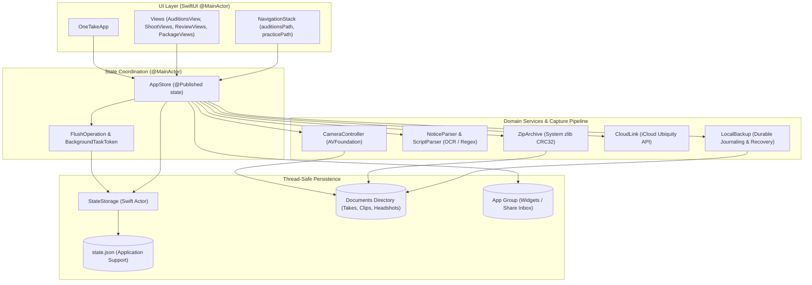

# OneTake iOS — System Architecture

This document outlines the architectural patterns, component boundaries, concurrency models, and data flows implemented in OneTake iOS.

---

## 1. High-Level Architecture Overview

OneTake follows an **Unidirectional State Flow (UDF)** architecture built around a single-source-of-truth `@MainActor` coordinator (`AppStore`), coupled with isolated actors and background workers for CPU-intensive, disk, and network I/O.

---

## 2. Component Responsibilities

### 2.1 UI Layer (`OneTake/Views/`)
- Pure SwiftUI declarative views.
- Subscribes directly to `AppStore` via `@EnvironmentObject` or injected `@ObservedObject`.
- Does **not** perform disk writing, audio processing, or OCR calculation directly. All actions dispatch into `AppStore` methods.

### 2.2 Central State Coordinator (`AppStore`)
- Declared as `@MainActor final class AppStore: ObservableObject`.
- Owns all in-memory arrays and entities: `auditions: [Audition]`, `takes: [Take]`, `practice: [Piece]`, `slate: SlateConfig`, `account: AccountProfile?`.
- Manages navigation stacks (`auditionsPath: [AuditionRoute]`, `practicePath: [PracticeRoute]`).
- Dispatches state mutations to persistence via debounced or immediate flush operations.
- Triggers widget updates (`WidgetSync`) and live activity sync (`LiveActivitySync`).

### 2.3 Off-MainActor Persistence (`StateStorage`)
- Declared as `actor StateStorage`.
- Dedicated background actor completely off `@MainActor` to prevent UI thread frame drops during JSON encoding and atomic disk writes.
- Enforces strictly monotonic sequence ordering: rejects any write whose sequence is `≤ lastCommittedSequence`, guaranteeing that older snapshots can never overwrite newer snapshots.

### 2.4 Background Task Coordinator (`BackgroundTaskCoordinator`)
- Decouples UIKit `UIApplication.shared.beginBackgroundTask` from AppStore logic via the `BackgroundTaskManaging` protocol.
- `BackgroundTaskToken`: Thread-safe token using `NSLock` ensuring `endBackgroundTask` executes **exactly once**, preventing duplicate termination crashes.
- `FlushOperation`: State machine managing transitions across `.running`, `.completed`, `.failed`, and `.expired`.

### 2.5 Media & Capture Subsystem (`CameraController`)
- Wraps `AVCaptureSession` and `AVCaptureMovieFileOutput`.
- Uses `CACurrentMediaTime()` (monotonic hardware clock) to compute elapsed recording time, eliminating software timer drift.
- Inspects real `AVURLAsset` durations upon file completion.
- Handles audio session and capture session interruptions cleanly.

### 2.6 Document & Parser Pipeline (`NoticeParser`, `ScriptParser`)
- Ingests text from Vision OCR, PDFKit, or clipboard.
- Performs hierarchical chunking and regular expression matching for sluglines (`INT.`/`EXT.`), character cues, and scene numbers.
- Independent handling for Casting Call PDF vs Script Sides PDF (`WORKFLOW-PDF-01`).

### 2.7 Packaging & Export (`ZipArchive`, `CloudLink`)
- `ZipArchive`: Custom zero-dependency ZIP compiler utilizing Apple's system `zlib` for streaming CRC32 computation.
- `CloudLink`: Interfaces with `NSFileManager` ubiquity containers to publish public iCloud download links and safely revoke them by deleting the ubiquitous folder.

### 2.8 App Group Centralization (`AppGroup`)
- Centralizes the app group identifier `group.com.srmist.onetake` across the main application, Widget Extension (`OneTakeWidgets`), and Share Extension (`OneTakeShare`).

---

## 3. Concurrency & Synchronization Model

| Boundary | Mechanism | Purpose |
| :--- | :--- | :--- |
| **Main Actor** | `@MainActor` | View layout, user interaction, navigation state, and `@Published` properties. |
| **Persistence Actor** | `actor StateStorage` | Serialized background JSON encoding, atomic disk writing, monotonic sequence tracking. |
| **Background Assertions** | `NSLock` + `BackgroundTaskToken` | Prevents race conditions between expiration handlers and async write completion. |
| **Flush Lifecycle** | `NSLock` + `FlushOperation` | Enforces single terminal outcome (`completed`, `failed`, or `expired`), protecting MainActor dirty flags. |
| **Detached I/O** | `Task.detached(priority:)` | File copying, unzipping, and iCloud uploads run off the main thread. |
