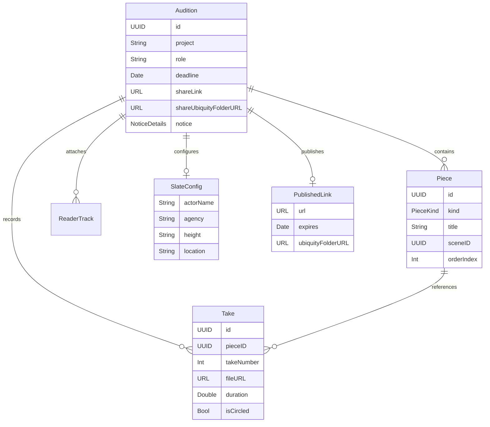

# OneTake iOS — Data Models & Schemas

This document defines the core domain models, Codable schemas, persistence invariants, and backward-compatibility rules in OneTake iOS.

---

## 1. Entity Relationship Diagram

---

## 2. Core Model Definitions

### 2.1 `Audition` ([`OneTake/Models/Models.swift`](../OneTake/Models/Models.swift))
The top-level entity representing an audition opportunity.
- **Key Properties**:
  - `id: UUID`: Unique audition identifier.
  - `project: String`: Project / production title.
  - `role: String`: Role or character name.
  - `deadline: Date?`: Submission due date.
  - `pieces: [Piece]`: Ordered list of required pieces (Headshots, Slate, Full Length, Scenes).
  - `castingCallNotice: NoticeDetails?`: Structured notice metadata.
  - `scriptSides: ScriptSides?`: Parsed script scenes and dialogue cues.
  - `shareLink: URL?`: Published public iCloud download link.
  - `shareUbiquityFolderURL: URL?`: Persisted container directory in iCloud Drive. *(Added in Phase 6; backward-compatible optional)*.
  - `sentDate: Date?`: Timestamp when marked as sent.
- **Backward Compatibility**: `shareUbiquityFolderURL` defaults to `nil` for legacy JSON files. Optional decoding prevents failures on pre-Phase 6 backups.

---

### 2.2 `Piece` and `PieceKind` ([`OneTake/Models/Models.swift`](../OneTake/Models/Models.swift))
Represents a deliverable item within an audition checklist.
- **`PieceKind` Enum**:
  - `.headshot`: Front or profile photo.
  - `.slate`: Slate video clip.
  - `.fullLength`: Full-body video clip (only instantiated when casting notice explicitly requests it).
  - `.scene(UUID)`: Specific scene dialogue piece.
- **Flow Order**: Enforces the canonical order: `Headshots` → `Slate` → `Full Length` → `Scenes`. Migration key `migration.auditionPieces.headshotsSlateScenes.v1` automatically normalizes legacy audition checklists.

---

### 2.3 `Take` ([`OneTake/Models/Models.swift`](../OneTake/Models/Models.swift))
A recorded video attempt for a specific `Piece`.
- **Key Properties**:
  - `id: UUID`: Unique take identifier.
  - `pieceID: UUID`: Target piece.
  - `takeNumber: Int`: Sequential take number (1, 2, 3...).
  - `fileURL: URL`: File location on disk under `Documents/audition-<id>/take-<uuid>.mov`.
  - `duration: Double`: Exact media duration queried from `AVURLAsset` on disk.
  - `isCircled: Bool`: True if selected as the preferred "Send Take" for this piece.
  - `trimStart: Double?`, `trimEnd: Double?`: Non-destructive trim boundary offsets.

---

### 2.4 `PersistedState` ([`OneTake/Models/Persistence.swift`](../OneTake/Models/Persistence.swift))
The root document serialized to `state.json` in `Application Support/OneTake/`.
- **Properties**:
  - `auditions: [Audition]`
  - `takes: [Take]`
  - `practice: [Piece]`
  - `slate: SlateConfig`
  - `isOnboarded: Bool`
  - `account: AccountProfile?`
  - `formatVersion: Int = 1`
- **Decoding Invariant**: Custom date decoding strategy accepts both fractional-second and standard ISO-8601 strings, plus legacy reference-date numbers. Uses lossy decoding for resilient array recovery without dropping entire states.

---

### 2.5 `RestoreJournal` & `OriginalEntrySnapshot` ([`OneTake/Models/LocalBackup.swift`](../OneTake/Models/LocalBackup.swift))
Durable state-machine journal recorded in Application Support during local backup restoration.
- **`RestoreJournal`**:
  - `formatVersion: Int = 1`
  - `operationID: UUID`
  - `state: RestoreState` (`.prepared`, `.preservationStarted`, `.preservationCompleted`, `.installationStarted`, `.installationCompleted`, `.validationCompleted`, `.committed`)
  - `stagedDirectoryPath: String`
  - `rollbackDirectoryPath: String`
  - `destinationDirectoryPath: String`
  - `originalSnapshot: [OriginalEntrySnapshot]`: Complete snapshot of pre-restore Documents directory.
  - `incomingManifest: [String]`: List of all incoming filenames bundled in the backup archive.
  - `originalItemsMoved: [String]`
  - `incomingItemsInstalled: [String]`
- **`OriginalEntrySnapshot`**:
  - `name: String`: Item filename.
  - `isDirectory: Bool`: File vs directory flag.
  - `fileSize: Int64?`: Byte count for content integrity verification.
  - `crc32: UInt32?`: Streaming zlib CRC32 checksum for non-destructive verification.
