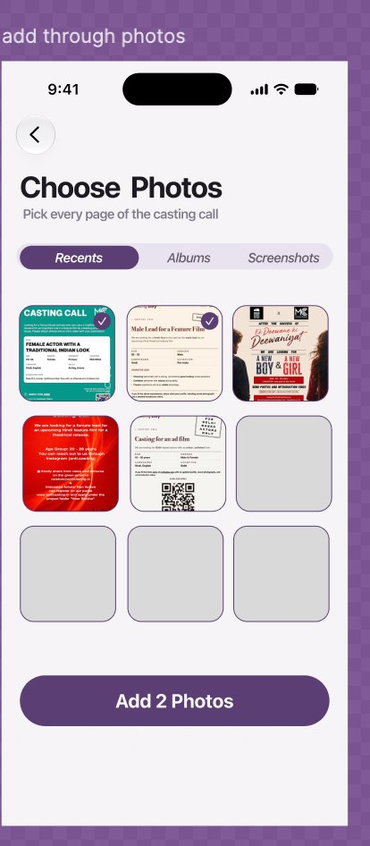

# Future Enhancements & Design Specifications

This document catalogs planned feature enhancements, architectural specifications, and design mockups for OneTake-iOS to guide future development iterations.

---

## 1. Custom In-App Photo Picker ("Choose Photos")

### 1.1 Context & Motivation
Currently, document and image imports utilize Apple's system `PHPickerViewController` or `UIDocumentPickerViewController`. While functional, the system picker presents as an out-of-context modal sheet that interrupts OneTake's immersive dark/light-mode design language and lacks specialized filtering presets (e.g. immediate access to casting screenshots).

A dedicated in-app photo picker provides:
- Seamless visual integration with OneTake design tokens (`OT.accent`, `OT.surfaceElevated`, `OT.textSecondary`).
- Tailored filtering presets for actors: **Recents**, **Albums**, and **Screenshots** (since casting calls are overwhelmingly saved as screenshots from casting emails, Instagram casting notices, or PDF captures).
- Clean multi-selection counter with dynamic feedback (`Add X Photos`).
- Zero modal hop or transition jarringness.

### 1.2 Design Specification & Visual Reference



#### Visual Layout & Component Anatomy

```
┌────────────────────────────────────────────────────────┐
│  ( < )                                     [Status Bar]│
│                                                        │
│  Choose Photos                                         │
│  Pick every page of the casting call                   │
│                                                        │
│  ┌──────────────┬──────────────┬──────────────┐        │
│  │   Recents    │    Albums    │ Screenshots  │ (Pills)│
│  └──────────────┴──────────────┴──────────────┘        │
│                                                        │
│  ┌─────────┐   ┌─────────┐   ┌─────────┐               │
│  │       ✓ │   │       ✓ │   │         │               │
│  │ Page 1  │   │ Page 2  │   │ Photo 3 │ (3-Col Grid)  │
│  └─────────┘   └─────────┘   └─────────┘               │
│  ┌─────────┐   ┌─────────┐   ┌─────────┐               │
│  │         │   │         │   │         │               │
│  │ Photo 4 │   │ Photo 5 │   │ Photo 6 │               │
│  └─────────┘   └─────────┘   └─────────┘               │
│                                                        │
│  ┌──────────────────────────────────────────────────┐  │
│  │                 Add 2 Photos                     │  │
│  └──────────────────────────────────────────────────┘  │
└────────────────────────────────────────────────────────┘
```

1. **Header Navigation**:
   - Circular `<` back button (diameter 40pt, `OT.surfaceElevated` background, centered icon).
   - Large title: **Choose Photos** (`OT.title` / 32pt bold system font).
   - Subtitle: *"Pick every page of the casting call"* (`OT.textSecondary` / 15pt regular).
2. **Segmented Category Pills**:
   - Three filter segments: `Recents`, `Albums`, and `Screenshots`.
   - Selected segment: Full pill fill in OneTake purple (`OT.accent`), white bold text.
   - Unselected segments: Subtle elevated background (`OT.surfaceElevated` / `OT.backgroundSecondary`), muted text (`OT.textSecondary`).
   - Smooth spring animation on selection change.
3. **3-Column Square Grid**:
   - 3 equal-width columns with 4pt to 8pt spacing and squircle corner radius (12pt).
   - High-performance thumbnail streaming via `PHCachingImageManager`.
   - **Selection Indicator**:
     - Circular badge in upper-right corner of each selected thumbnail (diameter 24pt).
     - Filled with `OT.accent` (purple) with white checkmark `Image(systemName: "checkmark")`.
     - 1.5pt white border for high contrast against dark or light photo contents.
     - Subtle scale spring animation on tap.
   - Blank / Loading state: Shimmering placeholder squares matching theme surface.
4. **Bottom Floating Action Button**:
   - Fixed above safe area bottom with background blur scrim.
   - Text updates dynamically based on selection count:
     - 0 selected: *"Select Photos"* (disabled, opacity 0.5).
     - 1 selected: *"Add 1 Photo"*.
     - N selected: *"Add N Photos"*.
   - Tap action extracts high-resolution UIImages and passes them directly to the audition intake pipeline (`NoticeParser` / Vision OCR).

---

### 1.3 Technical Architecture & Implementation Blueprint

#### Frameworks & Dependencies
- `Photos` framework (`PHPhotoLibrary`, `PHAsset`, `PHFetchResult`, `PHCachingImageManager`).
- `PhotosUI` for fallback permissions.
- `SwiftUI` for responsive declarative UI.

#### State Model & Service Structure

```swift
@MainActor
final class CustomPhotoPickerModel: ObservableObject {
    enum Category: String, CaseIterable, Identifiable {
        case recents = "Recents"
        case albums = "Albums"
        case screenshots = "Screenshots"
        var id: String { rawValue }
    }

    @Published var selectedCategory: Category = .recents
    @Published var assets: [PHAsset] = []
    @Published var selectedAssetIDs: Set<String> = []
    @Published var authorizationStatus: PHAuthorizationStatus = .notDetermined

    private let imageManager = PHCachingImageManager()
    
    // Efficient thumbnail caching based on screen scale and target item size
    func thumbnail(for asset: PHAsset, size: CGSize, completion: @escaping (UIImage?) -> Void) {
        let options = PHImageRequestOptions()
        options.deliveryMode = .opportunistic
        options.isNetworkAccessAllowed = true
        imageManager.requestImage(for: asset, targetSize: size, contentMode: .aspectFill, options: options) { image, _ in
            completion(image)
        }
    }
    
    // Batch export selected full-res images for OCR parsing
    func loadSelectedImages() async -> [UIImage] { ... }
}
```

#### Privacy & Permissions (`Info.plist`)
- Ensure `NSPhotoLibraryUsageDescription` is descriptive ("OneTake needs access to your photos to import casting call breakdowns and script sides").
- Support `.limited` authorization gracefully by displaying an "Edit Selected Photos" accessory button when limited permissions are granted.

---

## 2. Additional Roadmap Enhancements

### 2.1 Discrete Dual-Document Intake Wizard
- **Problem**: Actors often receive an audition notice (breakdown email/flyer) separate from their script sides (PDF/dialogue). Currently, both are pasted or imported together, requiring parsing heuristics to separate notice metadata from script dialogue.
- **Solution**: A structured 2-step intake wizard:
  1. *Step 1: Notice & Casting Details* (Project name, role, casting office, taped deadline, instructions).
  2. *Step 2: Sides & Script Dialogue* (Upload PDF or multiple images of sides, character cue assignment, scene headings).

### 2.2 Non-Destructive Video Trim Revisions
- **Problem**: When actors trim a take before exporting, the trim should ideally remain reversible until package finalization.
- **Solution**: Store `CMTimeRange` start/end offsets in `AuditionTake` metadata without destructively re-encoding the raw `.mov` take until final package export or Tape Check.

### 2.3 Live Audio Level Metronome in Practice Mode
- **Feature**: Provide a real-time RMS visualizer pill next to the prompt lines so actors can check their vocal projection against the reader voice volume.
