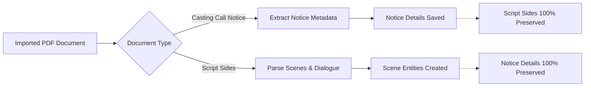

# OneTake iOS — Import & Document Parsing

This document details the text extraction, OCR pipeline, script parsing algorithms, and independent dual-document architecture.

---

## 1. Supported Ingestion Channels

Actors receive casting materials through diverse channels. OneTake ingests documents via:
1. **System Document Picker**: PDF and plain text file import via `UIDocumentPickerViewController`.
2. **VisionKit Document Camera**: Physical paper page scanning via `VNDocumentCameraViewController`.
3. **Photo Library**: Image OCR via Vision framework (`VNRecognizeTextRequest`).
4. **Clipboard Text**: Direct text paste into editor.
5. **iOS Share Extension (`OneTakeShare`)**: External apps (Mail, Safari, WhatsApp, Files) sharing directly into OneTake via `ShareInbox`.

---

## 2. Independent PDF Workflows (`WORKFLOW-PDF-01`)

### 2.1 The Overwrite Defect
Historically, audition setup treated imported PDFs as a single generic document. If an actor imported a Casting Call notice, followed by Script Sides, the second import completely overwrote the first, erasing project metadata and deadline information.

### 2.2 Dual-Document Architecture
`NoticeParser.Draft` explicitly separates the two document workflows:
- `castingCallDocument: AuditionDocument?`: Stores casting notice text and metadata.
- `scriptSidesDocument: AuditionDocument?`: Stores script pages, scene boundaries, and dialogue cues.

### 2.3 Replacement Rules
- Importing or replacing a Casting Call PDF updates project, role, deadline, and instructions while preserving existing scenes and recorded takes.
- Importing or replacing Script Sides updates dialogue cues and scene boundaries while preserving notice details.
- Dual-document imports produce identical state regardless of import order (Order A: Call then Sides == Order B: Sides then Call).

---

## 3. Parsing Algorithms (`NoticeParser.swift` & `ScriptParser.swift`)

### 3.1 Casting Notice Extraction
`NoticeParser` scans notice text using multi-pass regular expressions:
- **Project Title**: Detects prefixes (`PROJECT:`, `TITLE:`, `FILM:`) and prominent header blocks.
- **Role Name**: Detects role labels (`ROLE:`, `CHARACTER:`) and age/gender descriptors (`Male 20-30`, `Female 40-50`).
- **Deadline**: Parses date formats (`DD MONTH YYYY`, `MM/DD/YYYY`) and time limits.
- **Slate & Full Length Flags**: Scans for keywords (`slate`, `full body`, `full length`, `head to toe`, `wardrobe view`).
- **Pass 1 Reducer**: Extracts the notice section from large packets, reducing payload size by up to **90%** before deeper analysis.

### 3.2 Script Sides & Hierarchical Chunking
`ScriptParser` transforms script sides into playable scene structures:
- **Slugline Boundaries**: Identifies scene transitions via standard screenplay slugs:
  `INT.`, `EXT.`, `INT/EXT.`, `I/E.`, `SCENE [0-9]+`.
- **Character Cues**: Identifies centered uppercase character names preceding dialogue.
- **Dialogue Lines**: Maps consecutive dialogue lines to character cues, enabling line-by-line recorded reader playback.

### 3.3 Regular Expression Caching (`AUDIT-012`)
During SwiftUI view re-renders, re-evaluating complex screenplay regexes on every state change caused UI lag.
- **Solution**: `AddAuditionFlow` caches resolved scene structures in a dedicated `cachedParsedScenes: [ScriptScene]?` property. Regex evaluation occurs strictly once upon document ingestion and is invalidated only when the raw script text changes.
- **Result**: View evaluation speed increased by **2.9×–3.0×** (latency reduced from 0.77ms to 0.25ms per frame).
