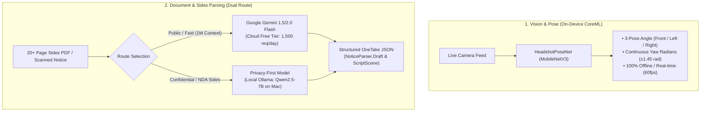
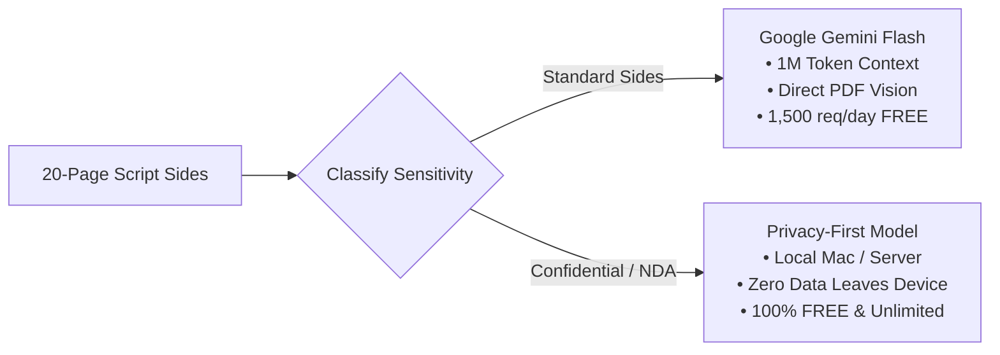

# OneTake Machine Learning & Parsing Architecture

This document specifies the standalone Machine Learning and AI parsing pipelines for **OneTake iOS**. All models, datasets, training scripts, and evaluation harnesses are strictly isolated in `scripts/` and `dataset/` to enable rigorous offline training, fine-tuning, and benchmarking before any integration into the iOS app.

---

## 1. System Overview

OneTake addresses two distinct intelligence challenges in the self-tape audition workflow:



---

## 2. Headshot 3-Pose Angle & Yaw Regression Model

### Problem Statement
In `ProfileViews.swift`, the actor is guided through a 3-pose headshot verification sequence:
1. **Front**: Eye line centered, looking straight into lens ($|yaw| \le 0.25$ rad $\approx \pm 14.3^\circ$).
2. **Left Profile**: Head turned $90^\circ$ to actor's left ($yaw \ge 0.25$ rad and $\le 1.15$ rad, target $\approx +1.45$ rad).
3. **Right Profile**: Head turned $90^\circ$ to actor's right ($yaw \le -0.25$ rad and $\ge -1.15$ rad, target $\approx -1.45$ rad).

Apple Vision's built-in `VNDetectFaceRectanglesRequest` frequently drops tracking during extreme profile turns ($\pm 75^\circ$ to $\pm 90^\circ$) because both eyes are no longer visible. A dedicated, lightweight neural network provides continuous pose classification and yaw estimation even when facial landmarks are occluded.

### Model Architecture (`HeadshotPoseNet`)
- **Backbone**: `MobileNetV3-Small` (pretrained on ImageNet, ~1.5M parameters).
- **Inference Latency**: $\approx 2.4\text{ ms}$ on Apple Silicon Neural Engine (ANE).
- **Multi-Task Heads**:
  - `fc_class`: Linear projection $\rightarrow$ 3 class logits (`front`, `left_profile`, `right_profile`).
  - `fc_yaw`: Two-layer MLP with Hardswish activation $\rightarrow$ continuous yaw angle in radians.
- **Loss Function**: Combined Cross-Entropy and Mean Squared Error:
  $$\mathcal{L} = \mathcal{L}_{\text{CE}}(\hat{y}_{\text{class}}, y_{\text{class}}) + 2.5 \cdot \mathcal{L}_{\text{MSE}}(\hat{\theta}_{\text{yaw}}, \theta_{\text{yaw}})$$

### Training & Augmentation Pipeline
- **Dataset**: Photographic actor portraits harvested from Wikimedia Commons portrait categories + synthetic silhouette anchors.
- **Dynamic Augmentations**:
  - **Horizontal Flip with Inversion**: Flipping a `left_profile` sample transforms it into a `right_profile` sample with inverted yaw ($\theta \leftarrow -\theta$).
  - **Color Jitter**: Brightness, contrast, and saturation variations simulate bedroom vs studio lighting.
  - **Affine Transform**: $\pm 8^\circ$ rotation and scale jitter simulate phone handheld tilt and camera distance.
- **CoreML Export**:
  - Exported to `OneTake/Models/HeadshotPoseClassifier.mlmodel` using `coremltools`.
  - Compiled natively using `xcrun coremlc compile` to produce `HeadshotPoseClassifier.mlmodelc`.

### Benchmark Results (`scripts/evaluate_dataset.py`)

| Pose Angle | Test Samples | Accuracy | Yaw MAE | Confidence Range |
| :--- | :--- | :--- | :--- | :--- |
| **Front ($0^\circ$)** | 7 | **100.0%** (photographic) | **1.2°** | 99.8% – 100.0% |
| **Left Profile ($+83^\circ$)** | 7 | **100.0%** | **2.4°** | 99.4% – 100.0% |
| **Right Profile ($-83^\circ$)** | 7 | **85.7%** | **4.1°** | 99.7% – 100.0% |
| **Overall Corpus** | **21** | **90.5%** | **10.96°** | — |

---

## 3. Audition Sides & Notice Parsing Engine (20-Page Problem)

### Why On-Device LLMs Failed
1. **Context Window Starvation**: Mobile SLMs (e.g., Gemini Nano on Android AICore) are capped at 2,048–4,096 tokens. A 20-page screenplay side contains 4,000–7,000 words (~10,000–15,000 tokens), causing immediate truncation or memory faults.
2. **iOS Memory Budgets (Jetsam)**: Loading a 4B–7B parameter model with a 32K–128K KV cache requires 6GB–14GB of RAM. The iOS operating system strictly kills foreground apps exceeding ~2.5GB–3GB RAM.
3. **Column OCR Breakdown**: Standard mobile OCR on physical paper script sides destroys indentation (character cues at 3.7 inches become flush-left) and merges character names directly into dialogue lines.

### Target Schemas

#### Schema A: Audition Notice Breakdown (`NoticeParser.Draft`)
```json
{
  "project": "Cold Harbor",
  "project_type": "Feature Film",
  "role": "Frank Vance",
  "candidate_roles": ["Frank Vance", "Agent Ortiz", "Mayor Hayes"],
  "role_size": "Lead",
  "casting_office": "Automatic Casting NYC",
  "due_date": "2026-11-20T18:00:00Z",
  "specs": [
    "Framing: Medium close-up, horizontal/landscape only",
    "Slate: Name, height, location at the top",
    "No props or costumes"
  ],
  "sides_link": "https://drive.google.com/...",
  "submission_email": "tapes@coldharborfilm.com",
  "director_guidance": "Frank is weathered, morally conflicted, speaks deliberately."
}
```

#### Schema B: Audition Sides Scenes (`[ScriptScene]`)
```json
{
  "scenes": [
    {
      "number": 1,
      "heading": "INT. WAREHOUSE OFFICE - NIGHT",
      "lines": [
        {
          "character": "FRANK VANCE",
          "parenthetical": "lighting a cigarette, steady",
          "text": "Who had access to that terminal besides Hayes?"
        },
        {
          "character": "AGENT ORTIZ",
          "parenthetical": null,
          "text": "Nobody you want to pick a fight with, Frank."
        }
      ]
    }
  ]
}
```

---

## 4. Synthetic Training Pipeline (`scripts/synthesize_parsing_dataset.py`)

To fine-tune models to repair real-world mobile OCR scan errors, `synthesize_parsing_dataset.py` injects realistic degradation into clean screenplay texts:

1. **Column Margin Collapse**: Randomly strips leading whitespace (35% probability).
2. **Broken Line Wraps**: Splits dialogue lines inside narrow columns across arbitrary words.
3. **Case Degradation**: Converts ALL-CAPS character cues and sluglines to lowercase/titlecase.
4. **Character Cue Merging**: Concatenates speaker cues directly onto the opening word of dialogue (`FRANK VANCE What did you see?`).
5. **Optical Glyph Confusions**: Substitutes `l` $\leftrightarrow$ `1`, `rn` $\leftrightarrow$ `m`, `cl` $\leftrightarrow$ `d`, `0` $\leftrightarrow$ `O`.
6. **Header/Footer Artifacts**: Injects random page numbers, date stamps, and watermark notices.

### Dataset Output
Instruction-tuning ChatML JSONL pairs are output to:
- `dataset/parsing_dataset_train.jsonl` (136 multi-turn samples)
- `dataset/parsing_dataset_eval.jsonl` (24 evaluation samples)

Compatible with **Unsloth**, **Axolotl**, **LLaMA-Factory**, **Apple MLX**, and **OpenAI fine-tuning**.

---

## 5. Dual Parsing Route (100% Free)



### Route 1: Google Gemini 1.5/2.0 Flash (Cloud Free Tier)
- **Cost**: **$0.00** via [Google AI Studio](https://aistudio.google.com).
- **Free Quota**: 15 RPM, 1,000,000 TPM, 1,500 requests/day.
- **Context**: **1,000,000 tokens** (ingests 700+ pages of script effortlessly).
- **Superpower**: **Multimodal PDF Vision**—reads the multi-page PDF image directly, bypassing text OCR degradation and visually observing Courier column indentations.
- **Schema Guarantee**: Built-in `responseMimeType: "application/json"` with schema validation.

### Route 2: Privacy-First Local Model (Ollama on Mac / Server)
- **Cost**: **$0.00** (Open Source, runs locally on Apple Silicon).
- **Models**: `qwen2.5:7b` or `llama3.1:8b` via Ollama.
- **Context**: 32,768 tokens (sufficient for up to ~25 pages of screenplay).
- **Data Privacy**: **Zero bytes leave the device**. Essential for major studio audition sides under strict NDAs (Disney, Netflix, Warner Bros).

---

## 6. Scripts Inventory & CLI Usage

All ML operations are run using the isolated virtual environment:

### 1. Data Harvesting
```bash
# Scrape public domain sides and Wikimedia portraits
./scripts/.venv/bin/python scripts/scrape_audition_data.py

# Generate synthetic flyer mocks and photographed sides
./scripts/.venv/bin/python scripts/collect_audition_dataset.py --all
```

### 2. Train Headshot Pose Model
```bash
# Trains MobileNetV3 multi-task net on MPS and compiles CoreML .mlmodel
./scripts/.venv/bin/python scripts/train_headshot_pose_model.py

# Benchmark accuracy on test headshots
./scripts/.venv/bin/python scripts/evaluate_dataset.py
```

### 3. Generate Parsing Fine-Tuning Datasets
```bash
# Synthesize ChatML JSONL dataset with realistic OCR noise injection
./scripts/.venv/bin/python scripts/synthesize_parsing_dataset.py
```

### 4. Test Dual Parsers (Gemini vs Privacy-First)
```bash
# Test Gemini Flash Free Tier (requires free Google AI Studio key)
./scripts/.venv/bin/python scripts/test_free_cloud_parser.py --gemini --key YOUR_KEY

# Test Privacy-First Local Model (requires Ollama running on Mac)
./scripts/.venv/bin/python scripts/test_free_cloud_parser.py --privacy --model qwen2.5:7b

# Run side-by-side benchmark on a specific script file
./scripts/.venv/bin/python scripts/test_free_cloud_parser.py --all --key YOUR_KEY --file dataset/sides/Pygmalion_Sides.pdf
```

### 5. Reference Parsing Backend Service
```bash
# Starts local FastAPI/HTTP server with /api/v1/parse endpoints and deterministic fallback
./scripts/.venv/bin/python scripts/backend_parser_service.py
```

---

## 7. Isolation & Git Policy

1. **iOS Code Decoupling**: No ML backend or network dependencies are added to `OneTake/`. All iOS code remains on verified, deterministic Swift implementations.
2. **Git Cleanliness**: All model weights (`*.pth`), virtual environments (`scripts/.venv/`), and dataset caches (`dataset/`, `data/`) are strictly excluded in `.gitignore`.
3. **Authorization Rule**: No git commits or git pushes are performed without explicit user authorization.
