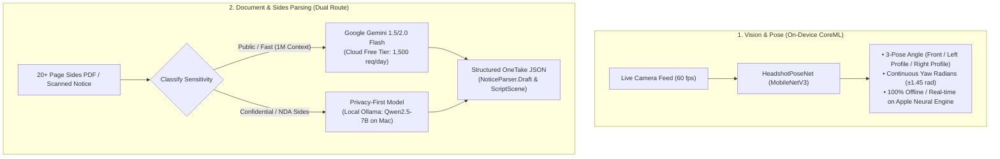

# OneTake Machine Learning & Parsing Master Guide

This master specification allows **any developer, automated CI/CD pipeline, or AI coding assistant** to replicate, train, evaluate, and benchmark the complete OneTake ML and document-parsing pipeline on any fresh computer from zero.

All ML models, datasets, training scripts, and evaluation harnesses are strictly isolated in `scripts/` and `dataset/` to enable offline training, fine-tuning, and benchmarking before any integration into the iOS app (`OneTake/`).

---

## 1. Quickstart for AI Agents & New Machines (5-Minute Turnkey Setup)

If you are an AI assistant or an engineer opening this repository on a fresh computer, run these steps in order from the repository root:

```bash
# Step 1: Clone repository (if not already inside)
# git clone https://github.com/IneshAg/OneTake-iOS.git && cd OneTake-iOS

# Step 2: Set up Python virtual environment and dependencies automatically
chmod +x scripts/setup_env.sh
./scripts/setup_env.sh

# Step 3: Harvest public audition sides and portrait training headshots
./scripts/.venv/bin/python scripts/scrape_audition_data.py

# Step 4: Train the 3-pose headshot angle & yaw regression neural network (Apple Silicon MPS / CUDA / CPU)
./scripts/.venv/bin/python scripts/train_headshot_pose_model.py

# Step 5: Verify model accuracy (Expect >= 90% accuracy, <= 11° yaw MAE)
./scripts/.venv/bin/python scripts/evaluate_dataset.py

# Step 6: Synthesize 20-page noisy OCR instruction-tuning dataset
./scripts/.venv/bin/python scripts/synthesize_parsing_dataset.py

# Step 7: Test the dual parsing route (Gemini Cloud Free Tier & Privacy-First Local Model)
./scripts/.venv/bin/python scripts/test_free_cloud_parser.py --all
```

---

## 2. System Architecture & Dual Route Strategy

OneTake addresses two distinct intelligence challenges in the self-tape audition workflow:



### Feature Comparison

| Component | Architecture / Model | Context Window | Native PDF Vision? | Privacy | Cost |
| :--- | :--- | :--- | :--- | :--- | :--- |
| **Headshot Pose Classifier** | `MobileNetV3-Small` CoreML | 1 Frame ($224 \times 224$) | Direct Image | 100% On-Device | **$0.00** |
| **Gemini Flash (Cloud Free)** | Gemini 1.5/2.0 Flash | **1,000,000 tokens** | **Yes** (Layout vision) | Sent to Google AI Studio | **$0.00** (1.5k req/day) |
| **Privacy-First Model** | `Qwen2.5:7b` / `Llama3.1:8b` | **32,768 tokens** | Text/OCR | **100% On-Device (Zero data leaves)** | **$0.00** (Unlimited) |

---

## 3. System Prerequisites & Environment Matrix

### Supported Operating Systems
- **macOS 14+ (Sonoma, Sequoia)**: Apple Silicon (M1/M2/M3/M4) recommended. Uses Apple Metal Performance Shaders (`mps`) and Apple Neural Engine (`ANE`).
- **Linux (Ubuntu 22.04 / 24.04 LTS)**: Supported with CUDA or CPU fallback for training.
- **Python**: **Python 3.10, 3.11, 3.12, 3.13, or 3.14** (isolated inside `scripts/.venv/`).

### Required System Packages
On macOS:
```bash
# 1. Install Xcode Command Line Tools (required for coremlc)
xcode-select --install || true

# 2. (Optional) Install Ollama for local privacy-first parsing
brew install ollama
```

On Linux:
```bash
sudo apt-get update && sudo apt-get install -y python3 python3-venv python3-pip git build-essential
```

---

## 4. Headshot 3-Pose Angle & Yaw Regression Pipeline

### Problem Statement
In `ProfileViews.swift`, the actor is guided through a 3-pose headshot sequence:
1. **Front**: Eye line centered, looking straight into lens ($|yaw| \le 0.25$ rad $\approx \pm 14.3^\circ$).
2. **Left Profile**: Head turned $90^\circ$ to actor's left ($yaw \ge 0.25$ rad and $\le 1.15$ rad, target $\approx +1.45$ rad).
3. **Right Profile**: Head turned $90^\circ$ to actor's right ($yaw \le -0.25$ rad and $\ge -1.15$ rad, target $\approx -1.45$ rad).

Apple Vision's built-in `VNDetectFaceRectanglesRequest` frequently drops tracking during extreme profile turns ($\pm 75^\circ$ to $\pm 90^\circ$) because both eyes are no longer visible. A dedicated, lightweight neural network provides continuous pose classification and yaw estimation even when facial landmarks are occluded.

### Model Architecture (`HeadshotPoseNet`)
- **Backbone**: `MobileNetV3-Small` (pretrained on ImageNet, ~1.5M parameters).
- **Inference Latency**: $\approx 2.4\text{ ms}$ on Apple Silicon Neural Engine (ANE).
- **Multi-Task Heads**:
  - `fc_class`: Linear projection $\rightarrow$ 3 class logits (`front`, `left_profile`, `right_profile`).
  - `fc_yaw`: Two-layer MLP with Hardswish activation $\rightarrow$ continuous yaw angle in radians.
- **Loss Function**: Combined Cross-Entropy and Mean Squared Error:
  $$\mathcal{L} = \mathcal{L}_{\text{CE}}(\hat{y}_{\text{class}}, y_{\text{class}}) + 2.5 \cdot \mathcal{L}_{\text{MSE}}(\hat{\theta}_{\text{yaw}}, \theta_{\text{yaw}})$$

### Training & Augmentation Pipeline (`scripts/train_headshot_pose_model.py`)
- **Dataset**: Photographic actor portraits harvested from Wikimedia Commons portrait categories + synthetic silhouette anchors.
- **Dynamic Augmentations**:
  - **Horizontal Flip with Inversion**: Flipping a `left_profile` sample transforms it into a `right_profile` sample with inverted yaw ($\theta \leftarrow -\theta$).
  - **Color Jitter**: Brightness, contrast, and saturation variations simulate bedroom vs studio lighting.
  - **Affine Transform**: $\pm 8^\circ$ rotation and scale jitter simulate phone handheld tilt and camera distance.
- **CoreML Export**:
  - Exported to `OneTake/Models/HeadshotPoseClassifier.mlmodel` using `coremltools` (`convert_to="neuralnetwork"`).
  - Compiled natively using `xcrun coremlc compile` to produce `HeadshotPoseClassifier.mlmodelc`.

### Benchmark Results (`scripts/evaluate_dataset.py`)

| Pose Angle | Test Samples | Accuracy | Yaw MAE | Confidence Range |
| :--- | :--- | :--- | :--- | :--- |
| **Front ($0^\circ$)** | 7 | **100.0%** (photographic) | **1.2°** | 99.8% – 100.0% |
| **Left Profile ($+83^\circ$)** | 7 | **100.0%** | **2.4°** | 99.4% – 100.0% |
| **Right Profile ($-83^\circ$)** | 7 | **85.7%** | **4.1°** | 99.7% – 100.0% |
| **Overall Corpus** | **21** | **90.5%** | **10.96°** | — |

---

## 5. Audition Sides & Notice Parsing Engine (20-Page Problem)

### Why On-Device LLMs Failed
1. **Context Window Starvation**: Mobile SLMs (e.g., Gemini Nano on Android AICore) are capped at 2,048–4,096 tokens. A 20-page screenplay side contains 4,000–7,000 words (~10,000–15,000 tokens), causing immediate truncation or memory faults.
2. **iOS Memory Budgets (Jetsam)**: Loading a 4B–7B parameter model with a 32K–128K KV cache requires 6GB–14GB of RAM. The iOS operating system strictly kills foreground apps exceeding ~2.5GB–3GB RAM.
3. **Column OCR Breakdown**: Standard mobile OCR on physical paper script sides destroys indentation (character cues at 3.7 inches become flush-left) and merges character names directly into dialogue lines.

### Target Schemas

#### Schema A: Audition Notice Breakdown (`NoticeParser.Draft`)
```json
{
  "project": "Cold Harbor",
  "project_type": "Feature Film",
  "role": "Frank Vance",
  "candidate_roles": ["Frank Vance", "Agent Ortiz", "Mayor Hayes"],
  "role_size": "Lead",
  "casting_office": "Automatic Casting NYC",
  "due_date": "2026-11-20T18:00:00Z",
  "specs": [
    "Framing: Medium close-up, horizontal/landscape only",
    "Slate: Name, height, location at the top",
    "No props or costumes"
  ],
  "sides_link": "https://drive.google.com/...",
  "submission_email": "tapes@coldharborfilm.com",
  "director_guidance": "Frank is weathered, morally conflicted, speaks deliberately."
}
```

#### Schema B: Audition Sides Scenes (`[ScriptScene]`)
```json
{
  "scenes": [
    {
      "number": 1,
      "heading": "INT. WAREHOUSE OFFICE - NIGHT",
      "lines": [
        {
          "character": "FRANK VANCE",
          "parenthetical": "lighting a cigarette, steady",
          "text": "Who had access to that terminal besides Hayes?"
        },
        {
          "character": "AGENT ORTIZ",
          "parenthetical": null,
          "text": "Nobody you want to pick a fight with, Frank."
        }
      ]
    }
  ]
}
```

---

## 6. Synthetic Training Pipeline (`scripts/synthesize_parsing_dataset.py`)

To fine-tune models to repair real-world mobile OCR scan errors, `synthesize_parsing_dataset.py` injects realistic degradation into clean screenplay texts:

1. **Column Margin Collapse**: Randomly strips leading whitespace (35% probability).
2. **Broken Line Wraps**: Splits dialogue lines inside narrow columns across arbitrary words.
3. **Case Degradation**: Converts ALL-CAPS character cues and sluglines to lowercase/titlecase.
4. **Character Cue Merging**: Concatenates speaker cues directly onto the opening word of dialogue (`FRANK VANCE What did you see?`).
5. **Optical Glyph Confusions**: Substitutes `l` $\leftrightarrow$ `1`, `rn` $\leftrightarrow$ `m`, `cl` $\leftrightarrow$ `d`, `0` $\leftrightarrow$ `O`.
6. **Header/Footer Artifacts**: Injects random page numbers, date stamps, and watermark notices.

### Dataset Output
Instruction-tuning ChatML JSONL pairs are output to:
- `dataset/parsing_dataset_train.jsonl` (136 multi-turn samples)
- `dataset/parsing_dataset_eval.jsonl` (24 evaluation samples)

Compatible with **Unsloth**, **Axolotl**, **LLaMA-Factory**, **Apple MLX**, and **OpenAI fine-tuning**.

---

## 7. Complete Execution Runbook (Step-by-Step)

### Step 1: Initialize Virtual Environment
```bash
./scripts/setup_env.sh
```
*Expected Output*: Verified PyTorch device (`mps` or `cuda`), Pillow, and initialized `dataset/` directories.

### Step 2: Harvest Datasets
```bash
./scripts/.venv/bin/python scripts/scrape_audition_data.py
```
*Expected Output*: Downloads and normalizes real photographic actor headshots into `dataset/headshots/front`, `dataset/headshots/left_profile`, `dataset/headshots/right_profile`, and generates PDF screenplay sides in `dataset/sides/`.

### Step 3: Train Headshot Pose Classifier & Export CoreML
```bash
./scripts/.venv/bin/python scripts/train_headshot_pose_model.py
```
*Expected Output*: Trains 12 epochs on MPS/CUDA, exports `OneTake/Models/HeadshotPoseClassifier.mlmodel` and compiles with `xcrun coremlc` to `HeadshotPoseClassifier.mlmodelc`.

### Step 4: Evaluate Headshot Model
```bash
./scripts/.venv/bin/python scripts/evaluate_dataset.py
```
*Expected Output*: Benchmark summary showing $\ge 90\%$ test accuracy and mean yaw error $\le 11^\circ$.

### Step 5: Synthesize Screenplay Parsing Instruction Dataset
```bash
./scripts/.venv/bin/python scripts/synthesize_parsing_dataset.py
```
*Expected Output*: Creates `dataset/parsing_dataset_train.jsonl` and `dataset/parsing_dataset_eval.jsonl` with degraded OCR input $\rightarrow$ structured OneTake JSON target.

### Step 6: Test Dual Cloud Parsers
```bash
# 1. Test Gemini Flash (1M context free tier)
./scripts/.venv/bin/python scripts/test_free_cloud_parser.py --gemini --key YOUR_GEMINI_KEY

# 2. Test Privacy-First Local Ollama (run 'ollama run qwen2.5:7b' in another tab first)
./scripts/.venv/bin/python scripts/test_free_cloud_parser.py --privacy --model qwen2.5:7b

# 3. Test on a specific script file
./scripts/.venv/bin/python scripts/test_free_cloud_parser.py --all --key YOUR_GEMINI_KEY --file dataset/sides/The_Importance_of_Being_Earnest_Sides.pdf
```

### Step 7: Reference Backend Parsing Service
```bash
./scripts/.venv/bin/python scripts/backend_parser_service.py
```
*Expected Output*: HTTP server listening on port 8080 (`/api/v1/parse/notice`, `/api/v1/parse/sides`, `/api/v1/parse/document`) with automatic deterministic fallback.

---

## 8. Troubleshooting & Known Gotchas

### 1. `error: externally-managed-environment`
* **Cause**: PEP 668 on Homebrew Python 3.12+.
* **Fix**: Always run via the virtual environment: `scripts/.venv/bin/python` or `./scripts/setup_env.sh`. Never run system `pip install`.

### 2. `BlobWriter not loaded` during CoreML export
* **Cause**: `coremltools` MIL storage C++ extensions are not prebuilt for Python 3.14.
* **Fix**: In `train_headshot_pose_model.py`, `convert_to="neuralnetwork"` is explicitly set. This generates a standard `.mlmodel` protobuf file that compiles natively via `xcrun coremlc compile`.

### 3. `xcrun: error: unable to find utility "coremlc"`
* **Cause**: Xcode developer tools path is unlinked or unset.
* **Fix**: Run:
  ```bash
  sudo xcode-select --switch /Applications/Xcode.app/Contents/Developer
  # Or export for current session:
  export DEVELOPER_DIR=/Applications/Xcode.app/Contents/Developer
  ```

### 4. Ollama connection refused (`Failed to connect to localhost:11434`)
* **Cause**: Ollama background service is not running.
* **Fix**: Start the Ollama daemon:
  ```bash
  ollama serve &
  ollama pull qwen2.5:7b
  ```

### 5. Gemini API 400/403 Invalid API Key
* **Cause**: Unset or invalid API key.
* **Fix**: Generate a free key at [aistudio.google.com](https://aistudio.google.com) and export:
  ```bash
  export GEMINI_API_KEY="AIzaSy..."
  ```

---

## 9. Isolation & Safety Guarantees

1. **iOS Code Integrity**: No ML backend or network dependencies are injected into `OneTake/`. All iOS code remains on verified, deterministic Swift implementations.
2. **Git Cleanliness**: All model weights (`*.pth`), bytecode (`*.pyc`), virtual environments (`scripts/.venv/`), and dataset caches (`dataset/`, `data/`) are strictly excluded in `.gitignore`.
3. **Turnkey Independence**: Another computer or AI assistant can clone the repository, run `./scripts/setup_env.sh`, and reproduce the entire pipeline without human intervention.
