# OneTake iOS — Persistence, Background Lifecycle & Backup Recovery

This document details the persistence architecture, background lifecycle coordination, and crash-safe backup restore subsystems.

---

## 1. Primary State Persistence (`Persistence.swift`)

### 1.1 Storage Location
All structured application state is saved to `state.json` located under the app's sandboxed Application Support directory:
```text
<Container>/Library/Application Support/OneTake/state.json
```
Media files (recorded takes, slate clips, headshot photos) are stored in the user-visible `Documents` directory.

### 1.2 Off-MainActor Architecture (`StateStorage`)
To eliminate frame drops and UI hitches on `@MainActor`, serialization and file writing are isolated inside `actor StateStorage`:
- **Serialized Actor Mailbox**: All persistence tasks run sequentially on the actor's background executor.
- **Monotonic Sequence Ordering**: Every persistence request carries a sequential integer `sequence: Int`.
  ```swift
  guard sequence > lastCommittedSequence else { return false }
  ```
  If an older snapshot arrives late due to thread scheduling, `StateStorage` rejects it. Newer snapshots can never be overwritten by stale state.
- **Atomic File Writing**: `Data.write(to: target, options: .atomic)` writes to a temporary file before renaming, preventing partial-write file corruption during crashes.

---

## 2. Background Task Lifecycle & Race Protection (`BackgroundTaskCoordinator.swift`)

### 2.1 The Suspension Risk
When an actor switches away from OneTake, UIKit suspends the process within seconds. If an asynchronous disk write is mid-flight, iOS can terminate the process before completion.

### 2.2 Synchronized `FlushOperation` Architecture
[`AppStore.swift`](../OneTake/ModelViews/AppStore.swift) coordinates background execution time via [`BackgroundTaskCoordinator.swift`](../OneTake/ModelViews/BackgroundTaskCoordinator.swift):

```mermaid
stateDiagram-v2
    [*] --> Running : flushPersistence() acquires BackgroundTaskToken
    Running --> Completed : writeSnapshot succeeds -> markCompleted()
    Running --> Expired : OS triggers expiration -> markExpired()
    Running --> Failed : Disk error -> markFailed()

    Completed --> [*] : Token ended; UI state cleared
    Expired --> [*] : Token ended; uncommitted state preserved
    Failed --> [*] : Token ended; error surfaced to UI
```



### 2.3 Concurrency & Race Invariants
1. **Exactly-Once Token Termination**: `BackgroundTaskToken` wraps `UIApplication.shared.beginBackgroundTask` and synchronizes `endBackgroundTask` via an internal `NSLock`. Multiple calls to `end()` across task completion and expiration callbacks are idempotent and never double-end the token.
2. **Terminal State Winner**: `FlushOperation` synchronizes its state transitions. Once marked `.completed`, subsequent expiration closures cannot transition state to `.expired`.
3. **Synchronous Write & Cancellation Race**: In Swift Concurrency, `Task.cancel()` does not interrupt an in-progress POSIX `write()`. When expiration triggers, the expiration closure verifies whether `StateStorage.lastCommittedSequence ≥ operation.sequence`. If the write committed before process death, `hasUncommittedChanges` is cleared; if not, it remains `true` for foreground retry.
4. **Sequence-Matching Dirty State**: `hasUncommittedChanges` is only set to `false` if `self.saveSequence == operation.sequence`. If user edits occurred on `@MainActor` while a flush was in flight, the dirty flag **remains `true`**, guaranteeing newer edits are not discarded.

---

## 3. Local Backup & Transactional Crash Recovery (`LocalBackup.swift`)

### 3.1 Backup File Format (ZIP Version 1)
- `manifest.json`: `LocalBackupPayload` containing format version, creation timestamp, device name, and complete `PersistedState`.
- `Documents/`: Complete hierarchy of takes, headshots, exports, and audio files.

### 3.2 Inode Container Preservation (`AUDIT-001`)
iOS sandbox containers bind the root `Documents` directory inode to system file providers. Replacing `Documents` by deleting and recreating the directory breaks sandboxed file bindings.
- **Rule**: OneTake **never** deletes or renames the root `Documents` directory container. It safely preserves the root container and replaces only its child items.

### 3.3 Durable Crash Recovery Journaling Outside `tmp/` (`AUDIT-FINDING-02`)
During restore, existing live documents are moved into a rollback directory. If the app crashes or loses power midway:
- **Durable Location**: The journal (`restore-journal.json`) and rollback directory (`RestoreRollback/<UUID>/`) reside in `Library/Application Support/OneTake/`. This directory is persistent across reboots and immune to OS temporary file purges that routinely occur in `tmp/`.
- **Launch-Time Recovery**: In [`AppStore.init()`](../OneTake/ModelViews/AppStore.swift), `LocalBackup.recoverUnfinishedRestoreIfNeeded()` executes **before** `Persistence.load()` reads state.

### 3.4 Reconciled Rollback & Content Integrity (`Phases 8.1 & 8.2`)
To prevent orphaned incoming files or accidental deletion of external files:
1. **Pre-Flight Snapshot (`OriginalEntrySnapshot`)**: Captures every pre-restore item's filename, directory flag, file size, and streaming `zlib` CRC32 checksum before any destructive action begins.
2. **Incoming Manifest**: Records all filenames present in the backup archive (`incomingManifest`).
3. **Reconciliation Logic**:
   - Item in `rollback`: Restores original file from rollback storage.
   - Item in `originalSnapshot` but not in rollback: Original file was never moved; preserved intact.
   - Item in `incomingManifest`: Provably an incoming file introduced by the interrupted restore; removed.
   - Item in neither: **Ambiguous entry**. Recovery **halts**, preserves the ambiguous file, retains rollback data and journal, and surfaces a recoverable error.
4. **Content Integrity Validation**: Verifies that every restored file matches its recorded byte count and CRC32 checksum. If verification fails, rollback storage and journal are retained on disk to allow subsequent recovery attempts.
