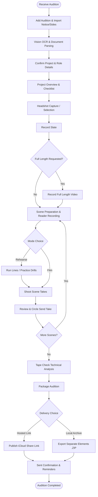
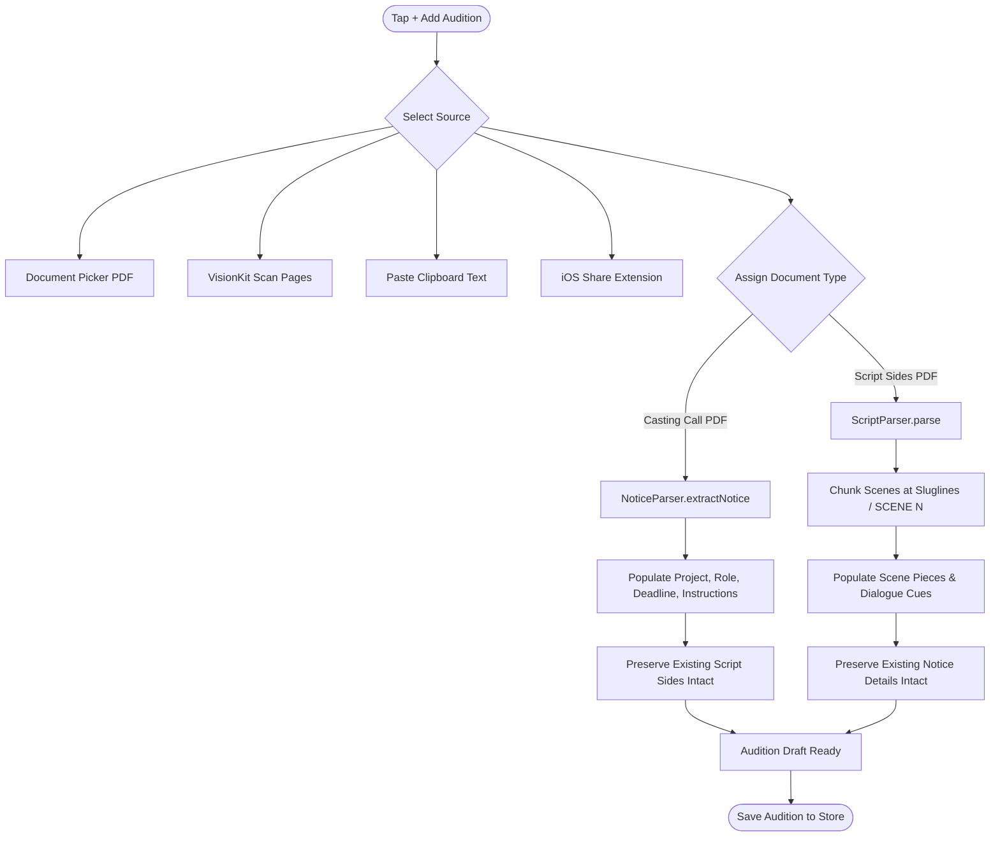
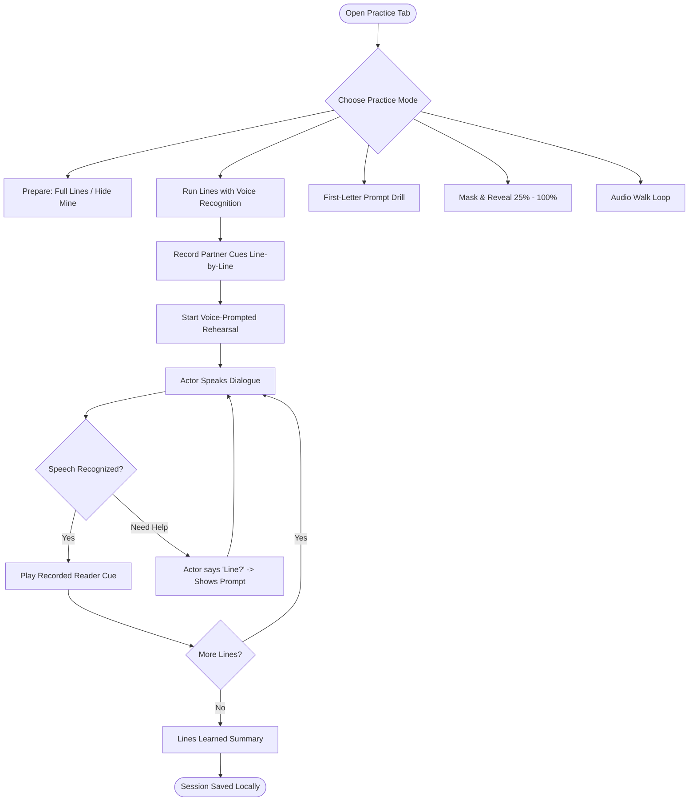
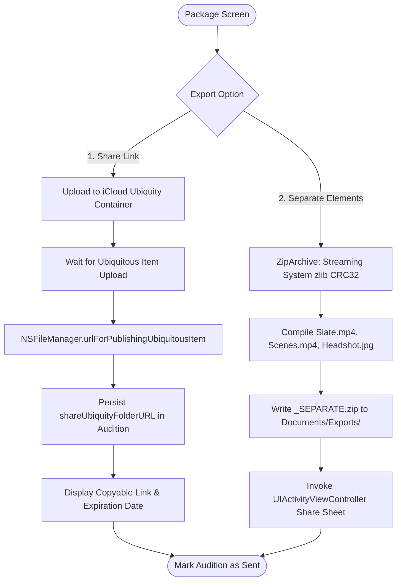

# OneTake iOS — User Flows

This document details the primary user journeys through OneTake iOS, accompanied by visual Mermaid flowcharts.

---

## 1. End-to-End Audition Workflow

The complete journey from casting notice ingestion to final submission.



---

## 2. Document Import Workflow (`WORKFLOW-PDF-01`)

Casting calls and script sides must remain strictly independent documents. Importing one must never overwrite or destroy the other.



---

## 3. Practice & Rehearsal Workflow

Standalone line-learning drills operate independently of audition recording state.



---

## 4. Camera Recording & Interruption Lifecycle

Ensures monotonic hardware clock tracking, take duration integrity, and crash-resilient storage.

```mermaid
sequenceDiagram
    autonumber
    actor Actor
    participant UI as ShootViews
    participant Controller as CameraController
    participant Clock as Hardware Clock (CACurrentMediaTime)
    participant Disk as MediaStore (Documents/audition-id/)
    participant Store as AppStore

    Actor->>UI: Tap Record (or say "Action")
    UI->>Controller: startRecording()
    Controller->>Clock: Sample startClock = CACurrentMediaTime()
    Controller->>Disk: Open QuickTime Movie Output (.mov)
    
    Note over Controller,Clock: Elapsed time computed via CACurrentMediaTime() - startClock (0.000s drift)

    alt Interruption (Phone Call / Lock Screen)
        Controller->>Controller: captureSessionWasInterrupted
        Controller->>Disk: Finalize partial movie file
        Controller->>UI: Notify interruption handled
    else Normal Stop
        Actor->>UI: Hold-to-Stop (or say "Cut")
        UI->>Controller: stopRecording()
    end

    Controller->>Disk: Query true AVURLAsset.duration
    Controller->>Store: Add Take(fileURL, duration, takeNumber)
    Store->>Store: persist() with monotonic sequence order
    Store->>UI: Display review sheet with exact take duration
```

---

## 5. Submission & Sharing Workflow

Only **Share Link** and **Separate Elements** are supported export formats.


